# SOFTWARE.md — Documentación técnica del software

**Sistema de Monitoreo Vehicular Inteligente (YOLO + IoT)**
Universidad Católica de Santa María (UCSM) — Arequipa, Perú

> Documento de ingeniería de software del proyecto de tesis
> *"Sistema inteligente IoT con YOLO para monitoreo en tiempo real y alertas ante eventos de
> riesgo en vehículos particulares"*.
>
> Contiene la descripción funcional, el diseño, la lógica de negocio, los contratos de interfaz
> y el conjunto completo de diagramas (clases, secuencia, estados, actividad, temporal, lógico,
> físico, despliegue, componentes, casos de uso y flujo de datos) para los capítulos III, IV y V
> de la tesis.
>
> Todos los diagramas están en **Mermaid** (se renderizan en GitHub, VS Code, Obsidian y Typora)
> y los diagramas temporales en **ASCII** para que puedan pegarse tal cual en el documento Word.

---

## Índice

1. [Ficha técnica del software](#1-ficha-técnica-del-software)
2. [Qué hace el sistema](#2-qué-hace-el-sistema)
3. [Requisitos](#3-requisitos)
4. [Decisiones de diseño y justificación](#4-decisiones-de-diseño-y-justificación)
5. [Arquitectura general](#5-arquitectura-general)
6. [Diagramas de casos de uso](#6-diagramas-de-casos-de-uso)
7. [Modelo de datos (lógico y físico)](#7-modelo-de-datos-lógico-y-físico)
8. [Diagramas de clases](#8-diagramas-de-clases)
9. [Diagramas de secuencia](#9-diagramas-de-secuencia)
10. [Diagramas de estados](#10-diagramas-de-estados)
11. [Diagramas de actividad y de flujo de decisión](#11-diagramas-de-actividad-y-de-flujo-de-decisión)
12. [Diagramas temporales](#12-diagramas-temporales)
13. [Modelo de concurrencia](#13-modelo-de-concurrencia)
14. [Contratos de interfaz](#14-contratos-de-interfaz)
15. [Lógica de negocio detallada](#15-lógica-de-negocio-detallada)
16. [Seguridad](#16-seguridad)
17. [Métricas y resultados para la tesis](#17-métricas-y-resultados-para-la-tesis)
18. [Pruebas](#18-pruebas)
19. [Configuración](#19-configuración)
20. [Instalación y operación](#20-instalación-y-operación)
21. [Trazabilidad requisito → componente → prueba](#21-trazabilidad-requisito--componente--prueba)
22. [Limitaciones y trabajo futuro](#22-limitaciones-y-trabajo-futuro)
23. [Glosario](#23-glosario)

---

## 1. Ficha técnica del software

| Atributo | Valor |
|---|---|
| Nombre | Sistema de Monitoreo Vehicular Inteligente (SV_INTERFAZ_UCSM) |
| Versión | 3.0.0 (migración a MQTT + reglas definitivas de detección + mapa en vivo) |
| Tipo | Sistema ciberfísico distribuido: nodo IoT + servidor de visión artificial + panel web + bot de mensajería |
| Dominio | Seguridad vehicular / IoT / visión por computadora |
| Paradigma | Programación orientada a objetos (POO) estricta sobre patrón MVC + capa de servicios |
| Lenguajes | Python 3.12 (servidor), C++ / Arduino (firmware ESP32), JavaScript ES6 (frontend), HTML/CSS |
| Framework backend | Django 6 + Django REST Framework + Django Channels (ASGI) |
| Servidor ASGI | Daphne (levantado programáticamente desde `main.py`) |
| Base de datos | SQLite 3 en modo WAL (`PRAGMA journal_mode=WAL`, `busy_timeout=5000`) |
| Mensajería IoT | MQTT 3.1.1 sobre broker Mosquitto local (`paho-mqtt` 2.x en el servidor, `esp-mqtt` de ESP-IDF en el nodo) |
| Visión artificial | Ultralytics YOLO (modelo propio `yolo26_ucsm_best.pt`, 5 clases; respaldo `yolo26n.pt`) |
| Tiempo real (web) | WebSocket (Channels, `InMemoryChannelLayer`) con respaldo por sondeo HTTP |
| Notificaciones | Telegram Bot API (long polling, sin webhook: el servidor no tiene IP pública) |
| Cartografía | Google Maps JS API con *fallback* a Leaflet + OpenStreetMap |
| Hardware del nodo | ESP32-S3 + GPS NEO-6M + MPU-6050 + INMP441 (+ señal ACC/IGN y batería opcionales) |
| Hardware de visión | ESP32-CAM (OV2640) con doble servidor HTTP: `/capture` (puerto 80) y `/stream` MJPEG (puerto 81) |
| Idioma del código | Español (clases, métodos, comentarios, UI); solo palabras reservadas y nombres de librería en inglés |
| Líneas de código | ≈ 10 700 (servidor ≈ 7 200; firmware ≈ 3 500) en 241 archivos versionados |
| Pruebas | 161 pruebas automatizadas del servidor + 47 casos de prueba de host del firmware |
| Despliegue | LAN aislada, sin dependencias de CDN en tiempo de ejecución (todos los *vendor* self-hosted) |

### 1.1 Documentos normativos del proyecto

El software se construyó contra dos especificaciones; ambas son **autoritativas** y hay secciones
declaradas **fijas** (no se pueden renombrar campos, tablas, rutas ni claves JSON):

| Documento | Contenido | Secciones fijas |
|---|---|---|
| `PROMPT_CLAUDE_CODE_Sistema_Monitoreo_UCSM.md` | Sistema original: base de datos, API HTTP, frontend, métricas | §6 Base de datos, §7 Contrato de la API |
| `PROMPT_FIRMWARE_MQTT_REGLAS_GPS.md` | Migración v3.0.0: transporte MQTT, reglas definitivas, GPS 5 Hz, stream MJPEG, mapa en vivo | §2 Contrato de tópicos MQTT |
| `docs/GUIA_MQTT.md` | Guía de operador: instalación de Mosquitto, usuarios/ACL, firewall, clave de Google Maps, solución de problemas | — |

---

## 2. Qué hace el sistema

### 2.1 Descripción en una frase

Un nodo IoT instalado en un vehículo particular detecta **choques y roturas de ventana** mediante
fusión de sensores inerciales y análisis espectral de audio, los publica por MQTT a un servidor
local que toma el **cuadro de vídeo del instante exacto del evento**, lo analiza con **YOLO** para
reconocer armas, personas sospechosas, apertura de puertas o daño visible, registra la
**incidencia con evidencia fotográfica y métricas de latencia por etapa**, y **alerta por Telegram
al propietario y a sus familiares autorizados** en menos de 2 segundos, mientras un panel web
muestra todo en vivo, incluido el vehículo moviéndose en un mapa a 5 Hz.

### 2.2 Funciones del software

**Adquisición y transporte**

1. Recibe telemetría del nodo cada 1 s (Wi-Fi/RSSI, sistema, IMU, audio, GPS, batería, salud MQTT).
2. Recibe posición GPS a **5 Hz en marcha** y **1 Hz estacionado**, descartando *fixes* con HDOP > 5.
3. Recibe eventos de las reglas de detección con QoS 1 y **deduplicación por `evento_uid`**.
4. Recibe el estado de conexión del nodo y de la cámara por tópicos **retenidos + Last Will**,
   de modo que la caída de un dispositivo se detecta al instante y no por *timeout*.
5. Responde la **sincronización de reloj** del nodo (`sync/req` → `sync/resp`) para que los
   `ts_ms` del firmware y del servidor estén en la misma base temporal (requisito para medir
   latencias reales en la tesis).
6. Mantiene abierto el **stream MJPEG** de cada cámara y llena un buffer circular de ~3 s.
7. Mantiene la **API HTTP de respaldo** (`/api/v1/telemetria/`, `/api/v1/eventos/`) con el mismo
   contrato, por si el broker no está disponible.

**Detección y decisión**

8. Ejecuta **YOLO continuo** sobre el vídeo en vivo, con racha de confirmación y *cooldown*
   **independientes por clase**.
9. Mapea cada clase del modelo a un `TipoEvento` del catálogo con su propio umbral de confianza
   y su restricción de modo (p. ej. `person` solo alerta estacionado y armado; un arma alerta siempre).
10. **Reclasifica** el evento del sensor según lo que ve la cámara (excepto `CHOQUE`, que conserva
    su identidad por ser una emergencia con evidencia propia).
11. Decide la acción (alerta con notificación / alerta silenciosa / solo registro) a partir del
    `nivel_riesgo` **del catálogo de la base de datos**, editable desde la web sin reflashear el ESP32.

**Registro y evidencia**

12. Persiste la incidencia con imagen original, imagen anotada con las cajas de YOLO, coordenadas,
    aceleración de pico, nivel de audio y una `observacion` con la **evidencia numérica legible**
    de la regla que disparó (energías por banda, piso de ruido, planitud, duración del estallido,
    desfase sonido–golpe).
13. Registra **siete marcas de tiempo por incidencia** y calcula las cinco latencias derivadas
    (`MedicionTiempo.save()`).
14. Guarda el heartbeat de disponibilidad (`estado_dispositivo`) para el cálculo del *uptime*.

**Notificación y control**

15. Difunde la alerta a **todos los destinatarios autorizados en paralelo** (propietario,
    familiares con alertas activas no silenciados, administradores), creando una fila
    `AlertaTelegram` por destinatario con reintentos y código HTTP.
16. Permite **validar la alerta desde el chat** (`✅ Es real` / `❌ Falsa alarma`); la primera
    pulsación gana y el teclado se actualiza en *todos* los chats que recibieron esa alerta.
17. Expone un **bot multiusuario** con 21 comandos (estado, foto en vivo con YOLO, ubicación,
    sensores, batería, incidencias, armar/desarmar con confirmación, silenciar, invitar familiar,
    revocar, métricas del día).
18. Permite **armar/desarmar** desde web, API y bot por un único camino
    (`ControlArmadoService`), que publica `config` retenido para que el nodo lo reciba incluso si
    estaba desconectado.
19. Envía comandos al nodo (`reiniciar`, `recalibrar_piso`, `forzar_modo`) y a la cámara
    (`resolucion`, `calidad`, `fps_max`, `flash`, `reiniciar`).

**Visualización y explotación**

20. Panel en tiempo real por WebSocket: KPIs del día, estado de dispositivos, vídeo anotado,
    telemetría, feed de incidencias y **mapa en vivo** con flecha orientada al rumbo,
    interpolación de ~200 ms, rastro de 5 minutos, círculo de precisión y aviso de "Sin señal GPS".
21. CRUD completo de conductores, vehículos, dispositivos y tipos de evento; gestión de accesos
    de Telegram con **invitación por código de 6 caracteres y QR**.
22. Página de **Resultados**: estadística descriptiva por etapa (n, media, σ, mín, máx, p50, p95),
    matriz de confusión con precisión/exhaustividad/F1/exactitud, disponibilidad, entrega de
    alertas y consultas por Telegram.
23. **Exportación a Excel** con 6 hojas (Resumen, Tiempos, Matriz de confusión, Disponibilidad,
    Alertas, Incidencias) y a CSV, desde la web o por línea de comandos.

### 2.3 Lo que el sistema deliberadamente **no** hace

- No expone la cámara a Internet ni al navegador: **solo el servidor se conecta a la cámara**;
  el navegador y Telegram reciben imágenes ya procesadas por el servidor.
- No usa webhook de Telegram (el servidor no tiene IP pública): solo *long polling*.
- No usa CDN en tiempo de ejecución: Bootstrap, Chart.js, Leaflet y las tipografías están
  self-hosted para que el despliegue LAN funcione sin Internet.
- No arranca workers desde `AppConfig.ready()`: `manage.py` y las pruebas quedan libres de
  efectos secundarios, y `main.py` es el único punto de arranque real.
- No sirve `/media/` con `static()`: las capturas son evidencia y pasan por un controlador que
  exige sesión autenticada.

---

## 3. Requisitos

### 3.1 Requisitos funcionales

| ID | Requisito | Componente responsable |
|---|---|---|
| RF-01 | Recibir telemetría periódica del nodo y reflejarla en el panel sin recargar | `PuenteMQTT`, `TelemetriaService`, `NotificadorTiempoReal` |
| RF-02 | Recibir y almacenar eventos de riesgo con deduplicación | `PuenteMQTT`, `ProcesadorEventos` |
| RF-03 | Capturar la imagen del instante del evento | `ReceptorStreamCamara`, `BufferCuadros`, `ProveedorCuadros` |
| RF-04 | Detectar objetos de riesgo con YOLO y anotar la imagen | `DetectorYOLO` |
| RF-05 | Registrar la incidencia con evidencia e imagen | `IncidenciaService`, modelos `Incidencia`/`DeteccionYolo` |
| RF-06 | Decidir la acción según el nivel de riesgo del catálogo | `ReglasAccion` |
| RF-07 | Alertar por Telegram a todos los autorizados | `DifusorAlertas`, `ClienteBotAPI` |
| RF-08 | Validar la alerta (VP/FP) desde el chat y desde la web | `ManejadorCallbacks`, `IncidenciaDetalleController` |
| RF-09 | Medir el tiempo de cada etapa del pipeline | `MedicionTiempo`, `RelojServidor` |
| RF-10 | Mostrar el vehículo en un mapa en vivo a 5 Hz | `EstadoEnVivo` (rastro), `mapa_vivo.js` |
| RF-11 | Armar/desarmar desde web, API y bot, y que llegue al nodo | `ControlArmadoService`, `PublicadorConfiguracion` |
| RF-12 | Consultar estado, foto, ubicación y sensores desde Telegram | `monitoreo/bot/comandos/*` |
| RF-13 | Invitar y revocar familiares con código y QR | `ServicioInvitaciones`, `AccesoTelegramInvitarController` |
| RF-14 | Detectar desconexión de nodo y cámara | Last Will MQTT + `MonitorDispositivos` (respaldo) |
| RF-15 | Sincronizar el reloj del nodo con el del servidor | `PuenteMQTT._manejar_sync`, `RelojSincronizado` (firmware) |
| RF-16 | CRUD de conductores, vehículos, dispositivos y tipos de evento | `controllers/web/*` |
| RF-17 | Calcular métricas de resultados y exportarlas a Excel/CSV | `MetricasService`, `ExportacionService` |
| RF-18 | Operar sin hardware para pruebas y demostración | `CamaraSimulada`, `simular_nodo`, `--simular` |
| RF-19 | Mantener un canal HTTP de respaldo con el mismo contrato | `TelemetriaApi`, `EventosApi` |
| RF-20 | Limitar la frecuencia de comandos y los intentos de vinculación | `LimitadorFrecuencia` |

### 3.2 Requisitos no funcionales

| ID | Requisito | Objetivo / verificación |
|---|---|---|
| RNF-01 **Latencia** | Tiempo evento→alerta bajo 2 s en LAN | `medicion_tiempo.tiempo_respuesta_total_ms`, p95 en la página Resultados |
| RNF-02 **Tiempo real del nodo** | La FFT de 256 puntos debe caber en el bloque de 16 ms | `audio.fft_us` reportado en telemetría |
| RNF-03 **Disponibilidad** | ≥ 95 % de muestras `en_linea` en el periodo | `DisponibilidadService` |
| RNF-04 **Robustez de hilos** | Ningún worker muere por una excepción | `WorkerBase._ejecutar` aísla cada ciclo |
| RNF-05 **Concurrencia en SQLite** | Varios hilos escriben sin `database is locked` | WAL + `busy_timeout` + `_LOCK_ESCRITURA_BD` |
| RNF-06 **Degradación elegante** | Sin YOLO, sin broker, sin cámara o sin token el sistema sigue operando | `DetectorYOLO` tolerante, `--sin-mqtt`, `/capture` de respaldo, bot no-op |
| RNF-07 **Trazabilidad de evidencia** | Toda incidencia debe decir de dónde salió su imagen y por qué se clasificó así | `Incidencia.observacion` |
| RNF-08 **Operación sin Internet** | El panel debe cargar en una LAN aislada | `static/vendor/` self-hosted, Leaflet como *fallback* de Google Maps |
| RNF-09 **Seguridad de acceso** | Panel y media solo con sesión; API del firmware con clave comparada en tiempo constante | `LoginRequiredMixin`, `MediaController`, `AutenticacionApiKey` |
| RNF-10 **Mantenibilidad** | Política de alertas modificable sin reflashear el firmware | `tipo_evento.nivel_riesgo` + `ReglasAccion` |
| RNF-11 **Testabilidad** | Todo el pipeline debe probarse sin hardware ni red | Inyección de dependencias + dobles (`ClienteMqttFalso`, `ClienteBotAPIFalso`) |
| RNF-12 **Configurabilidad** | Un único punto de configuración, sin `os.environ` disperso | `config.py` (80 variables de `.env`) |

---

## 4. Decisiones de diseño y justificación

### 4.1 Elección de protocolo por flujo

| Flujo | Protocolo | Justificación |
|---|---|---|
| Nodo → servidor (telemetría, GPS, eventos, estado) | **MQTT** | Conexión persistente (sin coste de *handshake* por mensaje), cabecera mínima de 2 bytes, QoS por tipo de mensaje, *Last Will* para detectar la desconexión al instante y suscripción para recibir comandos |
| Servidor → nodo (armado, umbrales, comandos) | **MQTT retenido** | El nodo recibe la configuración vigente apenas se conecta, sin que el servidor deba recordar reenviarla |
| Cámara → servidor (vídeo) | **HTTP MJPEG** (`/stream`, puerto 81) | Estándar y eficiente en ESP32-CAM, una sola conexión persistente. MQTT no sirve para vídeo: *payload* grande y un salto extra por el broker |
| Cámara → servidor (foto puntual) | **HTTP** (`/capture`, puerto 80) | Respaldo cuando el stream no está disponible |
| Cámara estado/comandos | **MQTT** (retenido + LWT, `cam/cmd`) | Mismo canal de control que el nodo, una sola lógica de salud |
| Servidor → navegador | **WebSocket** | *Push* en tiempo real, frames anotados y GPS a 5 Hz sin sondeo |
| Servidor → usuario final | **Telegram Bot API** | No requiere app propia ni IP pública; *long polling* |

### 4.2 Por qué el `nivel_riesgo` vive en la base de datos y no en el firmware

El firmware **propone** un nivel (`ALERTA`, `ALERTA_LEVE`, `REGISTRO`) pero la decisión la toma
`ReglasAccion` leyendo `tipo_evento.nivel_riesgo` del catálogo. Consecuencias deseadas:

- La política de alertas se cambia desde la página "Tipos de evento" **sin reflashear el ESP32**,
  lo cual es esencial durante la fase experimental de la tesis.
- Una discrepancia entre lo que propone el nodo y lo que dice el catálogo queda **escrita en
  `observacion`**, y es la señal de que firmware y catálogo se desincronizaron.
- Existe una prueba que verifica exactamente esta propiedad
  (`test_cambiar_el_nivel_del_catalogo_cambia_la_accion`).

### 4.3 Por qué la imagen sale de un buffer circular y no de `/capture`

Pedir una foto nueva con `GET /capture` en el momento del evento costaba cientos de milisegundos
(captura + codificación + transferencia) y, peor, devolvía la escena **después** del golpe.
El `ReceptorStreamCamara` mantiene ~3 s de vídeo en memoria, de modo que:

- `IncidenciaService` pide el cuadro **más cercano a `t_deteccion_sensor`** → la imagen es la del
  instante real del evento y el coste de "captura" es 0 ms.
- `VigilanciaVisual` pide el cuadro **más reciente** → el ciclo de YOLO deja de hacer *polling* HTTP.
- El método usado (`stream` / `captura` / `simulada`) y el desfase en ms quedan anotados en
  `observacion`, que es la evidencia de la mejora que se reporta en el Capítulo V.

### 4.4 Por qué `t_recepcion_ms` se toma antes de parsear el JSON

En `ClienteMqtt._on_message` la primera instrucción es la marca de tiempo. Si se tomara después
del `json.loads`, `medicion_tiempo.t_recepcion_servidor` incluiría el trabajo del servidor y la
"latencia de red" reportada en la tesis estaría inflada.

Por la misma razón, `sync/req` se responde **sin tocar la base de datos**: cualquier consulta
añadiría milisegundos al RTT con el que el nodo calcula su *offset* de reloj.

### 4.5 Por qué la lógica de reglas del firmware está en un `.h` sin dependencias de hardware

`reglas_deteccion.h` es la **única excepción** a la regla "un archivo por sketch": contiene
`UmbralesDeteccion`, `AnalizadorEspectral`, `EstimadorPiso`, `ReglaChoque`, `ReglaRotura` y
`MaquinaModo` con **cero** dependencias de `Arduino.h`, FreeRTOS o registros. Gracias a eso
compila y se prueba en la PC (47 casos sobre señales sintéticas de 16 kHz) y las reglas pueden
validarse sin ESP32. Si alguna vez se necesita `Arduino.h` dentro de ese archivo, el diseño está
mal: la parte de hardware va en el `.ino`.

### 4.6 Por qué SQLite y no PostgreSQL

El despliegue objetivo es un solo equipo en LAN, con un vehículo instrumentado y un panel. SQLite
elimina la administración de un servidor de base de datos y hace reproducible el experimento
(la base es un archivo que se adjunta a la tesis). El precio es que SQLite es **de un único
escritor**, y se paga explícitamente:

- `PRAGMA journal_mode=WAL` y `busy_timeout=5000` registrados en `MonitoreoConfig.ready()` para
  que también apliquen bajo `manage.py test`/`shell`.
- `difusor_alertas._LOCK_ESCRITURA_BD` serializa las escrituras (rápidas) de los hilos de envío,
  dejando en paralelo solo las llamadas HTTP (lo lento). Quitar ese lock reintroduce
  `OperationalError: database table is locked`.

### 4.7 Patrones de diseño aplicados

| Patrón | Dónde | Para qué |
|---|---|---|
| **Singleton** | `DetectorYOLO`, `EstadoEnVivo`, `RegistroBuffers`, `ProcesadorEventos`, `PublicadorConfiguracion`, `LimitadorFrecuencia`, `EstadoBot`, `RegistroComandosBot` | Un solo modelo cargado en memoria, un solo estado en vivo, una sola cola |
| **Fábrica** | `FabricaCamara`, `FabricaTeclados` | Elegir cámara real o simulada sin que el llamador lo sepa |
| **Estrategia** | `TransformadaBase` → `TransformadaRadix2` / `TransformadaEspDsp`; `CapaMapa` → `CapaGoogleMaps` / `CapaLeaflet` | Cambiar la FFT o el proveedor de mapas sin tocar el consumidor |
| **Comando** | `ComandoBase` y sus 21 subclases + `RegistroComandos` | Un comando del bot = una clase; alta sin tocar el worker |
| **Repositorio** | `IncidenciaRepository`, `DispositivoRepository`, `MetricasRepository` | Consultas ORM reutilizables fuera de las vistas |
| **Observador / Pub-Sub** | MQTT (tópicos) + Channels (grupo `panel`) | Desacoplar productores y consumidores de eventos |
| **Plantilla de método** | `WorkerBase` (`iniciar`/`detener`/`_ejecutar`/`ciclo`) | Ciclo de vida uniforme y aislamiento de excepciones por ciclo |
| **Inyección de dependencias** | `IncidenciaService`, `VigilanciaVisual`, `PuenteMQTT`, `DifusorAlertas`, `MetricasService` | Probar el pipeline completo con dobles, sin hardware ni red |
| **Fachada** | `ControlArmadoService` | Un único camino para armar/desarmar desde tres orígenes |
| **Objeto de valor** | `AccionIncidencia`, `ResultadoCaptura`, `ResultadoDeteccion`, `MensajeMqtt`, `PuntoGps`, `ResultadoControl`, `ResultadoDifusion` | Devolver decisiones y resultados inmutables y autoexplicativos |
| **Máquina de estados** | `ReglaRotura`, `MaquinaModo`, `ReglaChoque` | Reglas de detección deterministas y verificables |

---

## 5. Arquitectura general

### 5.1 Diagrama de contexto (nivel 1)

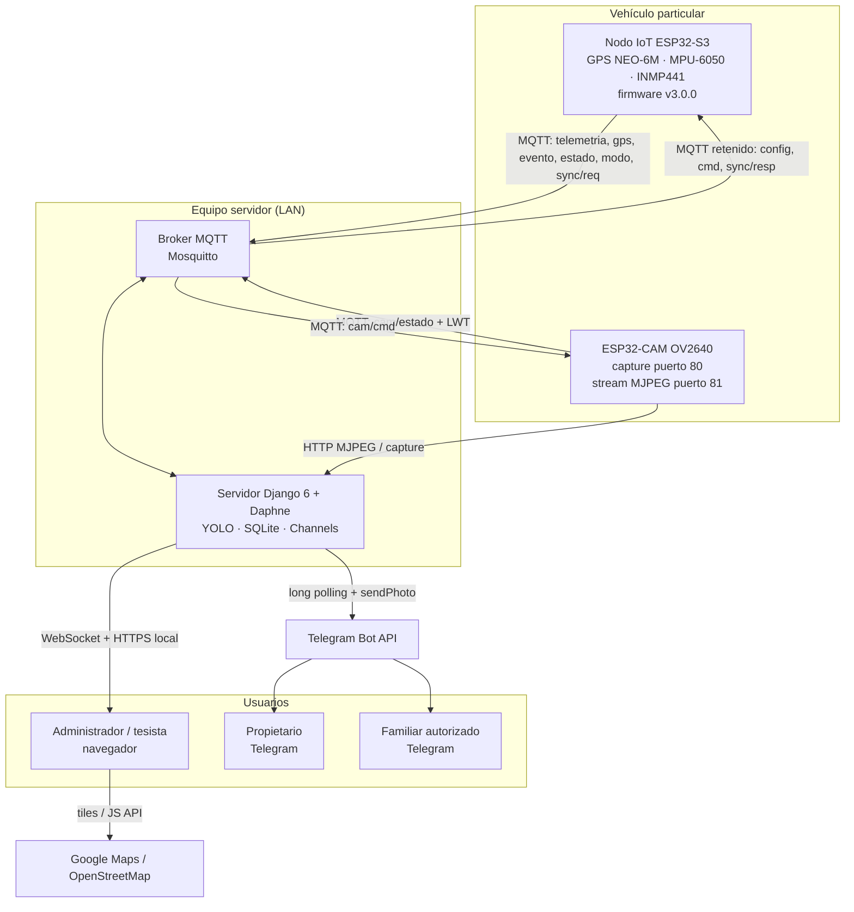

### 5.2 Diagrama de componentes (nivel 2)

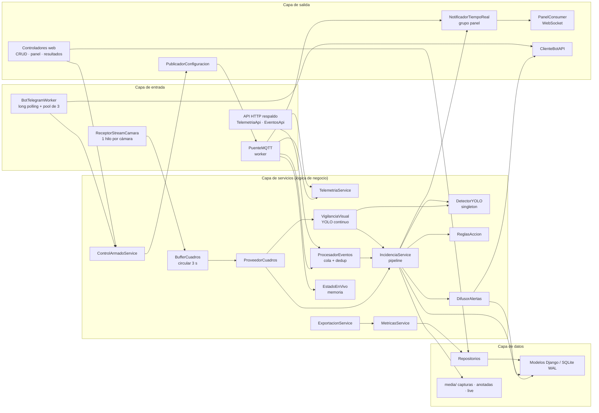

### 5.3 Diagrama de despliegue (nivel físico)

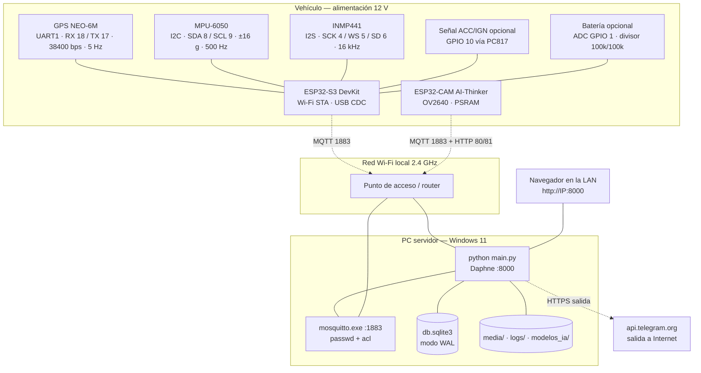

### 5.4 Diagrama de paquetes (estructura MVC + servicios)

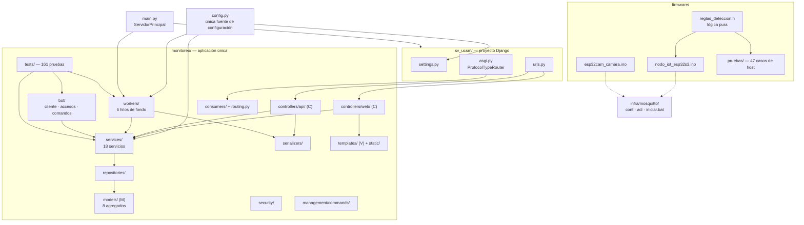

### 5.5 Capas y regla de dependencia

```
┌─────────────────────────────────────────────────────────────────────────┐
│ PRESENTACIÓN   templates/ · static/js · PanelConsumer · formateador bot │
├─────────────────────────────────────────────────────────────────────────┤
│ CONTROL        controllers/web · controllers/api · comandos del bot     │
├─────────────────────────────────────────────────────────────────────────┤
│ SERVICIOS      IncidenciaService · ReglasAccion · DifusorAlertas · …    │  ← toda la lógica
├─────────────────────────────────────────────────────────────────────────┤
│ ACCESO A DATOS repositories/ · serializers/                             │
├─────────────────────────────────────────────────────────────────────────┤
│ DOMINIO        models/ (esquema fijo)                                   │
├─────────────────────────────────────────────────────────────────────────┤
│ INFRAESTRUCTURA ClienteMqtt · ClienteCamaraESP32 · ClienteBotAPI · YOLO │
└─────────────────────────────────────────────────────────────────────────┘
          config.py atraviesa todas las capas (solo lectura)

Reglas:  · las capas superiores dependen de las inferiores, nunca al revés
         · ninguna vista contiene lógica: siempre delega en un servicio
         · ningún módulo lee os.environ fuera de config.py
         · los workers solo los arranca main.py, nunca AppConfig.ready()
```

---

## 6. Diagramas de casos de uso

### 6.1 Actores

| Actor | Tipo | Descripción |
|---|---|---|
| **Administrador / tesista** | Humano primario | Usuario autenticado del panel web. Gestiona catálogos, valida incidencias, exporta resultados, configura umbrales y envía comandos. En Telegram, los `chat_id` de `TELEGRAM_ADMIN_CHAT_IDS` saltan toda verificación por vehículo |
| **Propietario del vehículo** | Humano primario | Se vincula con `/vincular DNI TELEFONO`. Recibe alertas, consulta, controla el armado e invita familiares |
| **Familiar autorizado** | Humano secundario | Se vincula con `/unirse CODIGO` o `/start CODIGO`. Consulta siempre; controla solo si `puede_controlar = True` |
| **Nodo ESP32-S3** | Sistema externo | Publica telemetría, GPS, eventos, estado y modo; se suscribe a `config`, `cmd` y `sync/resp` |
| **ESP32-CAM** | Sistema externo | Sirve `/capture` y `/stream`; publica `cam/estado` retenido con *Last Will*; obedece `cam/cmd` |
| **Broker Mosquitto** | Sistema externo | Enruta tópicos, conserva los retenidos y publica el *Last Will* |
| **Telegram Bot API** | Sistema externo | Entrega mensajes y fotos; devuelve `message_id` y las pulsaciones de botones |
| **Google Maps / OSM** | Sistema externo | Tiles del mapa y geocodificación inversa opcional |

### 6.2 Casos de uso del panel web

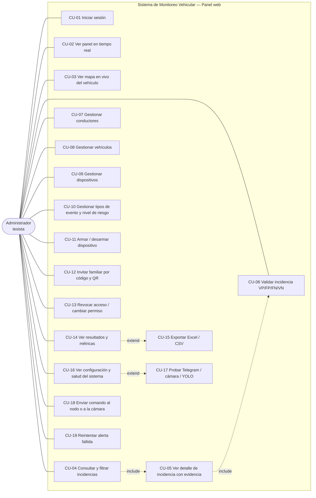

### 6.3 Casos de uso del bot de Telegram

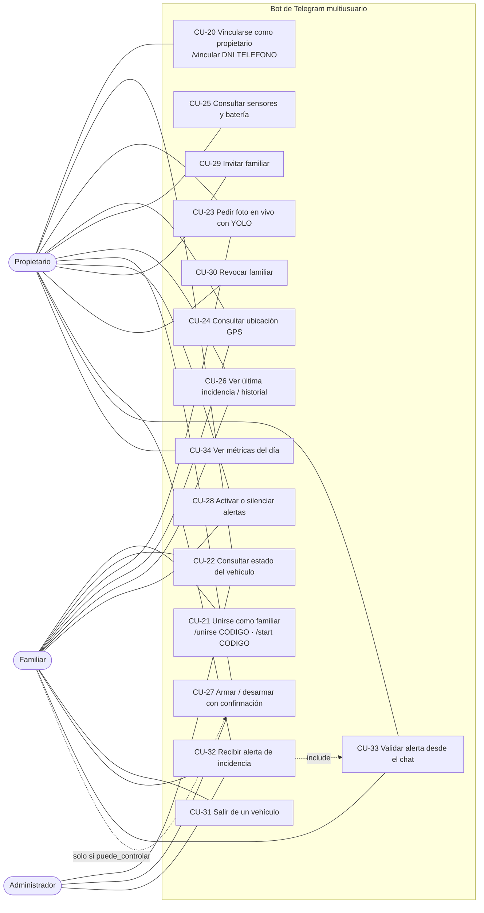

### 6.4 Casos de uso automáticos (sin intervención humana)

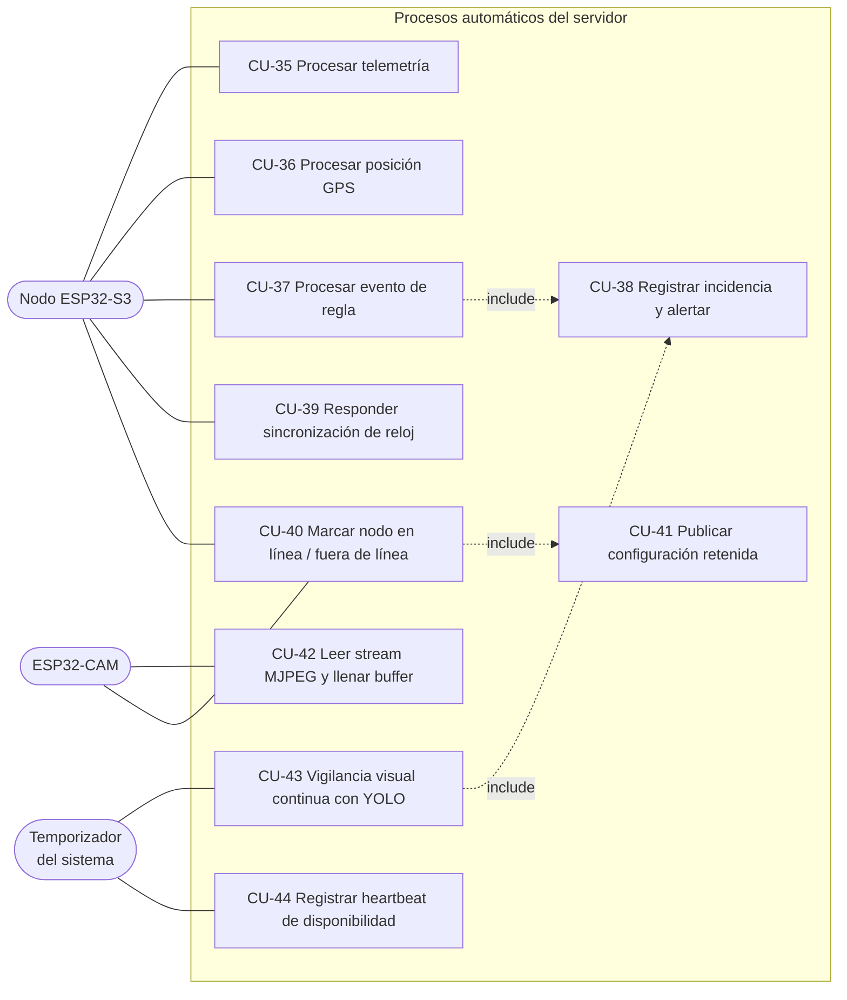

### 6.5 Especificación del caso de uso crítico CU-38

| Campo | Contenido |
|---|---|
| **Nombre** | CU-38 Registrar incidencia y alertar |
| **Actor principal** | Nodo ESP32-S3 (o `VigilanciaVisual` para incidencias visuales) |
| **Actores secundarios** | ESP32-CAM, Telegram Bot API, navegador del panel |
| **Precondiciones** | El `codigo` del nodo existe en la tabla `dispositivo`; el broker está activo o se usa el respaldo HTTP |
| **Disparador** | Llega un mensaje al tópico `ucsm/v1/<codigo>/evento` con QoS 1, o YOLO confirma una clase vigilada durante N cuadros seguidos |
| **Flujo principal** | 1. `ClienteMqtt` sella `t_recepcion_ms` antes de parsear.<br/>2. `EventoSerializer` valida el payload.<br/>3. `ProcesadorEventos` descarta duplicados por `evento_uid` y encola.<br/>4. El hilo del procesador toma el evento y llama a `IncidenciaService.procesar_evento_sensor`.<br/>5. `ProveedorCuadros` entrega el cuadro más cercano a `t_deteccion_sensor`.<br/>6. `DetectorYOLO` infiere y devuelve cajas + imagen anotada.<br/>7. `_tipo_final` reclasifica el tipo si YOLO vio algo más informativo (salvo `CHOQUE`).<br/>8. Se persiste `Incidencia` + `DeteccionYolo` en una transacción.<br/>9. Se emite `incidencia_nueva` por WebSocket.<br/>10. `ReglasAccion` decide la acción según `nivel_riesgo`.<br/>11. `DifusorAlertas` envía en paralelo a todos los destinatarios y crea una `AlertaTelegram` por cada uno.<br/>12. Se guarda `MedicionTiempo` con las 7 marcas y las 5 latencias derivadas.<br/>13. Se emite `incidencia_actualizada`.<br/>14. Geocodificación inversa opcional, siempre al final. |
| **Flujos alternativos** | **A1** Dispositivo no registrado → se descarta y se registra advertencia.<br/>**A2** Evento duplicado (QoS 1 reentregado) → se descarta y se incrementa el contador.<br/>**A3** Cola llena → se registra error y se pierde el evento (se reporta en Configuración).<br/>**A4** Sin stream → se usa `/capture`, anotado en `observacion`.<br/>**A5** Sin cámara → incidencia sin imagen, YOLO no se ejecuta.<br/>**A6** `nivel_riesgo = BAJO` → solo registro, sin Telegram.<br/>**A7** `nivel_riesgo = MEDIO` → alerta silenciosa (`disable_notification`).<br/>**A8** Sin destinatarios → *fallback* a `Conductor.telegram_chat_id`.<br/>**A9** `TipoEvento` ausente → se autosiembra con advertencia (nunca se pierde la alerta).<br/>**A10** `ts_ms` nulo → se usa la hora de recepción y `latencia_red_ms` queda en `NULL`. |
| **Postcondiciones** | Existe una `Incidencia` con su `MedicionTiempo`; hay una `AlertaTelegram` por destinatario; el panel refleja la incidencia; la imagen está en `media/capturas/` y la anotada en `media/anotadas/` |
| **Requisito de rendimiento** | `tiempo_respuesta_total_ms` < 2000 ms en LAN (RNF-01) |

---

## 7. Modelo de datos (lógico y físico)

### 7.1 Diagrama entidad-relación

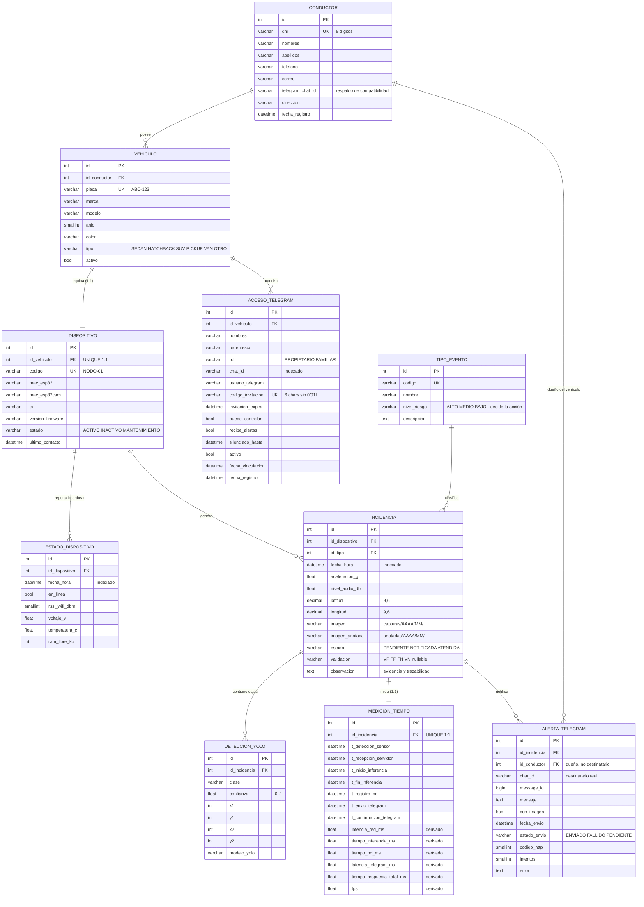

### 7.2 Modelo lógico relacional

```
conductor(id, dni↑, nombres, apellidos, telefono, correo, telegram_chat_id,
          direccion, fecha_registro)

vehiculo(id, id_conductor→conductor.id [PROTECT], placa↑, marca, modelo, anio,
         color, tipo, activo)

dispositivo(id, id_vehiculo→vehiculo.id [PROTECT, UNIQUE], codigo↑, mac_esp32,
            mac_esp32cam, ip, version_firmware, estado, ultimo_contacto)

estado_dispositivo(id, id_dispositivo→dispositivo.id [CASCADE], fecha_hora,
                   en_linea, rssi_wifi_dbm, voltaje_v, temperatura_c, ram_libre_kb)
                   INDEX idx_estado_disp_fecha(id_dispositivo, fecha_hora)

tipo_evento(id, codigo↑, nombre, nivel_riesgo, descripcion)

incidencia(id, id_dispositivo→dispositivo.id [PROTECT], id_tipo→tipo_evento.id [PROTECT],
           fecha_hora, aceleracion_g, nivel_audio_db, latitud, longitud,
           imagen, imagen_anotada, estado, validacion, observacion)
           INDEX idx_incidencia_disp_fecha(id_dispositivo, fecha_hora)

deteccion_yolo(id, id_incidencia→incidencia.id [CASCADE], clase, confianza,
               x1, y1, x2, y2, modelo_yolo)

medicion_tiempo(id, id_incidencia→incidencia.id [CASCADE, UNIQUE],
                t_deteccion_sensor, t_recepcion_servidor, t_inicio_inferencia,
                t_fin_inferencia, t_registro_bd, t_envio_telegram,
                t_confirmacion_telegram, latencia_red_ms, tiempo_inferencia_ms,
                tiempo_bd_ms, latencia_telegram_ms, tiempo_respuesta_total_ms, fps)

alerta_telegram(id, id_incidencia→incidencia.id [CASCADE],
                id_conductor→conductor.id [PROTECT], chat_id, message_id, mensaje,
                con_imagen, fecha_envio, estado_envio, codigo_http, intentos, error)

acceso_telegram(id, id_vehiculo→vehiculo.id [CASCADE], nombres, parentesco, rol,
                chat_id, usuario_telegram, codigo_invitacion↑, invitacion_expira,
                puede_controlar, recibe_alertas, silenciado_hasta, activo,
                fecha_vinculacion, fecha_registro)
                UNIQUE uq_acceso_vehiculo_chat(id_vehiculo, chat_id) WHERE chat_id <> ''

↑ = UNIQUE      → = clave foránea      [..] = política ON DELETE
```

**Normalización.** El esquema está en 3FN: no hay atributos multivaluados (las cajas de YOLO
y los destinatarios de una alerta están en tablas propias), no hay dependencias parciales (todas
las claves primarias son simples) y no hay dependencias transitivas (la placa vive solo en
`vehiculo`, el nivel de riesgo solo en `tipo_evento`).

**Desnormalizaciones deliberadas y su justificación:**

| Caso | Motivo |
|---|---|
| `medicion_tiempo` guarda las 5 latencias además de las 7 marcas | Las latencias se calculan una vez en `save()` y se consultan miles de veces para la estadística del Capítulo V; recalcularlas en cada consulta encarecería la página Resultados |
| `alerta_telegram.id_conductor` apunta al **dueño del vehículo**, no al destinatario | Compatibilidad con el esquema fijo de la especificación §6. El destinatario real se resuelve con `AlertaTelegram.destinatario_nombre`, que consulta `acceso_telegram` por `chat_id` |
| `conductor.telegram_chat_id` sigue existiendo pese a `acceso_telegram` | Camino de compatibilidad: si un vehículo no tiene ningún acceso con `recibe_alertas`, `DifusorAlertas` cae a este campo |
| `incidencia.observacion` es texto libre con evidencia | Las reglas evolucionan y cada una aporta métricas distintas; un texto legible es la forma de que la evidencia llegue intacta al Excel de la tesis sin cambiar el esquema fijo |

### 7.3 Modelo físico (DDL equivalente en SQLite)

```sql
PRAGMA journal_mode = WAL;      -- varios hilos escriben (workers + pool del bot)
PRAGMA busy_timeout = 5000;     -- 5 s de espera antes de fallar por lock

CREATE TABLE conductor (
    id                INTEGER PRIMARY KEY AUTOINCREMENT,
    dni               VARCHAR(8)   NOT NULL UNIQUE,     -- RegexValidator ^\d{8}$
    nombres           VARCHAR(80)  NOT NULL,
    apellidos         VARCHAR(80)  NOT NULL,
    telefono          VARCHAR(15)  NOT NULL,            -- ^\+?\d{9,15}$
    correo            VARCHAR(100) NOT NULL DEFAULT '',
    telegram_chat_id  VARCHAR(30)  NOT NULL DEFAULT '',
    direccion         VARCHAR(150) NOT NULL DEFAULT '',
    fecha_registro    DATETIME     NOT NULL
);

CREATE TABLE vehiculo (
    id            INTEGER PRIMARY KEY AUTOINCREMENT,
    id_conductor  INTEGER      NOT NULL REFERENCES conductor(id),
    placa         VARCHAR(10)  NOT NULL UNIQUE,         -- ^[A-Z0-9]{3}-?[A-Z0-9]{3}$
    marca         VARCHAR(40)  NOT NULL,
    modelo        VARCHAR(40)  NOT NULL,
    anio          SMALLINT     NOT NULL CHECK (anio BETWEEN 1980 AND 2100),
    color         VARCHAR(30)  NOT NULL,
    tipo          VARCHAR(20)  NOT NULL DEFAULT 'SEDAN',
    activo        BOOLEAN      NOT NULL DEFAULT 1
);

CREATE TABLE dispositivo (
    id                INTEGER PRIMARY KEY AUTOINCREMENT,
    id_vehiculo       INTEGER     NOT NULL UNIQUE REFERENCES vehiculo(id),
    codigo            VARCHAR(20) NOT NULL UNIQUE,      -- NODO-01
    mac_esp32         VARCHAR(17) NOT NULL DEFAULT '',
    mac_esp32cam      VARCHAR(17) NOT NULL DEFAULT '',
    ip                CHAR(39)    NULL,
    version_firmware  VARCHAR(10) NOT NULL DEFAULT '',
    estado            VARCHAR(15) NOT NULL DEFAULT 'ACTIVO',
    ultimo_contacto   DATETIME    NULL
);

CREATE TABLE estado_dispositivo (
    id              INTEGER PRIMARY KEY AUTOINCREMENT,
    id_dispositivo  INTEGER  NOT NULL REFERENCES dispositivo(id) ON DELETE CASCADE,
    fecha_hora      DATETIME NOT NULL,
    en_linea        BOOLEAN  NOT NULL DEFAULT 1,
    rssi_wifi_dbm   SMALLINT NULL,
    voltaje_v       REAL     NULL,
    temperatura_c   REAL     NULL,
    ram_libre_kb    INTEGER  NULL
);
CREATE INDEX idx_estado_disp_fecha ON estado_dispositivo(id_dispositivo, fecha_hora);
CREATE INDEX estado_dispositivo_fecha_hora ON estado_dispositivo(fecha_hora);

CREATE TABLE tipo_evento (
    id            INTEGER PRIMARY KEY AUTOINCREMENT,
    codigo        VARCHAR(20) NOT NULL UNIQUE,
    nombre        VARCHAR(60) NOT NULL,
    nivel_riesgo  VARCHAR(10) NOT NULL DEFAULT 'MEDIO',  -- ALTO | MEDIO | BAJO
    descripcion   TEXT        NOT NULL DEFAULT ''
);

CREATE TABLE incidencia (
    id              INTEGER PRIMARY KEY AUTOINCREMENT,
    id_dispositivo  INTEGER      NOT NULL REFERENCES dispositivo(id),
    id_tipo         INTEGER      NOT NULL REFERENCES tipo_evento(id),
    fecha_hora      DATETIME     NOT NULL,
    aceleracion_g   REAL         NULL,
    nivel_audio_db  REAL         NULL,
    latitud         DECIMAL(9,6) NULL,
    longitud        DECIMAL(9,6) NULL,
    imagen          VARCHAR(100) NULL,
    imagen_anotada  VARCHAR(100) NULL,
    estado          VARCHAR(15)  NOT NULL DEFAULT 'PENDIENTE',
    validacion      VARCHAR(2)   NULL,                   -- VP | FP | FN | VN
    observacion     TEXT         NOT NULL DEFAULT ''
);
CREATE INDEX idx_incidencia_disp_fecha ON incidencia(id_dispositivo, fecha_hora);
CREATE INDEX incidencia_fecha_hora ON incidencia(fecha_hora);

CREATE TABLE deteccion_yolo (
    id             INTEGER PRIMARY KEY AUTOINCREMENT,
    id_incidencia  INTEGER     NOT NULL REFERENCES incidencia(id) ON DELETE CASCADE,
    clase          VARCHAR(30) NOT NULL,
    confianza      REAL        NOT NULL CHECK (confianza BETWEEN 0 AND 1),
    x1             INTEGER     NOT NULL,
    y1             INTEGER     NOT NULL,
    x2             INTEGER     NOT NULL,
    y2             INTEGER     NOT NULL,
    modelo_yolo    VARCHAR(30) NOT NULL DEFAULT 'yolo26n'
);

CREATE TABLE medicion_tiempo (
    id                        INTEGER PRIMARY KEY AUTOINCREMENT,
    id_incidencia             INTEGER  NOT NULL UNIQUE REFERENCES incidencia(id) ON DELETE CASCADE,
    t_deteccion_sensor        DATETIME NOT NULL,
    t_recepcion_servidor      DATETIME NOT NULL,
    t_inicio_inferencia       DATETIME NULL,
    t_fin_inferencia          DATETIME NULL,
    t_registro_bd             DATETIME NULL,
    t_envio_telegram          DATETIME NULL,
    t_confirmacion_telegram   DATETIME NULL,
    latencia_red_ms           REAL NULL,
    tiempo_inferencia_ms      REAL NULL,
    tiempo_bd_ms              REAL NULL,
    latencia_telegram_ms      REAL NULL,
    tiempo_respuesta_total_ms REAL NULL,
    fps                       REAL NULL
);

CREATE TABLE alerta_telegram (
    id             INTEGER PRIMARY KEY AUTOINCREMENT,
    id_incidencia  INTEGER     NOT NULL REFERENCES incidencia(id) ON DELETE CASCADE,
    id_conductor   INTEGER     NOT NULL REFERENCES conductor(id),
    chat_id        VARCHAR(30) NOT NULL,
    message_id     BIGINT      NULL,
    mensaje        TEXT        NOT NULL,
    con_imagen     BOOLEAN     NOT NULL DEFAULT 1,
    fecha_envio    DATETIME    NULL,
    estado_envio   VARCHAR(10) NOT NULL DEFAULT 'PENDIENTE',
    codigo_http    SMALLINT    NULL,
    intentos       SMALLINT    NOT NULL DEFAULT 0,
    error          TEXT        NOT NULL DEFAULT ''
);

CREATE TABLE acceso_telegram (
    id                 INTEGER PRIMARY KEY AUTOINCREMENT,
    id_vehiculo        INTEGER     NOT NULL REFERENCES vehiculo(id) ON DELETE CASCADE,
    nombres            VARCHAR(80) NOT NULL,
    parentesco         VARCHAR(30) NOT NULL DEFAULT '',
    rol                VARCHAR(12) NOT NULL DEFAULT 'FAMILIAR',
    chat_id            VARCHAR(30) NOT NULL DEFAULT '',
    usuario_telegram   VARCHAR(64) NOT NULL DEFAULT '',
    codigo_invitacion  VARCHAR(8)  NULL UNIQUE,
    invitacion_expira  DATETIME    NULL,
    puede_controlar    BOOLEAN     NOT NULL DEFAULT 0,
    recibe_alertas     BOOLEAN     NOT NULL DEFAULT 1,
    silenciado_hasta   DATETIME    NULL,
    activo             BOOLEAN     NOT NULL DEFAULT 1,
    fecha_vinculacion  DATETIME    NULL,
    fecha_registro     DATETIME    NOT NULL
);
CREATE INDEX acceso_telegram_chat_id ON acceso_telegram(chat_id);
CREATE UNIQUE INDEX uq_acceso_vehiculo_chat
    ON acceso_telegram(id_vehiculo, chat_id) WHERE chat_id <> '';
```

### 7.4 Catálogo sembrado de `tipo_evento`

Lo siembra `python manage.py sembrar_catalogos` de forma idempotente. El `nivel_riesgo` **no es
decorativo**: es la política de acción del sistema.

| Código | Nombre | Riesgo | Acción resultante | Origen | Condición de disparo |
|---|---|---|---|---|---|
| `CHOQUE` | Choque detectado | ALTO | Alerta con notificación | Regla 1 (nodo) | En marcha: \|a\| ≥ 4 g **y** golpe sonoro ≥ 112 dB SPL en ±500 ms |
| `IMPACTO_SIN_CONFIRMAR` | Impacto sin confirmar | BAJO | Solo registro | Regla 1 (nodo) | En marcha: \|a\| ≥ 4 g **sin** sonido en ±500 ms |
| `ROTURA_VENTANA` | Rotura de ventana | ALTO | Alerta con notificación | Regla 2 (nodo) | Estacionado y armado: golpe 150–400 Hz → estallido 3–7 kHz ≥ 150 ms **con** vibración fusionada |
| `VIDRIO_ROTO_EXTERNO` | Vidrio roto externo | BAJO | Solo registro | Regla 2 (nodo) | Estallido de vidrio **sin** vibración del vehículo |
| `GOLPE_MANIPULACION` | Golpe / manipulación | MEDIO | Alerta **silenciosa** | Regla 2 (nodo) | Estacionado y armado: vibración > 0.15 g sin estallido en 1 s |
| `ARMA_FUEGO` | Arma de fuego detectada (YOLO) | ALTO | Alerta con notificación | YOLO | Confianza ≥ 0.50 · alerta en cualquier modo |
| `ARMA_BLANCA` | Arma blanca detectada (YOLO) | ALTO | Alerta con notificación | YOLO | Confianza ≥ 0.50 · alerta en cualquier modo |
| `APERTURA_PUERTA` | Apertura de puerta (YOLO) | ALTO | Alerta con notificación | YOLO | Confianza ≥ 0.55 · alerta en cualquier modo |
| `VEHICULO_DANADO` | Vehículo dañado (YOLO) | ALTO | Alerta con notificación | YOLO | Confianza ≥ 0.55 · alerta en cualquier modo |
| `PERSONA_SOSPECHOSA` | Persona sospechosa (YOLO) | ALTO | Alerta con notificación | YOLO | Confianza ≥ 0.60 · alerta en cualquier modo |
| `PERSONA` | Persona detectada (YOLO) | ALTO | Alerta con notificación | YOLO | Confianza ≥ 0.60 · **solo ESTACIONADO y armado** |
| `VIBRACION` | Golpe o vibración | MEDIO | Alerta silenciosa | Legado v2.0.0 | Desactivado (`cfg::REGLAS_LEGADO = false`) |
| `RUIDO` | Ruido fuerte | MEDIO | Alerta silenciosa | Legado v2.0.0 | Desactivado |
| `MANIPULACION` | Manipulación / inclinación | ALTO | Alerta con notificación | Legado v2.0.0 | Desactivado |
| `MOVIMIENTO` | Movimiento no autorizado | ALTO | Alerta con notificación | Legado v2.0.0 | Desactivado |

> Los tipos de visión se **derivan** de `config.yolo.clases_vigiladas`, de modo que el catálogo
> de la base de datos y lo que reconoce el detector no pueden desincronizarse: una clase sin
> `TipoEvento` nunca podría generar una alerta.

---

## 8. Diagramas de clases

> Para que sean legibles, el diagrama de clases se presenta por subsistemas. El diagrama 8.9
> resume las dependencias entre subsistemas.

### 8.1 Modelo de dominio (capa M del MVC)

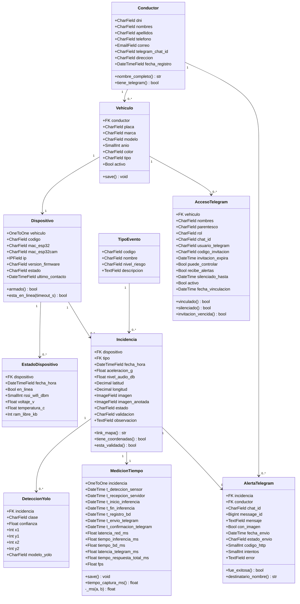

### 8.2 Configuración (`config.py`)

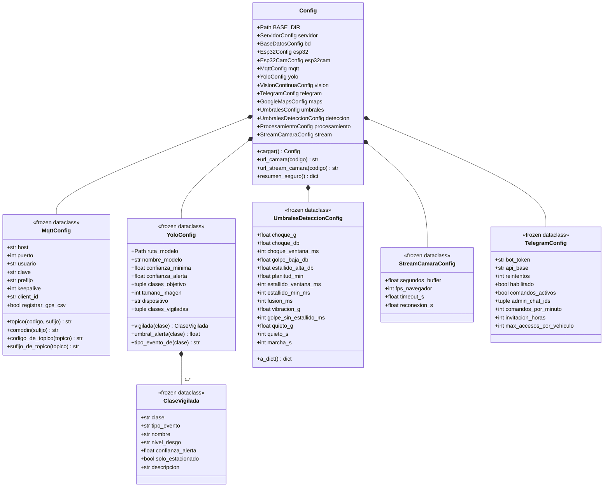

### 8.3 Pipeline de incidencias (clases centrales)

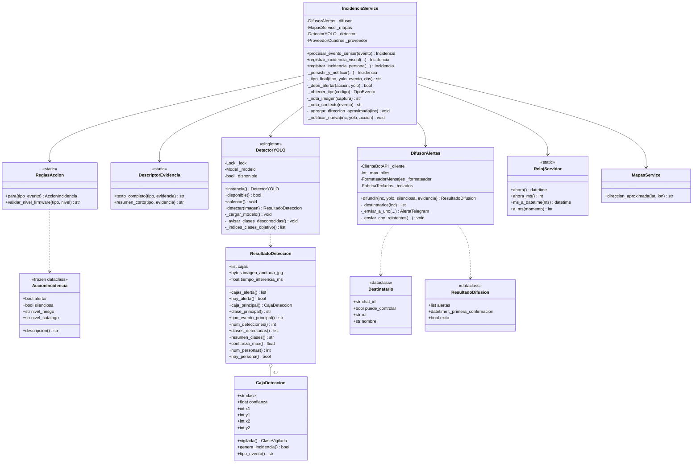

### 8.4 Captura de imagen: stream, buffer y proveedor

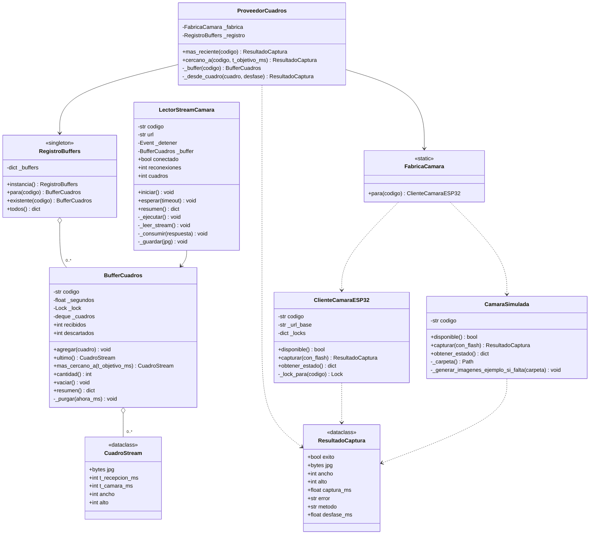

### 8.5 Workers (hilos de fondo) y estado en vivo

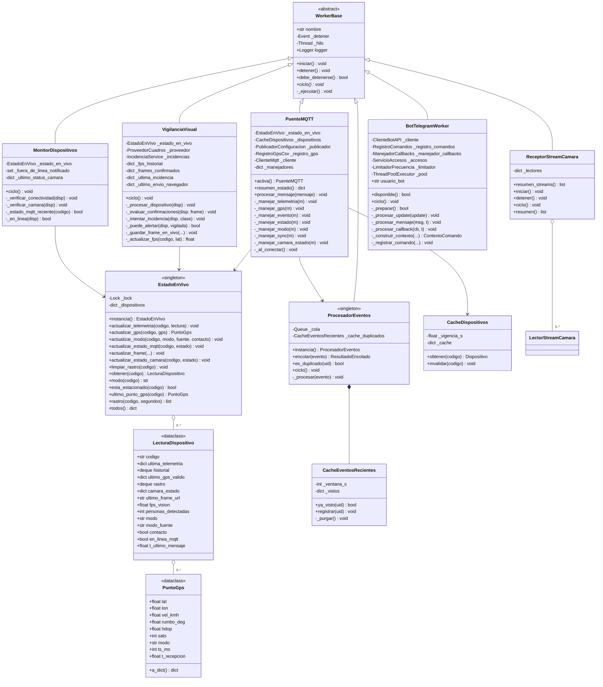

### 8.6 Subsistema MQTT

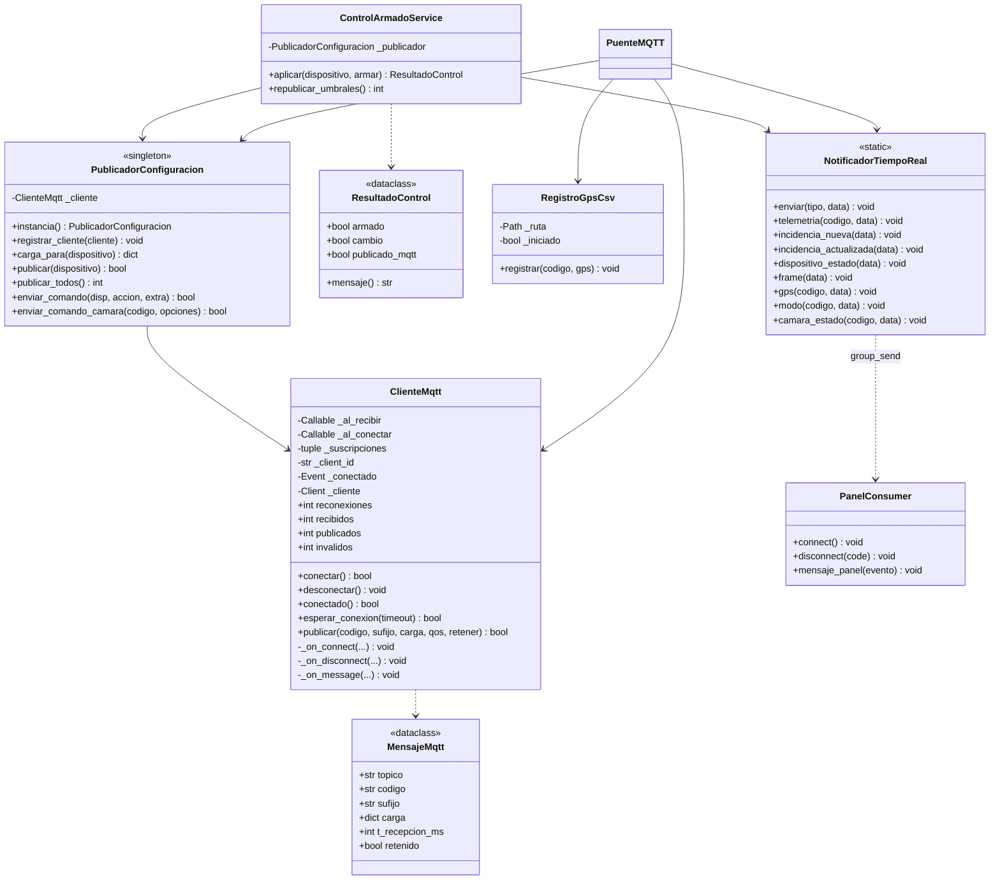

### 8.7 Subsistema del bot de Telegram

```mermaid
classDiagram
    class ComandoBase {
        <<abstract>>
        +str nombre
        +str descripcion
        +bool requiere_vinculacion
        +str permiso
        -ServicioAccesos _accesos
        -FabricaTeclados _teclados
        +ejecutar(ctx)* void
        +tiene_permiso(ctx, vehiculo) bool
        +resolver_vehiculo_o_responder(ctx, placa) Vehiculo
        +resolver_dispositivo_o_responder(ctx, placa) Dispositivo
    }

    class ComandoInicio
    class ComandoAyuda
    class ComandoVincular
    class ComandoUnirse
    class ComandoSalir
    class ComandoEstado
    class ComandoFoto
    class ComandoUbicacion
    class ComandoSensores
    class ComandoBateria
    class ComandoUltima
    class ComandoIncidencias
    class ComandoArmar
    class ComandoDesarmar
    class ComandoAlertas
    class ComandoSilenciar
    class ComandoInvitar
    class ComandoFamilia
    class ComandoRevocar
    class ComandoVehiculo
    class ComandoMetricas

    class RegistroComandos {
        -dict _por_nombre
        -dict _alias_botones
        +obtener(nombre) ComandoBase
        +resolver_desde_texto(texto) tuple
        +lista_para_set_my_commands() list
    }

    class ContextoComando {
        <<dataclass>>
        +str chat_id
        +ClienteBotAPI cliente
        +list accesos
        +str nombre_telegram
        +str usuario_telegram
        +datetime t_recepcion
        +str texto
        +list args
        +Vehiculo vehiculo
        +bool es_callback
        +str callback_query_id
        +int mensaje_id_origen
        +esta_vinculado() bool
        +es_admin() bool
    }

    class ServicioAccesos {
        +es_admin(chat_id) bool
        +accesos_de(chat_id) QuerySet
        +vehiculos_de(chat_id) QuerySet
        +acceso_para_vehiculo(chat_id, veh) AccesoTelegram
        +puede_consultar(chat_id, veh) bool
        +puede_controlar(chat_id, veh) bool
        +puede_invitar(chat_id, veh) bool
        +resolver_vehiculo(chat_id, placa) tuple
    }

    class ServicioInvitaciones {
        +generar_codigo() str
        +crear_invitacion(veh, nombres, parentesco) tuple
        +enlace_invitacion(acceso, usuario_bot) str
        +canjear(codigo, chat_id, usuario) tuple
    }

    class LimitadorFrecuencia {
        <<singleton>>
        -dict _comandos
        -dict _intentos_vinculacion
        +instancia() LimitadorFrecuencia
        +permitir_comando(chat_id) bool
        +registrar_intento_vinculacion_fallido(chat_id) int
        +puede_intentar_vinculacion(chat_id) bool
        +reiniciar_intentos_vinculacion(chat_id) void
    }

    class ManejadorCallbacks {
        -RegistroComandos _registro
        -ServicioAccesos _accesos
        -FabricaTeclados _teclados
        +procesar(ctx, callback_data) void
        -_validar(ctx, partes) void
        -_foto(ctx, partes) void
        -_ubicacion(ctx, partes) void
        -_desarmar(ctx, partes) void
        -_control_confirmado(ctx, partes) void
        -_revocar(ctx, partes) void
        -_permiso_control(ctx, partes) void
        -_seleccion_vehiculo(ctx, partes) void
    }

    class ClienteBotAPI {
        +get_me() dict
        +get_updates(offset, timeout, allowed) dict
        +delete_webhook() dict
        +set_my_commands(comandos) dict
        +send_message(chat_id, texto, ...) dict
        +send_photo(chat_id, foto, caption, ...) dict
        +send_location(chat_id, lat, lon) dict
        +edit_message_reply_markup(...) dict
        +answer_callback_query(id, texto) dict
    }

    class FormateadorMensajes {
        +bienvenida(vinculado) str
        +ayuda(propietario, control, vinculado) str
        +alerta_incidencia(inc, yolo, evidencia, silenciosa) str
        +estado_vehiculo(...) str
        +incidencia(...) str
        +sensores(...) str
    }

    class FabricaTeclados {
        +menu_principal(control, propietario) dict
        +alerta(incidencia, puede_controlar) dict
        +seleccion_vehiculo(vehiculos, comando) dict
        +confirmacion(...) dict
    }

    class EstadoBot {
        <<singleton>>
        +marcar_conectado(usuario) void
        +marcar_desconectado() void
        +registrar_update() void
        +resumen() dict
    }

    class RegistroComandosBot {
        <<singleton>>
        +registrar(chat_id, rol, comando, exito, tiempo_ms) void
    }

    class MetricasBotService {
        +resumen_por_comando() list
    }

    ComandoBase <|-- ComandoInicio
    ComandoBase <|-- ComandoAyuda
    ComandoBase <|-- ComandoVincular
    ComandoBase <|-- ComandoUnirse
    ComandoBase <|-- ComandoSalir
    ComandoBase <|-- ComandoEstado
    ComandoBase <|-- ComandoFoto
    ComandoBase <|-- ComandoUbicacion
    ComandoBase <|-- ComandoSensores
    ComandoBase <|-- ComandoBateria
    ComandoBase <|-- ComandoUltima
    ComandoBase <|-- ComandoIncidencias
    ComandoBase <|-- ComandoArmar
    ComandoBase <|-- ComandoDesarmar
    ComandoBase <|-- ComandoAlertas
    ComandoBase <|-- ComandoSilenciar
    ComandoBase <|-- ComandoInvitar
    ComandoBase <|-- ComandoFamilia
    ComandoBase <|-- ComandoRevocar
    ComandoBase <|-- ComandoVehiculo
    ComandoBase <|-- ComandoMetricas
    RegistroComandos o-- "21" ComandoBase
    ComandoBase --> ServicioAccesos
    ComandoBase --> FabricaTeclados
    ComandoBase ..> ContextoComando
    ComandoInvitar --> ServicioInvitaciones
    ComandoUnirse --> ServicioInvitaciones
    ComandoArmar --> ControlArmadoService
    ComandoDesarmar --> ControlArmadoService
    BotTelegramWorker --> RegistroComandos
    BotTelegramWorker --> ManejadorCallbacks
    BotTelegramWorker --> LimitadorFrecuencia
    BotTelegramWorker --> ClienteBotAPI
    BotTelegramWorker --> EstadoBot
    BotTelegramWorker --> RegistroComandosBot
    ManejadorCallbacks --> RegistroComandos
    DifusorAlertas --> ClienteBotAPI
    DifusorAlertas --> FormateadorMensajes
    DifusorAlertas --> FabricaTeclados
    RegistroComandosBot ..> MetricasBotService
```

### 8.8 Firmware del nodo ESP32-S3

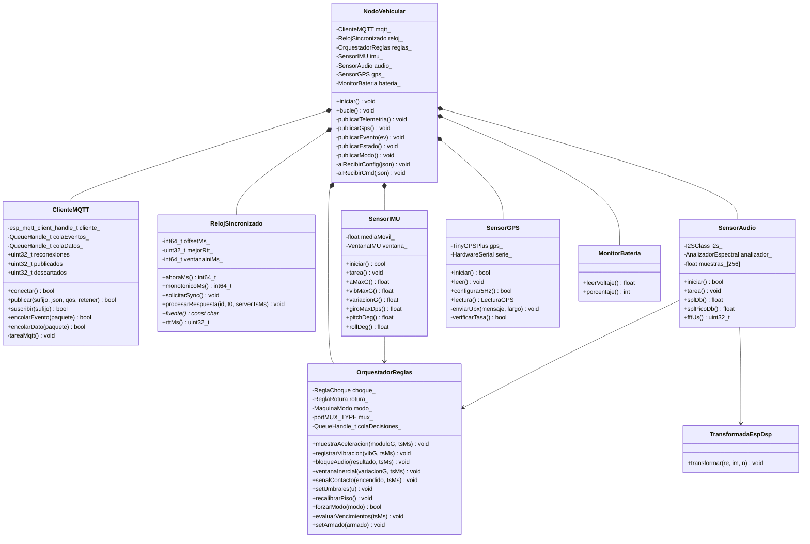

### 8.9 Lógica pura de reglas (`reglas_deteccion.h`, probable en PC)

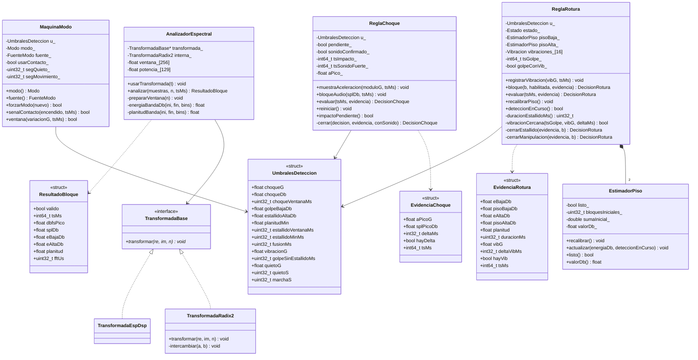

### 8.10 Dependencias entre subsistemas

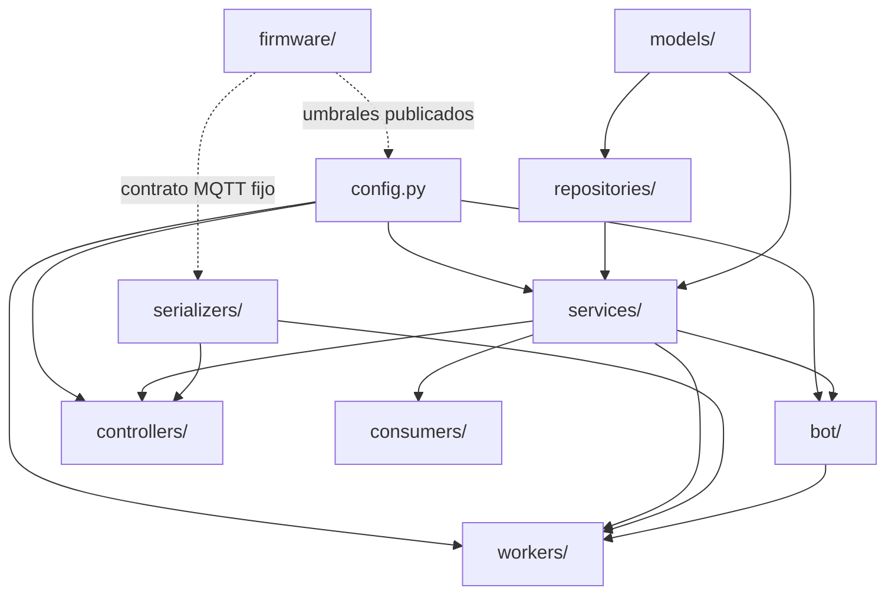

---

## 9. Diagramas de secuencia

### 9.1 Arranque del sistema (`python main.py`)

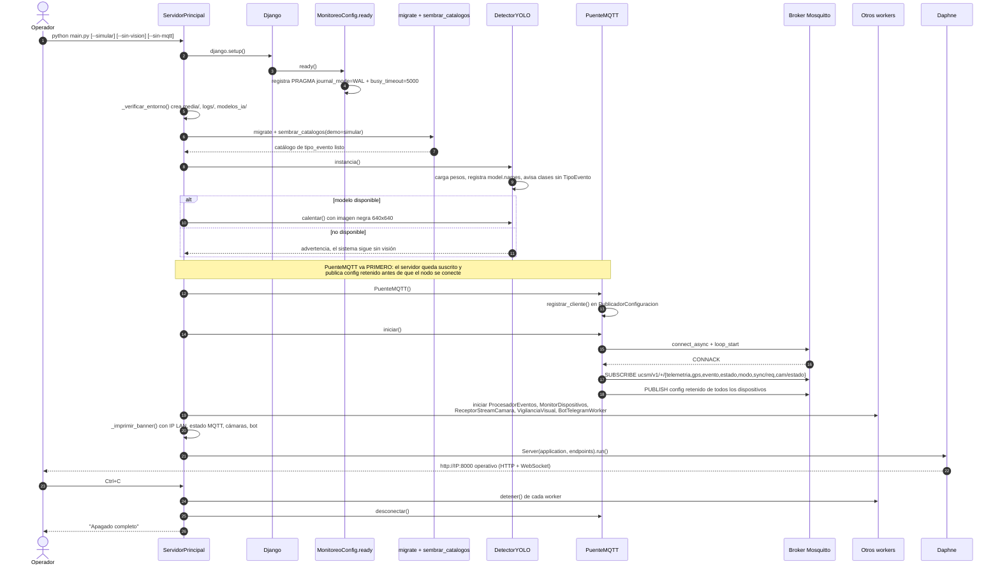

### 9.2 Pipeline completo: evento de sensor → alerta de Telegram (CU-38)

```mermaid
sequenceDiagram
    autonumber
    participant ND as Nodo ESP32-S3
    participant BR as Mosquitto
    participant CM as ClienteMqtt
    participant PM as PuenteMQTT
    participant ES as EventoSerializer
    participant PE as ProcesadorEventos
    participant IS as IncidenciaService
    participant PC as ProveedorCuadros
    participant BC as BufferCuadros
    participant YO as DetectorYOLO
    participant RA as ReglasAccion
    participant DB as SQLite
    participant DF as DifusorAlertas
    participant TG as Telegram Bot API
    participant WS as Panel (WebSocket)

    ND->>BR: PUBLISH ucsm/v1/NODO-01/evento (QoS 1)
    BR->>CM: on_message
    CM->>CM: t_recepcion_ms = time_ns() // 1e6  ← PRIMERA instrucción
    CM->>CM: json.loads(payload)
    CM->>PM: procesar_mensaje(MensajeMqtt)
    PM->>ES: validar payload
    ES-->>PM: datos validados
    PM->>PM: _dispositivo_de() desde CacheDispositivos
    PM->>PE: encolar(datos + t_recepcion_ms + origen=MQTT)

    alt evento_uid ya visto en los últimos 10 min
        PE-->>PM: ResultadoEncolado(duplicado=True)
        PM->>PM: contador _eventos_duplicados++
    else cola llena
        PE-->>PM: ResultadoEncolado(encolado=False)
        PM->>PM: log ERROR, evento perdido
    else encolado
        PE-->>PM: ResultadoEncolado(encolado=True)
    end

    Note over PE,IS: cambio de hilo: el worker del procesador toma el evento
    PE->>IS: procesar_evento_sensor(evento)
    IS->>DB: Dispositivo.objects.filter(codigo).select_related(...)
    IS->>IS: t_deteccion_sensor = ms_a_datetime(ts_ms)
    IS->>PC: cercano_a(codigo, ts_ms)
    PC->>BC: mas_cercano_a(t_objetivo_ms)
    alt hay stream
        BC-->>PC: CuadroStream (captura_ms = 0, desfase anotado)
    else sin stream
        PC->>PC: FabricaCamara.para(codigo).capturar()
    end
    PC-->>IS: ResultadoCaptura(metodo, desfase_ms)

    IS->>IS: t_inicio_inferencia = ahora()
    IS->>YO: detectar(jpg)
    YO-->>IS: ResultadoDeteccion(cajas, imagen_anotada)
    IS->>IS: t_fin_inferencia = ahora()

    IS->>IS: _tipo_final(): reclasifica salvo CHOQUE
    IS->>IS: observacion += nota_imagen + nota_contexto + evidencia

    IS->>RA: para(tipo_evento)
    RA-->>IS: AccionIncidencia(alertar, silenciosa, nivel_riesgo)
    IS->>RA: validar_nivel_firmware(tipo, nivel del nodo)
    RA-->>IS: nota para observacion

    IS->>DB: BEGIN; guardar Incidencia + imágenes + bulk_create DeteccionYolo; COMMIT
    IS->>IS: t_registro_bd = ahora()
    IS->>WS: incidencia_nueva(id, tipo, riesgo, placa, miniatura, lat, lon, clases)

    alt accion.alertar y (ALERTAR_SIN_PERSONA o yolo.hay_alerta)
        IS->>IS: t_envio_telegram = ahora()
        IS->>DF: difundir(incidencia, yolo, silenciosa, evidencia)
        DF->>DB: destinatarios: AccesoTelegram activos con recibe_alertas y no silenciados
        DF->>DF: + TELEGRAM_ADMIN_CHAT_IDS; si vacío → conductor.telegram_chat_id
        par envío paralelo (ThreadPoolExecutor, 6 hilos)
            DF->>DB: INSERT AlertaTelegram (bajo _LOCK_ESCRITURA_BD)
            DF->>TG: sendPhoto(chat_id, imagen anotada, caption, teclado, disable_notification)
            TG-->>DF: ok + message_id
            DF->>DB: UPDATE estado_envio=ENVIADO, message_id, fecha_envio
        end
        DF-->>IS: ResultadoDifusion(t_primera_confirmacion, exito)
        IS->>DB: Incidencia.estado = NOTIFICADA
    else nivel BAJO
        IS->>IS: log "solo registro (sin Telegram)"
    end

    IS->>DB: MedicionTiempo.save() → calcula las 5 latencias + fps
    IS->>WS: incidencia_actualizada(id, estado, alerta, accion, tiempo_total_ms)

    opt GOOGLE_GEOCODING y hay coordenadas
        IS->>IS: direccion_aproximada() → se añade a observacion
    end
```

### 9.3 Vigilancia visual continua (YOLO sobre el vídeo en vivo)

```mermaid
sequenceDiagram
    autonumber
    participant CAM as ESP32-CAM
    participant RS as LectorStreamCamara
    participant BC as BufferCuadros
    participant VV as VigilanciaVisual
    participant EV as EstadoEnVivo
    participant YO as DetectorYOLO
    participant IS as IncidenciaService
    participant WS as Panel (WebSocket)

    CAM->>RS: GET /stream (MJPEG persistente, puerto 81, ?key=)
    loop por cada cuadro
        RS->>RS: acumula bytes y corta en SOI FFD8 … EOI FFD9
        RS->>BC: agregar(CuadroStream(jpg, t_recepcion_ms))
        BC->>BC: purga lo anterior a 3 s
    end

    loop cada VISION_INTERVALO_MS (500 ms por defecto)
        VV->>VV: Dispositivo.objects.filter(estado=ACTIVO)
        VV->>BC: mas_reciente(codigo)
        BC-->>VV: ResultadoCaptura(metodo=stream, captura_ms=0)
        VV->>YO: detectar(jpg)
        YO-->>VV: ResultadoDeteccion(cajas_alerta por clase)
        VV->>VV: _actualizar_fps() media móvil de 20 muestras
        VV->>EV: actualizar_frame(url, fps, detecciones, latencia)
        VV->>VV: escribe media/live/<codigo>.jpg
        opt no se excede STREAM_FPS_NAVEGADOR
            VV->>WS: frame(url, fps, clases, resumen_clases, modo, bytes)
        end

        VV->>VV: _evaluar_confirmaciones()
        loop por cada clase detectada
            VV->>VV: vigilada = config.yolo.vigilada(clase)
            alt clase no vigilada
                VV->>VV: se dibuja pero NO genera incidencia
            else solo_estacionado y (no armado o modo != ESTACIONADO)
                VV->>EV: modo(codigo)
                VV->>VV: no alerta; log como máximo 1 vez por minuto
            else puede alertar
                VV->>VV: _frames_confirmados[(codigo, clase)].append(frame)
            end
        end
        VV->>VV: las clases que dejaron de verse pierden su racha

        opt racha >= VISION_FRAMES_CONFIRMACION y fuera del cooldown
            VV->>IS: registrar_incidencia_visual(tipo_codigo, clase_yolo, tiempos del primer frame)
            IS-->>VV: Incidencia (sigue el mismo _persistir_y_notificar de 9.2)
            VV->>VV: _ultima_incidencia[(codigo, clase)] = ahora; limpia la racha
        end
    end
```

### 9.4 Sincronización de reloj nodo ↔ servidor

```mermaid
sequenceDiagram
    autonumber
    participant RL as RelojSincronizado (nodo)
    participant BR as Mosquitto
    participant CM as ClienteMqtt
    participant PM as PuenteMQTT

    Note over RL: cada 30 s, y 5 veces seguidas al conectar
    RL->>RL: t0 = monotonicoMs()
    RL->>BR: PUBLISH sync/req {"id":17,"t0":123456} QoS 0
    BR->>CM: on_message
    CM->>CM: t_recepcion_ms (marca inmediata)
    CM->>PM: procesar_mensaje
    Note over PM: se responde PRIMERO y SIN tocar la base de datos:<br/>cualquier consulta inflaría el RTT
    PM->>BR: PUBLISH sync/resp {"id":17,"t0":123456,"server_ts_ms":t_recepcion_ms} QoS 0
    BR->>RL: sync/resp
    RL->>RL: t1 = monotonicoMs()
    RL->>RL: rtt = t1 - t0
    RL->>RL: offset = server_ts_ms - (t0 + t1) / 2
    alt rtt < mejorRtt de la ventana de 60 s
        RL->>RL: adopta este offset (muestra de menor RTT)
    else
        RL->>RL: descarta la muestra
    end
    Note over RL: las reglas siempre usan el reloj MONOTÓNICO;<br/>el offset solo se aplica al publicar ts_ms
    Note over PM: close_old_connections() se omite para sync/req<br/>porque el handler no abre conexión
```

### 9.5 Armar / desarmar desde cualquiera de los tres orígenes

```mermaid
sequenceDiagram
    autonumber
    actor U as Usuario
    participant W as Web / API / Bot
    participant CA as ControlArmadoService
    participant DB as SQLite
    participant NT as NotificadorTiempoReal
    participant PU as PublicadorConfiguracion
    participant BR as Mosquitto
    participant ND as Nodo ESP32-S3

    alt desde la web
        U->>W: POST /dispositivos/<pk>/armar/
    else desde el panel
        U->>W: POST /api/v1/panel/dispositivos/<pk>/armar/ {"armado": true}
    else desde Telegram
        U->>W: /armar → botón de confirmación → callback ok:...
    end

    W->>CA: aplicar(dispositivo, armar)
    CA->>DB: dispositivo.estado = ACTIVO | INACTIVO (update_fields)
    CA->>NT: dispositivo_estado(codigo, armado)
    NT-->>U: el panel refleja el cambio al instante
    CA->>PU: publicar(dispositivo)
    alt broker conectado
        PU->>BR: PUBLISH ucsm/v1/NODO-01/config {"armado":..,"umbrales":{..}} QoS 1 RETENIDO
        BR->>ND: config
        ND->>ND: OrquestadorReglas.setArmado() + setUmbrales()
        CA-->>W: ResultadoControl(publicado_mqtt=True)
    else sin broker
        CA-->>W: ResultadoControl(publicado_mqtt=False)
        Note over W: "el nodo lo recibirá al reconectarse<br/>(config es un mensaje retenido)"
    end
    W-->>U: mensaje de resultado
```

### 9.6 Comando `/foto` del bot (consulta con YOLO en vivo)

```mermaid
sequenceDiagram
    autonumber
    actor U as Propietario / Familiar
    participant TG as Telegram Bot API
    participant BW as BotTelegramWorker
    participant LM as LimitadorFrecuencia
    participant RC as RegistroComandos
    participant CF as ComandoFoto
    participant SA as ServicioAccesos
    participant PC as ProveedorCuadros
    participant YO as DetectorYOLO
    participant RM as RegistroComandosBot

    U->>TG: /foto  (o botón "📷 Foto")
    BW->>TG: getUpdates(offset, timeout=25 s)
    TG-->>BW: update
    BW->>BW: pool de 3 hilos → _procesar_update
    BW->>LM: permitir_comando(chat_id)
    alt supera TELEGRAM_COMANDOS_POR_MINUTO
        BW->>TG: "⏳ Muchos comandos seguidos"
    else permitido
        BW->>RC: resolver_desde_texto("/foto")
        RC-->>BW: (ComandoFoto, args)
        BW->>BW: construye ContextoComando (accesos del chat_id)
        alt requiere_vinculacion y no está vinculado
            BW->>TG: "Primero vincúlate con /vincular o /unirse"
        else
            BW->>CF: ejecutar(ctx)
            CF->>SA: resolver_vehiculo(chat_id, placa)
            alt varios vehículos y sin placa
                CF->>TG: teclado de selección (callback sel:...)
            else un vehículo
                CF->>SA: puede_consultar(chat_id, vehiculo)
                CF->>PC: mas_reciente(codigo)
                PC-->>CF: ResultadoCaptura
                CF->>YO: detectar(jpg)
                YO-->>CF: cajas + imagen anotada
                CF->>TG: sendPhoto(imagen anotada, resumen de clases y confianza)
                TG-->>U: foto con cajas dibujadas
            end
        end
    end
    BW->>RM: registrar(chat_id, rol, "foto", exito, tiempo_ms) → logs/bot_comandos.csv
```

### 9.7 Validación de una alerta desde el chat

```mermaid
sequenceDiagram
    autonumber
    actor U1 as Propietario
    actor U2 as Familiar
    participant TG as Telegram Bot API
    participant BW as BotTelegramWorker
    participant MC as ManejadorCallbacks
    participant DB as SQLite

    Note over TG,U2: ambos recibieron la alerta de la incidencia #42<br/>cada uno con su propio message_id
    U1->>TG: pulsa "✅ Es real" → callback_data "v:42:VP"
    TG->>BW: callback_query
    BW->>MC: procesar(ctx, "v:42:VP")
    MC->>DB: Incidencia #42
    alt la incidencia ya estaba validada
        MC->>TG: answerCallbackQuery("ya fue validada por …")
    else primera pulsación gana
        MC->>DB: incidencia.validacion = VP
        MC->>DB: todas las AlertaTelegram de la incidencia #42
        loop por cada alerta con message_id
            MC->>TG: editMessageReplyMarkup(chat_id, message_id, teclado actualizado)
        end
        TG-->>U1: teclado "✅ Validada como real por Juan"
        TG-->>U2: mismo teclado actualizado
    end
    Note over DB: la validación alimenta la matriz de confusión<br/>(VP / FP / FN / VN) del Capítulo V
```

### 9.8 Invitación de un familiar (web → QR → Telegram)

```mermaid
sequenceDiagram
    autonumber
    actor AD as Administrador
    participant WEB as AccesoTelegramInvitarController
    participant SI as ServicioInvitaciones
    participant DB as SQLite
    participant QR as qrcode
    actor FA as Familiar
    participant TG as Telegram
    participant BW as BotTelegramWorker
    participant CU as ComandoUnirse / ComandoInicio

    AD->>WEB: POST /vehiculos/<pk>/invitar-telegram/ (nombres, parentesco)
    WEB->>SI: crear_invitacion(vehiculo, nombres, parentesco)
    SI->>DB: cuenta accesos activos del vehículo
    alt supera TELEGRAM_MAX_ACCESOS_POR_VEHICULO
        SI-->>WEB: error "ya tiene N accesos (máximo M)"
    else
        SI->>SI: generar_codigo() 6 caracteres sin 0 O 1 I
        SI->>DB: INSERT AccesoTelegram(rol=FAMILIAR, codigo, expira=+24 h,<br/>puede_controlar=False, recibe_alertas=True)
        SI-->>WEB: acceso + enlace https://t.me/<bot>?start=CODIGO
        WEB->>QR: renderiza PNG del enlace
        WEB-->>AD: muestra código + QR
    end

    AD->>FA: comparte el QR o el código
    FA->>TG: escanea QR → /start CODIGO  (o escribe /unirse CODIGO)
    TG->>BW: update
    BW->>CU: ejecutar(ctx)
    CU->>SI: canjear(codigo, chat_id, usuario_telegram)
    alt código inexistente, vencido o ya usado
        SI-->>CU: error
        CU->>TG: mensaje de error
        CU->>BW: LimitadorFrecuencia.registrar_intento_vinculacion_fallido()
        Note over BW: tras 5 intentos fallidos en 1 h se bloquea el chat
    else válido
        SI->>DB: chat_id, fecha_vinculacion; codigo_invitacion = NULL
        SI-->>CU: acceso vinculado
        CU->>TG: bienvenida + menú principal según permisos
        Note over FA: desde ahora recibe las alertas del vehículo
    end
```

### 9.9 Detección de desconexión (Last Will) y recuperación

```mermaid
sequenceDiagram
    autonumber
    participant ND as Nodo ESP32-S3
    participant BR as Mosquitto
    participant PM as PuenteMQTT
    participant EV as EstadoEnVivo
    participant DB as SQLite
    participant MD as MonitorDispositivos
    participant WS as Panel

    ND->>BR: CONNECT con LWT = estado {"en_linea":false} retenido, keepalive 15 s
    ND->>BR: PUBLISH estado {"en_linea":true, firmware, ip, mac, rssi, boot_id} RETENIDO
    BR->>PM: estado
    PM->>EV: actualizar_estado_mqtt(en_linea=True)
    PM->>DB: dispositivo.ultimo_contacto/ip/mac/version_firmware
    PM->>DB: INSERT EstadoDispositivo(en_linea=True, rssi)
    PM->>WS: dispositivo_estado(en_linea=True, armado, modo, firmware)
    PM->>BR: PUBLISH config retenido (le reenvía su configuración vigente)

    Note over ND: el vehículo se aleja / se corta la alimentación
    ND--xBR: sin PINGREQ durante 1.5 × keepalive
    BR->>PM: estado {"en_linea":false} ← Last Will del broker
    PM->>EV: actualizar_estado_mqtt(en_linea=False)
    PM->>DB: INSERT EstadoDispositivo(en_linea=False)
    PM->>WS: dispositivo_estado(en_linea=False)
    Note over PM,WS: detección INMEDIATA, sin esperar ningún timeout

    loop cada 5 s
        MD->>EV: ¿hay estado MQTT reciente?
        alt sí
            MD->>MD: respeta la decisión del LWT y no notifica nada
        else no (respaldo HTTP o broker caído)
            MD->>DB: ¿ultimo_contacto más viejo que DISPOSITIVO_TIMEOUT_S?
            MD->>WS: dispositivo_estado(en_linea=False) una sola vez
            MD->>DB: INSERT EstadoDispositivo(en_linea=False) respetando ESTADO_INTERVALO_S
        end
    end
```

### 9.10 GPS a 5 Hz y mapa en vivo

```mermaid
sequenceDiagram
    autonumber
    participant GP as SensorGPS (NEO-6M)
    participant ND as NodoVehicular
    participant BR as Mosquitto
    participant PM as PuenteMQTT
    participant EV as EstadoEnVivo
    participant WS as PanelConsumer
    participant JS as mapa_vivo.js
    participant MP as CapaGoogleMaps / CapaLeaflet

    Note over GP: configurado por UBX a 5 Hz y 38400 bps,<br/>con verificación y retroceso a 9600
    loop 200 ms en EN_MARCHA · 1000 ms en ESTACIONADO
        GP->>ND: sentencias NMEA RMC + GGA
        alt hdop > 5
            ND->>BR: PUBLISH gps {"fix":false,"motivo":"hdop"}
        else fix válido
            ND->>BR: PUBLISH gps {ts_ms, lat, lon, alt_m, vel_kmh, rumbo_deg, sats, hdop, edad_ms, modo} QoS 0
        end
        BR->>PM: gps
        PM->>PM: GpsPosicionSerializer valida (fix=true exige lat y lon)
        PM->>EV: actualizar_gps(codigo, gps)
        alt sin fix
            EV-->>PM: None
            PM->>WS: gps {"fix": false, "sats", "motivo"}
            JS->>JS: tras 5 s sin punto → "Sin señal GPS"
        else con fix
            EV->>EV: rastro.append(PuntoGps) — deque de 300 puntos (60 s a 5 Hz)
            EV-->>PM: PuntoGps
            PM->>WS: gps(punto.a_dict() con antiguedad_s)
            WS->>JS: mensaje del grupo "panel"
            JS->>JS: interpola ~200 ms entre puntos para suavizar los 5 Hz
            JS->>MP: mueve la flecha rotada al rumbo
            JS->>MP: polilínea del rastro de 5 min
            JS->>MP: círculo de precisión ≈ hdop × 2.5 m
            opt seguimiento activado
                JS->>MP: centra el mapa en el vehículo
            end
        end
        opt MQTT_GPS_CSV=True
            PM->>PM: RegistroGpsCsv → logs/gps_track.csv
        end
    end

    Note over JS: al cargar la página, antes del primer mensaje WS:<br/>GET /api/v1/panel/rastro/<codigo>/ para no mostrar el mapa vacío
```

### 9.11 Camino de respaldo HTTP (sin broker MQTT)

```mermaid
sequenceDiagram
    autonumber
    participant ND as Nodo (modo respaldo)
    participant MW as MarcaTiempoRecepcionMiddleware
    participant AK as AutenticacionApiKey
    participant EA as EventosApi
    participant PE as ProcesadorEventos
    participant IS as IncidenciaService

    ND->>MW: POST /api/v1/eventos/ con X-API-Key y X-Device-Code
    MW->>MW: request.t_recepcion_ms = time_ns() // 1e6
    alt Content-Length > 64 KB
        MW-->>ND: 413 {"ok":false,"error":"cuerpo de la petición demasiado grande"}
    else
        MW->>AK: authenticate(request)
        alt clave inválida
            AK-->>ND: 401 {"ok":false,"error":"API key inválida"}
        else válida (hmac.compare_digest)
            AK->>AK: avisa en el log si X-Device-Code != codigo del cuerpo
            MW->>EA: post(request)
            EA->>EA: EventoSerializer (el MISMO que usa PuenteMQTT)
            EA->>EA: Dispositivo.objects.filter(codigo)
            alt no registrado
                EA-->>ND: 404 {"ok":false,"error":"dispositivo no registrado"}
            else
                EA->>PE: encolar(datos + t_recepcion_ms)
                alt duplicado
                    EA-->>ND: 200 {"ok":true,"duplicado":true,"server_ts_ms":...}
                else cola llena
                    EA-->>ND: 503 {"ok":false,"error":"cola de eventos llena, reintente"}
                else encolado
                    EA-->>ND: 202 {"ok":true,"encolado":true,"evento_uid":...,"server_ts_ms":...}
                end
                PE->>IS: procesar_evento_sensor() — pipeline idéntico al de 9.2
            end
        end
    end
    Note over ND,IS: mismo serializador, mismo servicio, mismas métricas:<br/>el respaldo no es un segundo pipeline, es otra puerta de entrada
```

### 9.12 Consulta de la página Resultados y exportación a Excel

```mermaid
sequenceDiagram
    autonumber
    actor AD as Administrador
    participant RC as ResultadosController
    participant MS as MetricasService
    participant MR as MetricasRepository
    participant DS as DisponibilidadService
    participant MB as MetricasBotService
    participant ES as ExportacionService
    participant DB as SQLite

    AD->>RC: GET /resultados/?desde&hasta&dispositivo&tipo
    RC->>MS: resultados_completos(filtros)
    MS->>MR: incidencias_en_rango(...).select_related("tiempos")
    MR->>DB: SELECT con los filtros
    MS->>MS: estadisticas_tiempos(): n, media, σ, mín, máx, p50, p95 por etapa
    MS->>MS: matriz_confusion(): VP/FP/FN/VN → precisión, exhaustividad, F1, exactitud
    MS->>DS: calcular(): % de muestras en_linea
    MS->>DB: resumen_alertas(): total, enviadas, fallidas, tasa, intentos
    MS->>MS: distribuciones por tipo, riesgo, día y hora
    MS-->>RC: dict de resultados
    RC->>MS: resumen_entrega_alertas(): latencia por destinatario
    RC->>MB: resumen_por_comando() desde logs/bot_comandos.csv
    RC-->>AD: página con tablas y gráficos (Chart.js)

    AD->>ES: GET /resultados/exportar-excel/?desde&hasta...
    ES->>MS: resultados_completos(filtros)
    ES->>ES: hojas Resumen · Tiempos · Matriz de confusión · Disponibilidad · Alertas · Incidencias
    ES-->>AD: resultados_monitoreo_ucsm.xlsx
```

---

## 10. Diagramas de estados

### 10.1 Modo del vehículo (`MaquinaModo`)

```mermaid
stateDiagram-v2
    [*] --> EN_MARCHA : arranque del nodo

    EN_MARCHA --> ESTACIONADO : variación &lt; quieto_g (0.05 g)<br/>durante quieto_s (300 s) seguidos<br/>fuente = INERCIAL
    ESTACIONADO --> EN_MARCHA : variación &ge; quieto_g<br/>durante marcha_s (10 s) seguidos<br/>fuente = INERCIAL

    EN_MARCHA --> ESTACIONADO : contacto ACC/IGN apagado<br/>antirrebote 2 s · fuente = CONTACTO
    ESTACIONADO --> EN_MARCHA : contacto ACC/IGN encendido<br/>antirrebote 2 s · fuente = CONTACTO

    EN_MARCHA --> ESTACIONADO : cmd forzar_modo<br/>fuente = FORZADO
    ESTACIONADO --> EN_MARCHA : cmd forzar_modo<br/>fuente = FORZADO

    note right of EN_MARCHA
        Reglas activas:
        · ReglaChoque (incluso desarmado, por seguridad)
        · ReglaRotura DESHABILITADA
        · GPS publicado a 5 Hz
        · YOLO no genera incidencias PERSONA
    end note

    note right of ESTACIONADO
        Reglas activas:
        · ReglaRotura solo si además está ARMADO
        · ReglaChoque inactiva
        · GPS publicado a 1 Hz
        · YOLO sí genera incidencias PERSONA (si armado)
    end note
```

> Si `USAR_CONTACTO = true`, la señal de contacto **tiene prioridad** sobre la regla inercial.
> Cada cambio publica el tópico `modo` retenido y queda reflejado en la telemetría.

### 10.2 Regla 1 — `ReglaChoque`

```mermaid
stateDiagram-v2
    [*] --> Reposo

    Reposo --> ImpactoPendiente : |a| &ge; choque_g (4 g)<br/>t_a = ahora · aPico = |a|
    Reposo --> Reposo : sonido &ge; choque_db (112 dB)<br/>se guarda t_sonidoFuerte (solo log)

    ImpactoPendiente --> ImpactoPendiente : nueva muestra en los 100 ms<br/>siguientes → actualiza aPico
    ImpactoPendiente --> SonidoConfirmado : sonido &ge; 112 dB SPL<br/>con |t_a - t_s| &le; 500 ms<br/>(mirando también hacia atrás)

    SonidoConfirmado --> EmitirChoque : transcurridos 100 ms desde t_a<br/>(ventana de medición del pico)
    ImpactoPendiente --> EmitirImpacto : vence la ventana de 500 ms<br/>sin sonido confirmado

    EmitirChoque --> Antirrebote : evento CHOQUE<br/>nivel ALERTA<br/>evidencia: a_pico_g, spl_pico_db, delta_ms
    EmitirImpacto --> Antirrebote : evento IMPACTO_SIN_CONFIRMAR<br/>nivel REGISTRO<br/>delta_ms = null

    Antirrebote --> Reposo : transcurridos 10 s<br/>(ANTIRREBOTE_MS)

    note left of Antirrebote
        Al cerrar se descarta
        haySonidoFuerte_: el sonido
        de este golpe no sirve
        para el siguiente evento.
    end note
```

### 10.3 Regla 2 — `ReglaRotura` (habilitada solo ESTACIONADO + armado)

```mermaid
stateDiagram-v2
    [*] --> INACTIVO

    INACTIVO --> ESPERANDO_ESTALLIDO : energía 150–400 Hz &gt; piso_baja + 15 dB<br/>(golpe acústico) · t_golpe = ahora
    INACTIVO --> ESPERANDO_ESTALLIDO : vibración &gt; vibracion_g (0.15 g)<br/>t_golpe = ahora · golpeConVib = true

    ESPERANDO_ESTALLIDO --> EN_ESTALLIDO : en &le; estallido_ventana_ms (300 ms):<br/>energía 3–7 kHz &gt; piso_alta + 12 dB<br/>Y planitud &ge; planitud_min (0.3)
    ESPERANDO_ESTALLIDO --> ESPERANDO_ESTALLIDO : vibración dentro de ±fusion_ms<br/>confirma el golpe (golpeConVib = true)
    ESPERANDO_ESTALLIDO --> INACTIVO : golpe solo acústico y sin estallido<br/>en 300 ms → se descarta SIN evento
    ESPERANDO_ESTALLIDO --> GOLPE_MANIP : había vibración y pasó<br/>golpe_sin_estallido_ms (1000 ms)<br/>sin ningún estallido

    EN_ESTALLIDO --> EN_ESTALLIDO : el estallido se sostiene<br/>(tolera 1 bloque aislado que no cumpla)
    EN_ESTALLIDO --> EVALUAR_FUSION : duración &ge; estallido_min_ms (150 ms)<br/>es decir &ge; 10 bloques de 16 ms
    EN_ESTALLIDO --> INACTIVO : el estallido se corta antes de 150 ms

    EVALUAR_FUSION --> ROTURA_VENTANA : hay vibración &gt; 0.15 g<br/>dentro de ±fusion_ms (500 ms) de t_golpe
    EVALUAR_FUSION --> VIDRIO_EXTERNO : sin vibración en el vehículo

    ROTURA_VENTANA --> ANTIRREBOTE : evento ROTURA_VENTANA · nivel ALERTA
    VIDRIO_EXTERNO --> ANTIRREBOTE : evento VIDRIO_ROTO_EXTERNO · nivel REGISTRO
    GOLPE_MANIP --> ANTIRREBOTE : evento GOLPE_MANIPULACION · nivel ALERTA_LEVE

    ANTIRREBOTE --> INACTIVO : transcurridos 15 s

    note right of INACTIVO
        bloque() se llama SIEMPRE,
        también desarmado y en marcha,
        para que los dos EstimadorPiso
        sigan aprendiendo el piso de
        ruido. habilitada=false solo
        impide decidir.
    end note
```

### 10.4 Piso de ruido (`EstimadorPiso`, uno por banda)

```mermaid
stateDiagram-v2
    [*] --> APRENDIENDO : arranque o cmd recalibrar_piso

    APRENDIENDO --> APRENDIENDO : acumula los primeros 2 s<br/>(≈125 bloques de 16 ms)
    APRENDIENDO --> LISTO : valorDb = media de la inicialización<br/>listo = true

    LISTO --> LISTO : bloque &lt; piso + 6 dB Y sin detección en curso<br/>→ media móvil exponencial, τ ≈ 10 s
    LISTO --> LISTO : bloque &ge; piso + 6 dB O detección en curso<br/>→ NO se actualiza (no aprender el evento)
    LISTO --> APRENDIENDO : cmd recalibrar_piso

    note right of LISTO
        Mientras no esté LISTO,
        ReglaRotura no decide nada:
        sin piso de referencia no hay
        umbral relativo que comparar.
        El piso se reporta en la
        telemetría (piso_baja_db,
        piso_alta_db).
    end note
```

### 10.5 Ciclo de vida de una `Incidencia`

```mermaid
stateDiagram-v2
    [*] --> PENDIENTE : _persistir_y_notificar() crea la fila

    PENDIENTE --> NOTIFICADA : DifusorAlertas tuvo al menos<br/>un envío exitoso
    PENDIENTE --> PENDIENTE : nivel_riesgo = BAJO → solo registro
    PENDIENTE --> PENDIENTE : todos los envíos fallaron<br/>(alerta_estado = FALLIDO)
    NOTIFICADA --> ATENDIDA : el administrador la marca como atendida<br/>desde la web

    state "Validación (dimensión independiente)" as VAL {
        [*] --> SIN_VALIDAR
        SIN_VALIDAR --> VP : "✅ Es real" en el chat<br/>o formulario web
        SIN_VALIDAR --> FP : "❌ Falsa alarma"
        SIN_VALIDAR --> FN : registro manual de un evento no detectado
        SIN_VALIDAR --> VN : registro manual de ausencia correcta
    }

    note right of VAL
        estado y validacion son ortogonales:
        · estado → ciclo operativo
        · validacion → métrica de calidad
          (alimenta la matriz de confusión)
        La primera pulsación gana; las
        posteriores reciben answerCallbackQuery
        indicando quién validó.
    end note
```

### 10.6 Estado del dispositivo (armado y conectividad)

```mermaid
stateDiagram-v2
    state "Armado (campo estado)" as ARM {
        [*] --> ACTIVO
        ACTIVO --> INACTIVO : desarmar (web / API / bot)<br/>→ publica config retenido
        INACTIVO --> ACTIVO : armar<br/>→ publica config retenido
        ACTIVO --> MANTENIMIENTO : edición manual en la web
        MANTENIMIENTO --> ACTIVO : edición manual en la web
    }

    state "Conectividad (en_linea)" as CON {
        [*] --> DESCONOCIDO
        DESCONOCIDO --> EN_LINEA : tópico estado {"en_linea":true}<br/>o telemetría HTTP recibida
        EN_LINEA --> FUERA_DE_LINEA : Last Will del broker (inmediato)
        EN_LINEA --> FUERA_DE_LINEA : sin contacto &gt; DISPOSITIVO_TIMEOUT_S<br/>(respaldo de MonitorDispositivos)
        FUERA_DE_LINEA --> EN_LINEA : vuelve a publicar estado<br/>→ el servidor le reenvía config
    }

    note right of ARM
        dispositivo.armado == (estado == "ACTIVO").
        VigilanciaVisual solo recorre dispositivos
        con estado = ACTIVO.
    end note
```

### 10.7 Ciclo de vida de un `AccesoTelegram`

```mermaid
stateDiagram-v2
    [*] --> INVITADO : crear_invitacion()<br/>codigo de 6 caracteres · expira en 24 h

    INVITADO --> VINCULADO : canjear(codigo, chat_id)<br/>→ chat_id, fecha_vinculacion, codigo = NULL
    INVITADO --> VENCIDO : invitacion_expira &lt; ahora
    VENCIDO --> [*] : el propietario genera una invitación nueva

    VINCULADO --> SILENCIADO : /silenciar &lt;minutos&gt;<br/>→ silenciado_hasta = ahora + minutos
    SILENCIADO --> VINCULADO : vence silenciado_hasta<br/>o /silenciar 0
    VINCULADO --> SIN_ALERTAS : /alertas off<br/>→ recibe_alertas = False
    SIN_ALERTAS --> VINCULADO : /alertas on

    VINCULADO --> REVOCADO : revocar desde la web o /revocar<br/>→ activo = False
    SILENCIADO --> REVOCADO : revocar
    SIN_ALERTAS --> REVOCADO : revocar
    VINCULADO --> REVOCADO : el propio usuario usa /salir
    REVOCADO --> [*]

    note right of VINCULADO
        DifusorAlertas incluye el acceso solo si:
        activo = True
        Y recibe_alertas = True
        Y no (silenciado_hasta &gt; ahora)
        Y chat_id &ne; ""
    end note

    note right of INVITADO
        puede_controlar arranca en False;
        el propietario lo activa desde la
        ficha del vehículo (toggle) o la
        web (callback pc:...).
    end note
```

### 10.8 Conexión en tiempo real del navegador (`ConexionTiempoReal`)

```mermaid
stateDiagram-v2
    [*] --> CONECTANDO : iniciar()

    CONECTANDO --> CONECTADO : onopen → intentos = 0,<br/>se detiene el sondeo
    CONECTANDO --> RECONECTANDO : onerror / excepción al construir

    CONECTADO --> RECONECTANDO : onclose (servidor reiniciado,<br/>Wi-Fi caído, sesión cerrada)
    CONECTADO --> CERRADO : detener()

    RECONECTANDO --> SONDEANDO : arranca el respaldo<br/>GET /api/v1/panel/estado/ cada 2 s
    SONDEANDO --> CONECTANDO : reintento con retroceso exponencial
    CONECTANDO --> CONECTADO : WebSocket restablecido
    SONDEANDO --> CERRADO : detener()

    note right of SONDEANDO
        El panel nunca se queda en blanco:
        si el WebSocket no conecta (p. ej.
        proxy que no soporta upgrade), el
        sondeo mantiene los datos vivos
        con menor frecuencia.
    end note
    note left of CONECTANDO
        PanelConsumer rechaza sockets
        anónimos con código 4401:
        sin sesión no hay tiempo real.
    end note
```

---

## 11. Diagramas de actividad y de flujo de decisión

### 11.1 Decisión de acción sobre una incidencia (`ReglasAccion` + `_debe_alertar`)

```mermaid
flowchart TD
    A["Llega una incidencia con su TipoEvento"] --> B{"¿Existe el TipoEvento<br/>en el catálogo?"}
    B -->|No| B1["_obtener_tipo() lo autosiembra<br/>con el nivel de config.py<br/>+ advertencia en el log"]
    B1 --> C
    B -->|Sí| C["riesgo = tipo_evento.nivel_riesgo"]

    C --> D{"nivel_riesgo"}
    D -->|BAJO| E["AccionIncidencia(alertar=False)<br/>→ solo registro, sin Telegram"]
    D -->|MEDIO| F["AccionIncidencia(alertar=True,<br/>silenciosa=True)"]
    D -->|ALTO| G["AccionIncidencia(alertar=True,<br/>silenciosa=False)"]

    F --> H{"TELEGRAM_ALERTAR_SIN_PERSONA"}
    G --> H
    H -->|True| I["Se difunde la alerta"]
    H -->|False| J{"¿resultado_yolo.hay_alerta?<br/>(alguna clase vigilada<br/>sobre su umbral)"}
    J -->|Sí| I
    J -->|No| E

    I --> K["DifusorAlertas.difundir(<br/>silenciosa=accion.silenciosa)"]
    K --> L{"¿nivel propuesto por el nodo<br/>== nivel del catálogo?"}
    L -->|Sí| M["observacion: 'coincide con el catálogo'"]
    L -->|No| N["observacion: 'manda el catálogo'<br/>← señal de desincronización<br/>firmware/catálogo"]
    E --> O["Se guarda MedicionTiempo<br/>(sin t_envio_telegram)"]
    M --> O
    N --> O
```

### 11.2 ¿Qué detección de YOLO llega a producir una alerta?

```mermaid
flowchart TD
    A["YOLO devuelve una caja:<br/>clase + confianza + xyxy"] --> B{"¿clase en<br/>CATALOGO_CLASES_YOLO?"}
    B -->|No| C["Se dibuja en la imagen<br/>pero NUNCA genera incidencia.<br/>DetectorYOLO lo avisa al arrancar"]
    B -->|Sí| D["vigilada = config.yolo.vigilada(clase)"]
    D --> E{"confianza &ge;<br/>vigilada.confianza_alerta?"}
    E -->|No| F["La caja no entra en cajas_alerta"]
    E -->|Sí| G{"vigilada.solo_estacionado?"}

    G -->|"False (armas, daño,<br/>apertura, sospechoso)"| J["Puede alertar en CUALQUIER modo:<br/>un arma es emergencia también en marcha"]
    G -->|"True (person)"| H{"¿dispositivo.armado?"}
    H -->|No| I["No alerta"]
    H -->|Sí| K{"EstadoEnVivo.modo(codigo)"}
    K -->|ESTACIONADO| J
    K -->|EN_MARCHA| L["No alerta: en marcha<br/>siempre hay gente dentro"]
    K -->|"vacío (sin tópico modo)"| M["Conservador: no alerta.<br/>Log 1 vez por minuto"]

    J --> N["Suma a la racha de ESA clase<br/>_frames_confirmados[(codigo, clase)]"]
    N --> O{"racha &ge;<br/>VISION_FRAMES_CONFIRMACION?"}
    O -->|No| P["Espera el siguiente ciclo"]
    O -->|Sí| Q{"¿pasó VISION_COOLDOWN_S<br/>desde la última de esta clase?"}
    Q -->|No| R["Se limpia la racha<br/>sin generar incidencia"]
    Q -->|Sí| S["registrar_incidencia_visual(<br/>tipo_codigo=vigilada.tipo_evento,<br/>clase_yolo=clase)"]
    S --> T["Pipeline de 9.2 desde<br/>_persistir_y_notificar"]
```

### 11.3 Reclasificación del tipo de evento (`_tipo_final`)

```mermaid
flowchart TD
    A["Evento del sensor con tipo_original"] --> B["YOLO analiza el cuadro<br/>del instante del evento"]
    B --> C{"¿hay alguna caja vigilada<br/>sobre su umbral?"}
    C -->|No| D["Se conserva tipo_original"]
    C -->|Sí| E["tipo_visual = tipo de la caja<br/>de MAYOR confianza"]
    E --> F{"tipo_original == CHOQUE?"}
    F -->|Sí| G["NO se reclasifica.<br/>Un choque es una emergencia en sí<br/>misma y reclasificarlo perdería<br/>su evidencia (a_pico_g, spl, delta_ms).<br/>Se añade a observacion lo que vio YOLO"]
    F -->|No| H["Se reclasifica a tipo_visual.<br/>observacion registra:<br/>· 'Disparado por sensor: X (evidencia)'<br/>· 'Reclasificado a Y por YOLO (clases)'"]
    G --> I["tipo final → ReglasAccion"]
    D --> I
    H --> I
```

### 11.4 Selección de la fuente de imagen

```mermaid
flowchart TD
    A{"¿Quién pide la imagen?"} -->|IncidenciaService| B["cercano_a(codigo, t_deteccion_sensor)"]
    A -->|VigilanciaVisual| C["mas_reciente(codigo)"]

    B --> D{"¿RegistroBuffers.existente(codigo)?"}
    C --> D
    D -->|"No (sin stream configurado<br/>o nunca llegó un cuadro)"| E["FabricaCamara.para(codigo)"]
    D -->|Sí| F{"¿el buffer tiene cuadros<br/>en los últimos 3 s?"}
    F -->|No| E
    F -->|Sí| G{"¿Se pide un instante concreto?"}
    G -->|"Sí (ts_ms)"| H["min por |t_recepcion_ms - ts_ms|<br/>metodo='stream'<br/>captura_ms=0<br/>desfase_ms registrado"]
    G -->|"No (ts_ms nulo)"| I["último cuadro<br/>metodo='stream' · desfase=0"]

    E --> J{"ESP32CAM_SIMULADA?"}
    J -->|True| K["CamaraSimulada:<br/>media/simulacion/*.jpg<br/>metodo='simulada'"]
    J -->|False| L["ClienteCamaraESP32:<br/>GET /capture con lock por<br/>dispositivo (la cámara atiende<br/>un solo cliente)<br/>metodo='captura'"]

    H --> M["observacion: 'Imagen del stream MJPEG,<br/>a N ms del instante del sensor'"]
    I --> N["observacion: 'Imagen del stream MJPEG<br/>(cuadro más reciente)'"]
    K --> O["observacion: 'Imagen de la cámara simulada'"]
    L --> P["observacion: 'Imagen pedida a /capture<br/>(sin stream disponible)'"]
```

### 11.5 Resolución del vehículo objetivo en un comando del bot

```mermaid
flowchart TD
    A["Comando recibido"] --> B{"¿ctx.vehiculo ya resuelto?<br/>(viene de un callback sel:)"}
    B -->|Sí| H
    B -->|No| C{"¿se pasó placa como argumento?"}
    C -->|Sí| D{"¿la placa está entre los<br/>vehículos visibles del chat?"}
    D -->|No| E["'No tienes acceso a un vehículo<br/>con placa XXX-000'"]
    D -->|Sí| H
    C -->|No| F{"¿cuántos vehículos ve el chat?"}
    F -->|0| G["'Todavía no tienes vehículos<br/>vinculados. Usa /vincular o /unirse'"]
    F -->|1| H
    F -->|"más de 1"| I["Teclado de selección<br/>callback_data sel:&lt;comando&gt;:&lt;id&gt;"]

    H{"¿permiso del comando?"} -->|consultar| J["puede_consultar()"]
    H -->|controlar| K["puede_controlar()<br/>exige acceso.puede_controlar"]
    H -->|invitar| L["puede_invitar()<br/>exige rol = PROPIETARIO"]
    H -->|None| M["comando público"]

    J --> N{"¿autorizado?"}
    K --> N
    L --> N
    N -->|No| O["'⛔ No tienes permiso para esta<br/>acción en ese vehículo'"]
    N -->|Sí| P["Se ejecuta el comando"]
    M --> P

    Q["Los chat_id de TELEGRAM_ADMIN_CHAT_IDS<br/>saltan TODAS estas verificaciones<br/>y ven todos los vehículos"] -.-> H
```

### 11.6 Flujo de datos del sistema (DFD de nivel 1)

```mermaid
flowchart LR
    E1["Nodo ESP32-S3"]
    E2["ESP32-CAM"]
    E3["Administrador"]
    E4["Propietario / Familiar"]
    E5["Telegram Bot API"]

    P1["P1 Recibir y validar<br/>mensajes del nodo"]
    P2["P2 Mantener estado<br/>en vivo"]
    P3["P3 Capturar y<br/>bufferizar vídeo"]
    P4["P4 Inferir con YOLO"]
    P5["P5 Decidir y registrar<br/>incidencia"]
    P6["P6 Difundir alertas"]
    P7["P7 Calcular métricas<br/>y exportar"]
    P8["P8 Atender comandos<br/>del bot"]
    P9["P9 Publicar configuración<br/>y comandos"]

    D1[("D1 dispositivo /<br/>vehiculo / conductor")]
    D2[("D2 incidencia /<br/>deteccion_yolo")]
    D3[("D3 medicion_tiempo")]
    D4[("D4 alerta_telegram")]
    D5[("D5 estado_dispositivo")]
    D6[("D6 acceso_telegram")]
    D7[("D7 tipo_evento")]
    D8[("D8 media/ capturas,<br/>anotadas, live")]
    D9[("D9 EstadoEnVivo<br/>+ BufferCuadros<br/>(memoria)")]
    D10[("D10 logs/<br/>bot_comandos.csv<br/>gps_track.csv")]

    E1 -->|"telemetria, gps, evento,<br/>estado, modo, sync/req"| P1
    P1 --> D5
    P1 --> D1
    P1 -->|"sync/resp"| E1
    P1 --> P2
    P2 --> D9
    P2 -->|"WebSocket: telemetria,<br/>gps, modo, dispositivo_estado"| E3

    E2 -->|"MJPEG /stream"| P3
    P3 --> D9
    E2 -->|"cam/estado"| P1

    D9 --> P4
    P4 --> P5
    P1 --> P5
    D7 --> P5
    P5 --> D2
    P5 --> D3
    P5 --> D8
    P5 -->|"WebSocket: incidencia_nueva,<br/>incidencia_actualizada, frame"| E3
    P5 --> P6
    D6 --> P6
    P6 --> D4
    P6 -->|"sendPhoto / sendMessage"| E5
    E5 -->|"alerta con botones"| E4

    E4 -->|"comandos y callbacks"| E5
    E5 -->|"getUpdates"| P8
    P8 --> D6
    P8 --> D2
    P8 --> D9
    P8 --> D10
    P8 --> P9

    E3 -->|"armar/desarmar, umbrales,<br/>comandos"| P9
    P9 -->|"config retenido, cmd"| E1
    P9 -->|"cam/cmd"| E2

    D2 --> P7
    D3 --> P7
    D4 --> P7
    D5 --> P7
    D10 --> P7
    P7 -->|"página Resultados,<br/>Excel, CSV"| E3
```

---

## 12. Diagramas temporales

### 12.1 Cronograma de una incidencia completa (diagrama temporal de latencias)

Este es el diagrama que sustenta la **Tabla 25 (tiempo de respuesta)** del Capítulo V. Cada
tramo corresponde a una de las latencias derivadas que `MedicionTiempo.save()` calcula.

```
t=0                                                                      t≈1.2 s
│                                                                              │
│ NODO ESP32-S3                                                                │
├──┬───────────────────────────────────────────────────────────────────────────┤
│  │ t_deteccion_sensor  ← instante del evento según el reloj SINCRONIZADO     │
│  │ (|a| ≥ 4 g, o cierre de la máquina de estados de rotura)                  │
│  ├─▶ serializa JSON y encola en la cola de eventos (QoS 1, prioridad)        │
│  ├─▶ PUBLISH ucsm/v1/NODO-01/evento                                          │
│  │                                                                           │
│ RED Wi-Fi + BROKER MOSQUITTO                                                 │
│  │◀────── latencia_red_ms ──────▶│                                           │
│  │        (típico 8–40 ms en LAN)│                                           │
│  │                               │ t_recepcion_servidor                      │
│  │                               │ ← sellado en _on_message ANTES de parsear │
│ SERVIDOR DJANGO                  │                                           │
│                                  ├─▶ json.loads + EventoSerializer           │
│                                  ├─▶ ProcesadorEventos.encolar (dedup)       │
│                                  │   ·········· cambio de hilo ··········    │
│                                  │◀── tiempo_captura_ms ──▶│                 │
│                                  │   (0–5 ms con stream;   │                 │
│                                  │    150–600 ms con /capture)               │
│                                  │                         │ t_inicio_inferencia
│                                  │                         ├──────────────┐  │
│                                  │        INFERENCIA YOLO   │              │  │
│                                  │                         │◀ tiempo_inferencia_ms ▶
│                                  │                         │ (60–250 ms CPU)│  │
│                                  │                         └──────────────┤  │
│                                  │                            t_fin_inferencia │
│                                  │                                   │◀ tiempo_bd_ms ▶
│                                  │                                   │ (3–25 ms) │
│                                  │                                   │ t_registro_bd
│                                  │                                   ├─▶ WS incidencia_nueva
│                                  │                                   ├─▶ ReglasAccion
│                                  │                                   │ t_envio_telegram
│ TELEGRAM BOT API                 │                                   ├────────┐
│                                  │                                   │        │
│                                  │                        │◀ latencia_telegram_ms ▶
│                                  │                        │  (300–900 ms, Internet)│
│                                  │                                   └────────┤
│                                  │                              t_confirmacion_telegram
│                                  │                              = PRIMERA confirmación
│                                  │                                de entre todos los
│                                  │                                destinatarios
│◀══════════════ tiempo_respuesta_total_ms ═══════════════════════════════════▶│
│   = t_confirmacion_telegram − t_deteccion_sensor        (objetivo: < 2000 ms) │
└──────────────────────────────────────────────────────────────────────────────┘

Fórmulas exactas implementadas en MedicionTiempo.save():

  latencia_red_ms            = t_recepcion_servidor      − t_deteccion_sensor
  tiempo_captura_ms          = t_inicio_inferencia       − t_recepcion_servidor   (propiedad)
  tiempo_inferencia_ms       = t_fin_inferencia          − t_inicio_inferencia
  tiempo_bd_ms               = t_registro_bd             − t_fin_inferencia
  latencia_telegram_ms       = t_confirmacion_telegram   − t_envio_telegram
  tiempo_respuesta_total_ms  = t_confirmacion_telegram   − t_deteccion_sensor
  fps                        = 1000 / tiempo_inferencia_ms

Caso especial — el nodo no tenía reloj sincronizado (ts_ms = null):
  · se activa la bandera _sin_reloj_sensor
  · latencia_red_ms            = NULL  (no se puede medir sin reloj común)
  · tiempo_respuesta_total_ms  = t_confirmacion_telegram − t_recepcion_servidor
  · observacion registra: "Sin reloj del sensor (ts_ms nulo)…"
  Esto evita contaminar la estadística de la tesis con restas entre relojes distintos.
```

### 12.2 Diagrama temporal de las tareas del nodo (FreeRTOS)

```
Núcleo 1                                                     Núcleo 0
─────────────────────────────────────────────────────────    ──────────────────────

Tarea IMU — prioridad 4 — cada 2 ms (500 Hz)
│▌│▌│▌│▌│▌│▌│▌│▌│▌│▌│▌│▌│▌│▌│▌│▌│▌│▌│▌│▌│▌│▌│▌│▌│▌│▌│▌│▌│
 0 2 4 6 8 … ms   lectura I2C del MPU-6050 (±16 g, 2048 LSB/g)
                  |a| = √(ax²+ay²+az²)   →  muestraAceleracion()
                  vib = | |a| − media_móvil(|a|) |  →  registrarVibracion()
                  ventana de 1 s: variación = max|a| − min|a| → ventanaInercial()

Tarea AUDIO — prioridad 3 — cada 16 ms (bloque de 256 muestras a 16 kHz)
│████████▌       │████████▌       │████████▌       │████████▌
 0        16      32        48     64        80     96 … ms
 └─ lectura I2S del INMP441 (24 bits, buf>>8)
    FFT de 256 puntos con ventana de Hann  ← fft_us medido y reportado
    dBFS_pico = 20·log10(pico / 2^23) ; dB SPL = 120 + dBFS_pico
    energía 150–400 Hz (bins 3–6) · energía 3–7 kHz (bins 48–112) · planitud
    → bloqueAudio() en ReglaChoque y ReglaRotura
    ▌ = sección crítica portENTER_CRITICAL (solo comparaciones, microsegundos)
    █ = cálculo FUERA del lock (FFT); debe caber holgadamente en los 16 ms

loop() — prioridad 1 — orquestación                        Tarea MQTT (esp-mqtt)
│·········│·········│·········│·········│                   │══════════════════│
 0        200       400       600  … ms                      conexión persistente
 ├─ lee NMEA del GPS (TinyGPSPlus)                           keepalive 15 s
 ├─ cada 200 ms EN_MARCHA / 1000 ms ESTACIONADO → publica gps (QoS 0)
 ├─ cada 1000 ms → publica telemetria (QoS 0, ~1 KB)        2 colas FreeRTOS:
 ├─ drena la cola de decisiones → arma el JSON del evento     · eventos  QoS 1 (prio)
 ├─ cada 30 s → publica sync/req                              · datos    QoS 0
 └─ al cambiar → publica modo (retenido)                        (descarta lo más viejo)

Reglas de oro de la concurrencia del nodo:
  1. OrquestadorReglas es el ÚNICO dueño de ReglaChoque, ReglaRotura y MaquinaModo.
  2. Cada punto de entrada toma una sección crítica MUY corta (solo comparaciones).
  3. El trabajo caro (FFT, JSON, PUBLISH) ocurre SIEMPRE fuera del lock.
  4. Nunca se llama a un método que bloquea desde dentro de otro lock (deadlock).
  5. Nunca se encola desde dentro del lock: las decisiones van a una cola y loop()
     las serializa a JSON.
```

### 12.3 Cadencias de publicación y consumo

```
Mensaje / proceso                 Frecuencia            QoS  Retenido  Volumen aprox.
─────────────────────────────────────────────────────────────────────────────────────
nodo → telemetria                 1 Hz                   0     no      ~1.0 KB/s
nodo → gps  (EN_MARCHA)           5 Hz                   0     no      ~1.0 KB/s
nodo → gps  (ESTACIONADO)         1 Hz                   0     no      ~0.2 KB/s
nodo → evento                     por evento             1     no      ~0.7 KB
nodo → estado                     al conectar + LWT      1     SÍ      ~0.2 KB
nodo → modo                       al cambiar             1     SÍ      ~0.1 KB
nodo → sync/req                   cada 30 s (+5 al conectar) 0  no     ~0.04 KB
servidor → sync/resp              inmediato              0     no      ~0.07 KB
servidor → config                 al armar/desarmar,
                                  al reconectar          1     SÍ      ~0.4 KB
servidor → cmd / cam/cmd          a demanda              1     no      ~0.1 KB
cámara → cam/estado               cada 30 s + LWT        1     SÍ      ~0.4 KB
cámara → /stream MJPEG            hasta ESP32CAM_FPS_MAX (8) — ~40 KB/cuadro ≈ 320 KB/s
ReceptorStreamCamara → buffer     continuo, ventana de 3 s (deque de hasta 200 cuadros)
VigilanciaVisual → ciclo YOLO     cada VISION_INTERVALO_MS (500 ms)
VigilanciaVisual → WS frame       tope STREAM_FPS_NAVEGADOR (5 fps)
MonitorDispositivos → ciclo       cada 5 s
PuenteMQTT → ciclo de vigilancia  cada 5 s (paho tiene su propio hilo de red)
ReceptorStreamCamara → salud      cada 15 s
BotTelegram → getUpdates          long polling de 25 s
TelemetriaService → heartbeat     como máximo 1 fila cada ESTADO_INTERVALO_S (30 s)
CacheDispositivos                 vigencia de 10 s (evita 1 consulta por mensaje GPS)
CacheEventosRecientes             ventana de dedup de 600 s
```

### 12.4 Ventanas temporales de las reglas de detección

```
REGLA 1 — CHOQUE
                       t_a (|a| ≥ 4 g)
                        │
  ◀──── 500 ms ────────┼──────── 500 ms ────▶       ventana de confirmación
                        │◀─ 100 ms ─▶                ventana de medición del pico
  ────────┬─────────────┼──────┬──────────────────▶ t
          │             │      │
   sonido ANTES    impacto   sonido DESPUÉS
   ≥112 dB SPL               ≥112 dB SPL
          └──── ambos casos producen CHOQUE ────┘
   sin sonido en toda la ventana → IMPACTO_SIN_CONFIRMAR
   ── antirrebote de 10 s antes de admitir otro evento de esta regla ──

REGLA 2 — ROTURA DE VENTANA
   t_golpe                     estallido sostenido
      │                    ┌──────────────────────┐
      │◀── ≤300 ms ──▶│    │ ≥150 ms (≥10 bloques)│
  ────┼───────────────┼────┴──────────────────────┴───────▶ t
      │               │
   energía         energía 3–7 kHz > piso_alta + 12 dB
   150–400 Hz       Y planitud ≥ 0.3
   > piso_baja
   + 15 dB
      │
      │◀── ±500 ms (fusion_ms) ──▶   búsqueda de vibración > 0.15 g
      │                               en el buffer circular de 16 vibraciones
      │
      └── con vibración    → ROTURA_VENTANA      (ALERTA)
      └── sin vibración    → VIDRIO_ROTO_EXTERNO (REGISTRO)
      └── vibración sola y 1000 ms sin estallido → GOLPE_MANIPULACION (ALERTA_LEVE)
   ── antirrebote de 15 s antes de admitir otro evento de esta regla ──

MÁQUINA DE MODO (regla inercial, ventanas de 1 s)
  variación < 0.05 g  ████████████████████ 300 s seguidos → ESTACIONADO
  variación ≥ 0.05 g  ██ 10 s seguidos                    → EN_MARCHA
```

---

## 13. Modelo de concurrencia

### 13.1 Hilos del proceso servidor

```mermaid
flowchart TB
    subgraph PROC["Proceso python main.py"]
        MAIN["Hilo principal<br/>Daphne / asyncio<br/>HTTP + WebSocket"]

        subgraph W["Hilos de WorkerBase (daemon)"]
            T1["PuenteMQTT.ciclo<br/>vigila el enlace cada 5 s"]
            T2["ProcesadorEventos.ciclo<br/>consume la cola FIFO"]
            T3["VigilanciaVisual.ciclo<br/>YOLO cada 500 ms"]
            T4["ReceptorStreamCamara.ciclo<br/>salud cada 15 s"]
            T5["MonitorDispositivos.ciclo<br/>cada 5 s"]
            T6["BotTelegramWorker.ciclo<br/>getUpdates 25 s"]
        end

        subgraph EXT["Hilos creados por librerías / workers"]
            P1["paho-mqtt network loop<br/>ejecuta _on_message"]
            P2["stream-NODO-01 …<br/>1 hilo por cámara"]
            P3["pool del bot<br/>3 hilos"]
            P4["pool del difusor<br/>hasta 6 hilos por alerta"]
        end
    end

    REC[("Recursos compartidos")]
    MAIN --- REC
    T1 --- REC
    T2 --- REC
    T3 --- REC
    T5 --- REC
    T6 --- REC
    P1 --- REC
    P2 --- REC
    P3 --- REC
    P4 --- REC
```

### 13.2 Recursos compartidos y su protección

| Recurso | Escritores | Lectores | Mecanismo |
|---|---|---|---|
| `EstadoEnVivo._dispositivos` | hilo de paho, `TelemetriaService`, `VigilanciaVisual`, `MonitorDispositivos` | panel API, bot, `VigilanciaVisual`, `IncidenciaService` | `threading.Lock` en cada método, singleton con doble comprobación |
| `BufferCuadros._cuadros` | hilo `stream-<codigo>` | `VigilanciaVisual`, `IncidenciaService`, bot `/foto` | `threading.Lock`; `deque(maxlen=200)` + purga por antigüedad |
| Modelo YOLO | — | `VigilanciaVisual`, `IncidenciaService`, bot `/foto` | `threading.Lock` alrededor de `predict()`; el modelo no es reentrante |
| `ProcesadorEventos._cola` | `PuenteMQTT`, `EventosApi` | hilo del procesador | `queue.Queue(maxsize=EVENTOS_COLA)` (ya es thread-safe) |
| `CacheEventosRecientes._vistos` | ambos productores | ambos | `threading.Lock` + purga de la ventana de 600 s |
| Escrituras en SQLite | todos los hilos | todos | WAL + `busy_timeout=5000`; `close_old_connections()` al final de cada ciclo y de cada handler MQTT |
| `alerta_telegram` (INSERT/UPDATE) | hasta 6 hilos del difusor | — | `difusor_alertas._LOCK_ESCRITURA_BD` serializa solo las escrituras; los envíos HTTP siguen en paralelo |
| `ClienteCamaraESP32` `/capture` | `VigilanciaVisual`, `IncidenciaService`, bot | — | Un `threading.Lock` **por código de dispositivo**: la ESP32-CAM atiende un solo cliente a la vez |
| `LimitadorFrecuencia` | hilos del pool del bot | ídem | `threading.Lock` + `deque` por `chat_id` |
| Reglas del firmware | tarea IMU, tarea audio, `loop()` | ídem | `portENTER_CRITICAL` muy corto dentro de `OrquestadorReglas` |

### 13.3 Reglas de concurrencia que no se deben romper

1. **`close_old_connections()` en cada frontera de hilo.** Los callbacks de paho, el pool del bot
   y los hilos del difusor no son hilos de Django: si no se cierran las conexiones viejas, SQLite
   acumula conexiones muertas. `WorkerBase._ejecutar` y `PuenteMQTT.procesar_mensaje` lo hacen
   centralmente (este último lo omite solo para `sync/req`, que no toca la base de datos).
2. **No quitar `_LOCK_ESCRITURA_BD` del difusor.** Sin él, varios hilos insertando
   `AlertaTelegram` desde conexiones distintas producen
   `OperationalError: database table is locked`.
3. **Pruebas que lanzan hilos reales deben usar `TransactionTestCase`.** Con `TestCase`, la
   transacción atómica por prueba de Django choca con las conexiones propias de los hilos del
   worker y la prueba se cuelga (ver `test_difusor_alertas.py`).
4. **Resetear singletons en las pruebas.** `EstadoEnVivo._instancia` debe limpiarse **antes** de
   construir `PuenteMQTT` (el puente captura la instancia que ve) y
   `PublicadorConfiguracion._instancia` en `tearDown`.
5. **`VigilanciaVisual` construye `IncidenciaService` de forma perezosa.** Hacerlo en `__init__`
   levantaría el cliente de Telegram antes de que `main.py` termine de arrancar.
6. **En el firmware, jamás encolar dentro de una sección crítica** ni llamar a un método que
   bloquea desde dentro de otro lock.

---

## 14. Contratos de interfaz

### 14.1 Contrato de tópicos MQTT (**fijo** — el firmware está escrito contra él)

Prefijo: `ucsm/v1/<codigo>` donde `<codigo>` = `dispositivo.codigo` (p. ej. `NODO-01`).
Los tópicos **siempre** se construyen con `config.mqtt.topico()` / `comodin()`, nunca por
concatenación de cadenas.

| Tópico | Publica | QoS | Retenido | Contenido |
|---|---|---|---|---|
| `ucsm/v1/NODO-01/telemetria` | nodo | 0 | no | JSON completo cada 1 s |
| `ucsm/v1/NODO-01/gps` | nodo | 0 | no | Posición: 5 Hz en marcha, 1 Hz estacionado |
| `ucsm/v1/NODO-01/evento` | nodo | **1** | no | Evento de regla, con `evento_uid` |
| `ucsm/v1/NODO-01/estado` | nodo / **Last Will** | 1 | **sí** | `{"en_linea":true,…}`; LWT = `{"en_linea":false}` |
| `ucsm/v1/NODO-01/modo` | nodo | 1 | **sí** | `{"modo":"ESTACIONADO","fuente":"INERCIAL","ts_ms":…}` |
| `ucsm/v1/NODO-01/config` | **servidor** | 1 | **sí** | `{"armado":true,"umbrales":{…}}` |
| `ucsm/v1/NODO-01/cmd` | **servidor** | 1 | no | `{"accion":"reiniciar"\|"recalibrar_piso"\|"forzar_modo","modo":"…"}` |
| `ucsm/v1/NODO-01/sync/req` | nodo | 0 | no | `{"id":17,"t0":123456}` (ms monotónicos del nodo) |
| `ucsm/v1/NODO-01/sync/resp` | **servidor** | 0 | no | `{"id":17,"t0":123456,"server_ts_ms":1760330000123}` |
| `ucsm/v1/NODO-01/cam/estado` | cámara / **Last Will** | 1 | **sí** | Estado de la ESP32-CAM; LWT = `{"en_linea":false}` |
| `ucsm/v1/NODO-01/cam/cmd` | **servidor** | 1 | no | `{"resolucion":"VGA","calidad":12,"fps_max":8,"flash":false}` |

**Client IDs:** `nodo-NODO-01`, `cam-NODO-01`, `servidor-ucsm`. `clean_session=true`, keepalive 15 s.
**Suscripciones del servidor:** `ucsm/v1/+/{telemetria, gps, evento, estado, modo, sync/req, cam/estado}` con QoS 1.

#### Payload de `telemetria`

```json
{
  "codigo": "NODO-01", "firmware": "3.0.0", "mac": "A0:B1:C2:D3:E4:F5",
  "ip": "10.189.44.57", "boot_id": 3, "seq": 1204, "uptime_ms": 1204331,
  "ts_ms": 1760330000113, "ts_fuente": "SERVIDOR", "armado": true,
  "modo": "ESTACIONADO", "modo_fuente": "INERCIAL", "contacto": null,
  "wifi":    {"rssi_dbm": -58},
  "sistema": {"ram_libre_kb": 184, "temp_c": 41.2},
  "gps":     {"fix": true, "sats": 9, "lat": -16.3989123, "lon": -71.5369871,
              "vel_kmh": 0.0, "rumbo_deg": 0, "alt_m": 2335.2, "hdop": 0.9},
  "imu":     {"ax": 0.01, "ay": -0.02, "az": 1.00, "a_max_g": 1.02,
              "vib_max_g": 0.012, "variacion_g": 0.008, "vib_rms_g": 0.004,
              "vib_pp_g": 0.019, "giro_max_dps": 1.4, "pitch_deg": 0.8,
              "roll_deg": -1.1, "muestras": 500},
  "audio":   {"rms_dbfs": -62.1, "spl_db": 57.9, "pico_dbfs": -48.3,
              "pico_spl_db": 71.7, "spl_pico_db": 71.7,
              "piso_baja_db": -55.0, "piso_alta_db": -56.3,
              "fft_us": 1840, "muestras": 62},
  "bateria": {"v": 4.02, "pct": 86},
  "mqtt":    {"reconexiones": 0, "publicados": 1204, "descartados": 0, "rtt_sync_ms": 9}
}
```

> `fft_us` es una evidencia del Capítulo V: debe quedar muy por debajo de los 16 000 µs del bloque.

#### Payload de `evento`

```json
{
  "codigo": "NODO-01", "evento_uid": "ABCD1234-7", "tipo": "ROTURA_VENTANA",
  "nivel": "ALERTA", "ts_ms": 1760330000113, "ts_fuente": "SERVIDOR",
  "modo": "ESTACIONADO", "armado": true,
  "evidencia": {"e_baja_db": -38.2, "piso_baja_db": -55.0, "e_alta_db": -41.0,
                "piso_alta_db": -56.3, "planitud": 0.42, "duracion_ms": 208,
                "vib_g": 0.31, "delta_vib_ms": -40},
  "aceleracion_g": 1.31, "nivel_audio_db": 104.7,
  "gps": {"fix": true, "lat": -16.3989123, "lon": -71.5369871,
          "vel_kmh": 0.0, "rumbo_deg": 0, "sats": 8, "hdop": 0.9}
}
```

Para `CHOQUE` / `IMPACTO_SIN_CONFIRMAR` la evidencia es
`{"a_pico_g": 6.8, "spl_pico_db": 115.2, "delta_ms": 42}` (`delta_ms` es `null` si no hubo sonido).
`nivel` ∈ {`ALERTA`, `ALERTA_LEVE`, `REGISTRO`} y es solo una **propuesta**: manda el catálogo.

#### Payload de `gps`

```json
{"ts_ms": 1760330000113, "fix": true, "lat": -16.3989123, "lon": -71.5369871,
 "alt_m": 2335.2, "vel_kmh": 32.4, "rumbo_deg": 118.5, "sats": 8, "hdop": 0.9,
 "edad_ms": 120, "modo": "EN_MARCHA"}
```

Sin fix: `{"ts_ms":…, "fix": false, "sats": 3}`. Con `hdop > 5` se publica
`{"fix": false, "motivo": "hdop"}`. Latitud y longitud con 7 decimales (`double` de TinyGPSPlus).

#### Payload de `config` (lo publica el servidor, retenido)

```json
{"armado": true,
 "umbrales": {"choque_g": 4.0, "choque_db": 112, "choque_ventana_ms": 500,
              "golpe_baja_db": 15, "estallido_alta_db": 12, "planitud_min": 0.3,
              "estallido_ventana_ms": 300, "estallido_min_ms": 150, "fusion_ms": 500,
              "vibracion_g": 0.15, "golpe_sin_estallido_ms": 1000,
              "quieto_g": 0.05, "quieto_s": 300, "marcha_s": 10}}
```

### 14.2 API HTTP

#### Rutas del firmware (contrato fijo, respaldo del canal MQTT)

| Método | Ruta | Autenticación | Cuerpo | Respuestas |
|---|---|---|---|---|
| POST | `/api/v1/telemetria/` | `X-API-Key` (+ `X-Device-Code` informativo) | `TelemetriaSerializer` | `200 {"ok":true,"server_ts_ms":…,"armado":…,"umbrales":{…}}` · `401` · `404` · `413` |
| POST | `/api/v1/eventos/` | `X-API-Key` | `EventoSerializer` | `202 {"ok":true,"encolado":true,"evento_uid":…,"server_ts_ms":…}` · `200` duplicado · `503` cola llena · `401` · `404` · `413` |

Ambas son CSRF-exentas **por construcción** (no incluyen `SessionAuthentication`), tienen un tope
de 64 KB de cuerpo y usan `manejador_excepciones_api` para dar forma uniforme `{"ok": false, …}`.

#### API del panel (autenticación por sesión)

| Método | Ruta | Devuelve |
|---|---|---|
| GET | `/api/v1/panel/estado/` | Estado en vivo de todos los dispositivos (respaldo de sondeo del WebSocket) |
| GET | `/api/v1/panel/incidencias/recientes/` | Últimas 10, o hasta 200 con filtros `desde`/`hasta`/`tipo` |
| GET | `/api/v1/panel/metricas/` | `MetricasService.resultados_completos()` con filtros |
| POST | `/api/v1/panel/dispositivos/<pk>/armar/` | `{"ok":true,"armado":…,"publicado_mqtt":…,"mensaje":…}` |
| GET | `/api/v1/panel/rastro/<codigo>/?segundos=300` | `{"ultimo":…,"rastro":[…],"modo":…}` |
| POST | `/api/v1/panel/rastro/<codigo>/limpiar/` | `{"ok":true}` |
| POST | `/api/v1/panel/dispositivos/<pk>/comando/` | Publica `cmd`; `400` acción inválida, `503` sin broker |
| POST | `/api/v1/panel/camara/<codigo>/comando/` | Publica `cam/cmd`; `400` sin opciones, `503` sin broker |

#### API de la ESP32-CAM (la consume el servidor)

| Puerto | Ruta | Descripción |
|---|---|---|
| 80 | `GET /capture` | Un JPEG. Cabeceras `X-Capture-Ms`, `X-Frame-Width`, `X-Frame-Height`. Autoriza por `X-API-Key` o `?key=` |
| 80 | `GET /status` | Estado en JSON (resolución, calidad, PSRAM, fps real, clientes del stream, capturas, fallos) |
| 80 | `POST /config` | Cambia resolución, calidad, flash y `fps_max` |
| 81 | `GET /stream?key=…` | MJPEG `multipart/x-mixed-replace`, cabecera `X-Timestamp-Ms` por cuadro, **un solo cliente** (si entra otro, `503`) |

#### Rutas web (todas requieren sesión)

```
/login/  /logout/
/                                   panel en tiempo real
/mapa-en-vivo/                      mapa a pantalla completa
/incidencias/            /incidencias/mapa/      /incidencias/<pk>/
/conductores/   nuevo/   <pk>/   <pk>/editar/   <pk>/eliminar/
/vehiculos/     nuevo/   <pk>/   <pk>/editar/   <pk>/eliminar/
/vehiculos/<pk>/invitar-telegram/
/accesos-telegram/<pk>/revocar/     /accesos-telegram/<pk>/permiso/
/dispositivos/  nuevo/   <pk>/   <pk>/editar/   <pk>/eliminar/
/dispositivos/<pk>/armar/           /dispositivos/<pk>/probar-camara/
/tipos-evento/  nuevo/   <pk>/   <pk>/editar/   <pk>/eliminar/
/alertas/                           /alertas/<pk>/reintentar/
/resultados/                        /resultados/exportar-excel/
/configuracion/                     /configuracion/probar-{telegram,camara,yolo}/
/media/<path:ruta>                  evidencia protegida por sesión
/admin/                             Django admin
```

### 14.3 Contrato del WebSocket

**Ruta:** `ws://<host>:8000/ws/panel/` — `PanelConsumer` rechaza sockets anónimos con el
código **4401** y une al grupo `"panel"`. Todos los mensajes tienen la forma
`{"tipo": "<nombre>", "data": {…}}`.

| `tipo` | Emisor | `data` | Frecuencia |
|---|---|---|---|
| `telemetria` | `TelemetriaService` | `{codigo, data:{armado, modo, modo_fuente, contacto, wifi, sistema, gps, imu, audio, bateria, mqtt}}` | 1 Hz |
| `gps` | `PuenteMQTT._manejar_gps` | `{codigo, data:{lat, lon, vel_kmh, rumbo_deg, hdop, sats, modo, ts_ms, antiguedad_s}}` o `{fix:false, motivo}` | hasta 5 Hz |
| `modo` | `PuenteMQTT._manejar_modo` | `{codigo, data:{modo, fuente, ts_ms, contacto}}` | al cambiar |
| `dispositivo_estado` | `PuenteMQTT`, `MonitorDispositivos`, `ControlArmadoService` | `{codigo, en_linea, armado, modo, firmware, ultimo_contacto}` | al cambiar |
| `camara_estado` | `PuenteMQTT._manejar_camara_estado` | Estado de la cámara + `ok` derivado | cada 30 s |
| `frame` | `VigilanciaVisual` | `{codigo, url, fps, personas, latencia_captura_ms, clases, resumen_clases, metodo, modo, bytes}` | tope `STREAM_FPS_NAVEGADOR` |
| `incidencia_nueva` | `IncidenciaService` | `{id, tipo, nombre_tipo, riesgo, placa, fecha_hora, accion, miniatura, lat, lon, personas, confianza_max, clases}` | por incidencia |
| `incidencia_actualizada` | `IncidenciaService` | `{id, estado, alerta, accion, tiempo_total_ms}` | por incidencia |

> `personas` y `num_personas` se conservan como **alias históricos** de `num_detecciones` porque
> son claves fijas de la API y de las plantillas.

### 14.4 Contrato del bot de Telegram

#### Comandos

| Comando | Descripción | Vinculación | Permiso |
|---|---|---|---|
| `/start [CODIGO]` | Bienvenida y vinculación por enlace | no | público |
| `/ayuda` | Lista de comandos disponibles | no | público |
| `/vincular DNI TELEFONO` | Vincularse como propietario | no | público |
| `/unirse CODIGO` | Vincularse como familiar invitado | no | público |
| `/salir` | Quitar su propio acceso a un vehículo | sí | propio |
| `/estado [placa]` | Estado del vehículo en este momento | sí | consultar |
| `/foto [placa]` | Foto en vivo de la cámara, con YOLO | sí | consultar |
| `/ubicacion [placa]` | Última ubicación GPS conocida | sí | consultar |
| `/sensores [placa]` | Vibración, ruido e inclinación actuales | sí | consultar |
| `/bateria [placa]` | Batería del nodo | sí | consultar |
| `/ultima [placa]` | Última incidencia registrada | sí | consultar |
| `/incidencias [n]` | Últimas incidencias (hasta 10) | sí | consultar |
| `/vehiculo [placa]` | Datos del vehículo y dispositivo | sí | consultar |
| `/metricas [placa]` | Resumen de resultados de hoy | sí | consultar |
| `/armar [placa]` | Arma la vigilancia (con confirmación) | sí | **controlar** |
| `/desarmar [placa]` | Desarma la vigilancia (con confirmación) | sí | **controlar** |
| `/alertas on\|off` | Activa/desactiva sus alertas | sí | propio |
| `/silenciar <minutos>` | Pausa sus alertas (0 reanuda) | sí | propio |
| `/invitar <nombre> [parentesco]` | Invita a un familiar | sí | **invitar** (propietario) |
| `/familia [placa]` | Lista los accesos del vehículo | sí | consultar |
| `/revocar <nombre>` | Quita el acceso de un familiar | sí | **invitar** (propietario) |

Botones del teclado de respuesta equivalentes: `📊 Estado`, `📷 Foto`, `📍 Ubicación`, `🔒 Armar`,
`🔓 Desarmar`, `🚨 Última`, `🛰️ Sensores`, `👪 Familia`, `❓ Ayuda`.

#### Prefijos de `callback_data` (botones en línea)

| Prefijo | Significado | Formato |
|---|---|---|
| `v` | Validar una incidencia | `v:<id_incidencia>:<VP\|FP>` |
| `f` | Foto del vehículo | `f:<id_vehiculo>` |
| `u` | Ubicación del vehículo | `u:<id_vehiculo>` |
| `d` | Pedir confirmación de desarmado | `d:<id_dispositivo>` |
| `ok` | Confirmación de armar/desarmar | `ok:<id_dispositivo>:<0\|1>` |
| `rv` | Revocar un acceso | `rv:<id_acceso>` |
| `pc` | Alternar permiso de control | `pc:<id_acceso>` |
| `sel` | Selección de vehículo para un comando | `sel:<comando>:<id_vehiculo>` |

#### Reglas de autorización

```
chat_id ∈ TELEGRAM_ADMIN_CHAT_IDS   → ve TODOS los vehículos y salta toda verificación
rol = PROPIETARIO                   → consultar + controlar + invitar/revocar
rol = FAMILIAR, puede_controlar=True→ consultar + controlar
rol = FAMILIAR, puede_controlar=False→ solo consultar
sin AccesoTelegram activo           → solo /start, /ayuda, /vincular, /unirse

Límites: TELEGRAM_COMANDOS_POR_MINUTO (20) por chat
         5 intentos de vinculación fallidos por hora → bloqueo temporal
         TELEGRAM_MAX_ACCESOS_POR_VEHICULO (6) accesos activos
         TELEGRAM_INVITACION_HORAS (24) de vigencia del código
```

### 14.5 Comandos de línea de órdenes

| Comando | Función |
|---|---|
| `python main.py` | Único punto de arranque real (workers + Daphne + warm-up de YOLO) |
| `python main.py --simular` | Cámara simulada y Telegram deshabilitado: pruebas sin hardware |
| `python main.py --sin-vision` | Sin YOLO continuo (el pipeline de eventos sigue usando YOLO) |
| `python main.py --sin-mqtt` | Sin `PuenteMQTT`: solo el respaldo HTTP |
| `python main.py --solo-migrar` | Migra, siembra y sale |
| `python manage.py simular_nodo --codigo NODO-01 --segundos 120 --eventos 5` | Emula el nodo v3.0.0 por MQTT: ruta GPS por Arequipa a 5 Hz y los cinco eventos de regla con evidencia completa |
| `… simular_nodo --duplicar-eventos` | Reenvía cada evento con el **mismo** `evento_uid` para ejercitar la deduplicación de QoS 1 |
| `… simular_nodo --http` | Usa el respaldo HTTP en lugar de MQTT |
| `python manage.py sembrar_catalogos [--demo]` | Siembra el catálogo (y datos demo + superusuario `admin`/`admin123`) |
| `python manage.py exportar_resultados --desde AAAA-MM-DD --hasta AAAA-MM-DD` | Exporta el libro de Excel desde la consola |
| `python manage.py test monitoreo` | Suite completa (161 pruebas) |
| `infra\mosquitto\iniciar_mosquitto.bat` | Arranca el broker (como administrador la primera vez: crea `passwd` y la regla de firewall) |
| `firmware\pruebas\compilar_pruebas.bat` | Compila y ejecuta las 47 pruebas de host de las reglas |

---

## 15. Lógica de negocio detallada

### 15.1 Procesamiento de audio en el nodo

```
Cadena de procesamiento por bloque (256 muestras a 16 kHz = 16 ms):

1. Lectura I2S del INMP441 (24 bits con signo):  muestra = buf[i] >> 8
2. Resta de la media del bloque           → elimina el nivel de continua del I2S
3. Pico absoluto → nivel:
       dBFS_pico = 20 · log10(pico / 2^23)         con 2^23 = 8 388 608
       dB SPL    = 120 + dBFS_pico                 (SPL_OFFSET_DB)
4. Ventana de Hann sobre la señal normalizada a fondo de escala
5. FFT de 256 puntos (esp-dsp si está disponible; TransformadaRadix2 si no)
       potencia[k] = Re[k]² + Im[k]²,  normalizada por n
       resolución = 16000 / 256 = 62.5 Hz por bin
6. Energía por banda:
       E_banda(dB) = 10 · log10( Σ potencia[k] + ε ),  ε = 1e-20
       banda BAJA  150–400 Hz  → bins 3 … 6
       banda ALTA  3–7 kHz     → bins 48 … 112
7. Planitud espectral de la banda alta (0 … 1):
       planitud = media_geométrica(potencia[k]) / media_aritmética(potencia[k])
       Un estallido de vidrio es espectralmente PLANO (ruido de banda ancha);
       un tono o un motor tiene picos → planitud baja. De ahí el umbral 0.3.
8. Actualización del piso de ruido por banda (EstimadorPiso)
9. Entrega a OrquestadorReglas (ReglaChoque y ReglaRotura)
```

**Fundamento físico de los umbrales:**

| Umbral | Valor | Fundamento |
|---|---|---|
| `choque_g` | 4.0 g | Un frenazo fuerte llega a ~1 g; una colisión real supera varios g. 4 g deja fuera baches y frenadas |
| `choque_db` | 112 dB SPL | El impacto de una colisión es un transitorio muy alto; el tráfico normal se queda muy por debajo |
| `choque_ventana_ms` | 500 ms | El sonido y el golpe son simultáneos físicamente; 500 ms cubre el jitter de muestreo de ambos sensores en cualquier orden |
| `golpe_baja_db` | +15 dB sobre el piso | El golpe inicial de un objeto contra el vidrio es de baja frecuencia (150–400 Hz) |
| `estallido_alta_db` | +12 dB sobre el piso | La fractura del vidrio templado genera energía en 3–7 kHz |
| `planitud_min` | 0.3 | Discrimina ruido de banda ancha (vidrio) de tonos (bocina, música, motor) |
| `estallido_min_ms` | 150 ms | El vidrio templado se desintegra progresivamente; un chasquido aislado no dura 150 ms |
| `fusion_ms` | 500 ms | Si el vidrio del propio vehículo se rompe, el MPU **debe** registrar la vibración; esto distingue el propio auto de un vidrio roto en la calle |
| `vibracion_g` | 0.15 g | Por encima del ruido inercial en reposo, por debajo de un golpe de puerta normal |
| `quieto_g` / `quieto_s` | 0.05 g / 300 s | Cinco minutos de quietud real: el motor al ralentí produce más de 0.05 g de variación |
| `marcha_s` | 10 s | Evita que una sacudida puntual (alguien cerrando la puerta) pase el vehículo a EN_MARCHA |

### 15.2 Lógica de las reglas (resumen formal)

**Regla 1 — CHOQUE** (solo en `EN_MARCHA`; se evalúa **aunque esté desarmado**, por seguridad):

```
SI |a| ≥ choque_g  Y  SPL ≥ choque_db  Y  |t_a − t_s| ≤ choque_ventana_ms
   → CHOQUE                   nivel propuesto ALERTA
SI |a| ≥ choque_g  Y  no hubo SPL ≥ choque_db en ±choque_ventana_ms
   → IMPACTO_SIN_CONFIRMAR    nivel propuesto REGISTRO
SI solo SPL ≥ choque_db
   → se ignora (solo cuenta para el log serie y el contador sonidosIgnorados)

donde  t_a = instante de la primera muestra con |a| ≥ choque_g
       t_s = instante del primer bloque de audio con SPL ≥ choque_db
       a_pico_g se sigue midiendo 100 ms después de t_a
       delta_ms = t_s − t_a   (negativo si el sonido llegó antes)
```

**Regla 2 — ROTURA DE VENTANA** (solo en `ESTACIONADO` **y armado**):

```
PASO 1 GOLPE      E_baja > piso_baja + golpe_baja_db      → t_golpe
                  o bien vibración > vibracion_g          → t_golpe, golpeConVib
PASO 2 ESTALLIDO  en ≤ estallido_ventana_ms desde t_golpe:
                  E_alta > piso_alta + estallido_alta_db  Y  planitud ≥ planitud_min
PASO 3 DURACIÓN   el estallido se sostiene ≥ estallido_min_ms
                  (≥10 bloques de 16 ms; tolera 1 bloque aislado que no cumpla)
PASO 4 FUSIÓN     ∃ vibración > vibracion_g con |t_vib − t_golpe| ≤ fusion_ms
                     → ROTURA_VENTANA        nivel propuesto ALERTA
                  sin vibración
                     → VIDRIO_ROTO_EXTERNO   nivel propuesto REGISTRO

CASO APARTE       vibración > vibracion_g y transcurren golpe_sin_estallido_ms
                  sin ningún estallido
                     → GOLPE_MANIPULACION    nivel propuesto ALERTA_LEVE

DESCARTE          golpe solo acústico sin estallido en estallido_ventana_ms
                     → se descarta SIN generar evento
```

Importante: `ReglaRotura.bloque()` se llama **siempre** (también desarmado y en marcha) para que
los dos `EstimadorPiso` sigan aprendiendo el piso de ruido; el parámetro `habilitada=false` solo
impide decidir. Si el piso no está listo, la regla no decide nada.

### 15.3 Política de acción (`ReglasAccion`)

| `tipo_evento.nivel_riesgo` | `alertar` | `silenciosa` | `nivel_catalogo` | Efecto |
|---|---|---|---|---|
| `ALTO` | `True` | `False` | `ALERTA` | Incidencia + alerta de Telegram con foto y notificación a todos los autorizados |
| `MEDIO` | `True` | `True` | `ALERTA_LEVE` | Incidencia + alerta **silenciosa** (`disable_notification=True`): llega, pero no despierta a nadie |
| `BAJO` | `False` | `False` | `REGISTRO` | Solo incidencia; nada de Telegram |

Filtro adicional: con `TELEGRAM_ALERTAR_SIN_PERSONA=False`, los tipos que sí alertarían exigen
además que YOLO haya confirmado **algo vigilado** (`resultado_yolo.hay_alerta`), no únicamente la
clase `person`.

### 15.4 Mapeo de clases de YOLO a tipos de evento

El modelo propio de la tesis (`modelos_ia/yolo26_ucsm_best.pt`) **no tiene la clase `person`**:
sus clases son `abriendo_puerta`, `arma_blanca`, `arma_fuego`, `car broken` (con espacio) y
`suspicious`. Por eso **nada en la ruta de detección compara un nombre de clase contra `"person"`
a mano**: cada caja se resuelve contra `CATALOGO_CLASES_YOLO` en `config.py`.

| Clase del modelo | `TipoEvento` | Confianza de alerta | Solo estacionado |
|---|---|---|---|
| `arma_fuego` | `ARMA_FUEGO` | 0.50 | no |
| `arma_blanca` | `ARMA_BLANCA` | 0.50 | no |
| `abriendo_puerta` | `APERTURA_PUERTA` | 0.55 | no |
| `car broken` | `VEHICULO_DANADO` | 0.55 | no |
| `suspicious` | `PERSONA_SOSPECHOSA` | 0.60 | no |
| `person` (modelo genérico) | `PERSONA` | `YOLO_CONFIANZA_ALERTA` (0.60) | **sí** |

> **Este mapeo es lo que hace que una detección llegue a Telegram.** Una clase que no esté en el
> catálogo se dibuja sobre el cuadro pero **nunca** puede producir una incidencia ni una alerta.
> Ese fue el defecto original: `hay_persona` tenía `"person"` codificado a mano, de modo que con
> estos pesos siempre era `False` y nada llegaba nunca a Telegram.

Consecuencias a tener presentes:

- `sembrar_catalogos` **deriva** los `TipoEvento` de visión de este mismo catálogo, de modo que
  la base de datos y el detector no pueden desincronizarse.
- `IncidenciaService._obtener_tipo` **autosiembra** un tipo ausente (con advertencia en el log)
  en lugar de lanzar `DoesNotExist` dentro del hilo del worker y perder la alerta en silencio.
- `ResultadoDeteccion.hay_persona` conserva su significado **literal** (solo la clase `person`),
  porque `PERSONA` tiene su propia regla de modo. Para "¿hay algo que alertar?" se usa `hay_alerta`.
- Ajuste desde `.env`: `YOLO_CLASES` debe coincidir **exactamente** con `model.names`;
  `YOLO_CONFIANZA_POR_CLASE` sobrescribe el umbral de una clase concreta;
  `YOLO_CLASES_SOLO_ESTACIONADO` lista las clases restringidas a ESTACIONADO + armado.
- `DetectorYOLO` registra en el log la lista real de clases del modelo al arrancar y avisa de
  clases de `YOLO_CLASES` que el modelo no tiene y de clases del modelo sin `TipoEvento`
  asociado. **Ese log es el primer sitio que hay que mirar cuando "detecta pero no alerta".**

### 15.5 Determinación de los destinatarios de una alerta

```
destinatarios = [ a for a in AccesoTelegram
                  si a.vehiculo == incidencia.dispositivo.vehiculo
                  y  a.activo
                  y  a.recibe_alertas
                  y  a.chat_id ≠ ""
                  y  no (a.silenciado_hasta y a.silenciado_hasta > ahora) ]

            + [ chat_id de TELEGRAM_ADMIN_CHAT_IDS que no esté ya incluido ]

si la lista queda VACÍA:
            → [ conductor.telegram_chat_id ]   (camino de compatibilidad v2.0.0)
```

Se crea **una fila `AlertaTelegram` por destinatario** y se envían concurrentemente con un
`ThreadPoolExecutor` de hasta 6 hilos, con hasta `TELEGRAM_REINTENTOS` intentos y esperas de
0.5 s, 1 s y 2 s. `t_confirmacion_telegram` es la **primera** confirmación entre todos los
destinatarios, no la de un envío arbitrario.

Si `TELEGRAM_HABILITADO=False` (modo `--simular`), la alerta se marca como `ENVIADO` con
`codigo_http = 0` y `error = "simulado"`: las métricas siguen siendo coherentes sin tocar la red.

### 15.6 Deduplicación de eventos

MQTT con QoS 1 garantiza entrega **al menos una vez**, de modo que un evento puede llegar
repetido. `CacheEventosRecientes` mantiene los `evento_uid` vistos en una ventana de 600 s:

```
encolar(evento):
    si evento_uid y ya_visto(evento_uid):
        → ResultadoEncolado(encolado=False, duplicado=True)   # se descarta
    si evento_uid:
        registrar(evento_uid)
    try:   cola.put_nowait(evento) → encolado=True
    except queue.Full: → encolado=False, duplicado=False      # se pierde, se registra ERROR
```

El contador de duplicados y el de eventos sin dispositivo se muestran en la página Configuración
(`PuenteMQTT.resumen_estado()`), lo que permite demostrar en la tesis que la deduplicación
funciona (`simular_nodo --duplicar-eventos` lo ejercita a propósito).

### 15.7 Separación de JPEG en el stream MJPEG

El lector **no** parsea el `Content-Length` del multipart, sino que busca los marcadores JPEG:

```
JPEG_INICIO = FF D8   (SOI)        JPEG_FIN = FF D9   (EOI)

acumular trozos de 8192 bytes
mientras haya un par SOI … EOI completo en el búfer:
      extraer el JPEG y entregarlo a BufferCuadros
si hay SOI pero aún no EOI:
      descartar lo anterior al SOI y esperar más bytes
      si el búfer supera 512 KB → el stream se desincronizó: vaciar y avisar
si no hay SOI todavía:
      conservar solo el último byte (el marcador pudo partirse entre dos trozos)
```

Esto hace que el lector tolere que la cámara reinicie el stream a mitad de un cuadro, que es lo
que ocurre cuando la ESP32-CAM se queda sin memoria o cambia de resolución.

### 15.8 Cálculo del modo y su efecto en la detección

```
                      │ ReglaChoque │ ReglaRotura │ PERSONA (YOLO) │ GPS
──────────────────────┼─────────────┼─────────────┼────────────────┼───────
EN_MARCHA, armado     │   activa    │  inactiva   │   no alerta    │ 5 Hz
EN_MARCHA, desarmado  │   activa*   │  inactiva   │   no alerta    │ 5 Hz
ESTACIONADO, armado   │  inactiva   │   activa    │    alerta      │ 1 Hz
ESTACIONADO, desarmado│  inactiva   │  inactiva** │   no alerta    │ 1 Hz

 * CHOQUE se evalúa aunque esté desarmado: es una emergencia de seguridad vial.
** bloque() se sigue llamando para que el piso de ruido siga aprendiendo.

Las clases de YOLO con solo_estacionado=False (armas, daño, apertura de puerta,
persona sospechosa) alertan en CUALQUIER fila de esta tabla: un arma junto al
vehículo es una emergencia también en marcha, y hacerla depender del armado
significaría quedarse callado justo cuando importa.
```

### 15.9 Trazabilidad de la evidencia en `observacion`

Cada incidencia acumula en `observacion` una cadena legible con todo lo necesario para
justificarla en la tesis. Ejemplo real de una incidencia de rotura:

```
Imagen del stream MJPEG, a 84 ms del instante del sensor.
Contexto del nodo: modo ESTACIONADO, armado, vía MQTT.
Evidencia: banda 150–400 Hz -38.2 dB (piso -55.0 dB), banda 3–7 kHz -41.0 dB
(piso -56.3 dB), planitud 0.42, estallido 208 ms, vibración 0.31 g,
desfase vibración-golpe -40 ms.
Disparado por sensor: ROTURA_VENTANA (estallido 208 ms, planitud 0.42, vibración 0.31 g).
Reclasificado a ARMA_BLANCA por YOLO (arma_blanca 86%, suspicious 61%).
Nivel del nodo: ALERTA (coincide con el catálogo).
Dirección aprox.: Av. Ejército 123, Yanahuara, Arequipa.
```

Y de una incidencia visual:

```
Detectado por vigilancia visual continua (YOLO): clase 'arma_fuego' al 91% de
confianza (detecciones: arma_fuego 91%, suspicious 64%), en modo EN_MARCHA,
confirmado en 2 cuadro(s) seguido(s).
Imagen del stream MJPEG (cuadro más reciente).
```

---

## 16. Seguridad

### 16.1 Matriz de controles

| Superficie | Amenaza | Control implementado |
|---|---|---|
| Panel web y CRUD | Acceso no autorizado | `LoginRequiredMixin` en todas las vistas web; sesión de Django; CSRF activo |
| `/media/` (evidencia fotográfica) | Enumeración de capturas por URL | **No** se sirve con `static()`: pasa por `MediaController`, que exige sesión |
| `/api/v1/telemetria/` y `/api/v1/eventos/` | Suplantación del nodo | `AutenticacionApiKey` con `hmac.compare_digest` (tiempo constante) contra `ESP32_API_KEY` |
| Las mismas rutas | CSRF | CSRF-exentas **por construcción**: no declaran `SessionAuthentication`, así que no hay sesión que falsificar |
| Las mismas rutas | Agotamiento de memoria por cuerpo grande | Tope de 64 KB en `MarcaTiempoRecepcionMiddleware` → `413` |
| API del panel | Uso desde fuera de la sesión | `SessionAuthentication` + `IsAuthenticated` |
| WebSocket | Escucha anónima del tiempo real | `PanelConsumer.connect()` cierra con código **4401** si el usuario no está autenticado |
| Broker MQTT | Publicación o suscripción no autorizada | Usuario/contraseña en `infra/mosquitto/passwd` + ACL por tópico en `infra/mosquitto/acl`; el broker escucha en la LAN, no en Internet |
| ESP32-CAM | Captura y stream abiertos | `X-API-Key` en `/capture` y `/status`; `?key=` en `/stream` (una conexión persistente no puede repetir la cabecera por cuadro); un solo cliente de stream |
| Bot de Telegram | Vinculación por fuerza bruta | Códigos de 6 caracteres de un alfabeto sin `0 O 1 I`, de un solo uso y con vigencia de 24 h; 5 intentos fallidos por hora bloquean el chat |
| Bot de Telegram | Abuso de comandos | `LimitadorFrecuencia`: `TELEGRAM_COMANDOS_POR_MINUTO` por `chat_id` |
| Bot de Telegram | Escalada de privilegios | `ServicioAccesos` verifica `consultar`/`controlar`/`invitar` **por vehículo** en cada comando |
| Secretos | Filtración en capturas de pantalla o en el repositorio | `.env` ignorado por git; `config.resumen_seguro()` enmascara (`abcd…wxyz`) todo secreto en la página Configuración; `infra/mosquitto/passwd` generado localmente y gitignored |
| Logs | Ruido que oculta incidentes reales | `FiltroDesconexionCliente` descarta los cortes de conexión del navegador, que no son fallos |
| Base de datos | Corrupción por escrituras concurrentes | WAL + `busy_timeout` + lock de escritura del difusor |

### 16.2 Secretos y su gestión

| Secreto | Variable | Enmascarado en la UI |
|---|---|---|
| Clave secreta de Django | `DJANGO_SECRET_KEY` | sí (se genera una temporal con advertencia si falta) |
| API key del nodo | `ESP32_API_KEY` | sí |
| API key de la cámara | `ESP32CAM_API_KEY` | sí |
| Contraseña del broker | `MQTT_CLAVE` | sí |
| Token del bot | `TELEGRAM_BOT_TOKEN` | sí |
| Clave de Google Maps | `GOOGLE_MAPS_API_KEY` | sí |

> Los `chat_id` de administradores (`TELEGRAM_ADMIN_CHAT_IDS`) **no** se enmascaran a propósito:
> es información de configuración, no un secreto, y debe poder verificarse en el panel.

### 16.3 Endurecimiento pendiente para despliegue real

Lo siguiente queda documentado como **deuda consciente**, válida para el entorno de tesis
(LAN aislada, un vehículo, un operador) pero no para producción abierta:

- `DJANGO_DEBUG=False` + `python manage.py check --deploy` + HTTPS con certificado (hoy la LAN va en claro).
- MQTT sobre TLS (puerto 8883) en lugar de 1883 en claro.
- Cambiar la contraseña del superusuario demo `admin`/`admin123` (el sembrador lo advierte).
- Rotación de la API key del firmware (hoy es un valor fijo compilado en el sketch).
- `InMemoryChannelLayer` sirve para un solo proceso; con varios procesos haría falta Redis.

---

## 17. Métricas y resultados para la tesis

### 17.1 Estadística descriptiva por etapa

`MetricasService.estadisticas_tiempos()` devuelve, para cada uno de los siete campos
(`latencia_red_ms`, `tiempo_captura_ms`, `tiempo_inferencia_ms`, `tiempo_bd_ms`,
`latencia_telegram_ms`, `tiempo_respuesta_total_ms`, `fps`):

| Estadístico | Implementación |
|---|---|
| `n` | Número de incidencias con el campo no nulo |
| `media` | `statistics.fmean(valores)` |
| `desviacion` | `statistics.pstdev(valores)` (poblacional; `0.0` si `n = 1`) |
| `minimo` / `maximo` | `min` / `max` |
| `p50` | `statistics.median(valores)` |
| `p95` | Percentil por **interpolación lineal** sobre los valores ordenados |

```
posicion  = (p / 100) · (n − 1)
inferior  = ⌊posicion⌋
superior  = min(inferior + 1, n − 1)
fraccion  = posicion − inferior
percentil = v[inferior] + (v[superior] − v[inferior]) · fraccion
```

> Se reporta **p95 además de la media** a propósito: la cola es lo que determina si el sistema
> cumple el requisito de los 2 s, y la media sola la oculta.

### 17.2 Matriz de confusión y métricas de clasificación

La validación la aporta el operador (`✅ Es real` / `❌ Falsa alarma` en el chat, o el formulario
de la ficha de incidencia). `MetricasService.matriz_confusion()` cuenta `VP`, `FP`, `FN`, `VN`
y calcula:

```
                    │ Predicho positivo │ Predicho negativo
────────────────────┼───────────────────┼──────────────────
Real positivo       │        VP         │        FN
Real negativo       │        FP         │        VN

precision      = VP / (VP + FP)                    ¿de lo que alerté, cuánto era real?
exhaustividad  = VP / (VP + FN)                    ¿de lo real, cuánto detecté? (recall)
F1             = 2 · P · R / (P + R)               media armónica
exactitud      = (VP + VN) / (VP + FP + FN + VN)
```

Cada métrica devuelve `None` si su denominador es cero (nunca se divide por cero ni se inventa
un 0 %), y se reporta explícitamente el número de incidencias **sin validar**, que es un dato
honesto necesario para interpretar el resto.

### 17.3 Disponibilidad

```
disponibilidad_pct = (filas de estado_dispositivo con en_linea = True / total de filas) · 100
```

Las filas las generan dos fuentes: `TelemetriaService` (a lo sumo una cada `ESTADO_INTERVALO_S`
= 30 s, para no inflar la tabla con 1 fila por segundo) y `PuenteMQTT._manejar_estado` en cada
cambio de conectividad, incluido el *Last Will*. Es un muestreo, no una integral del tiempo
en línea: es importante declararlo así en la tesis.

### 17.4 Entrega de alertas

| Métrica | Cálculo |
|---|---|
| `total` / `enviadas` / `fallidas` | Conteo de `AlertaTelegram` por `estado_envio` |
| `tasa_exito` | `enviadas / total · 100` |
| `intentos_promedio` | `Avg("intentos")` — mide la fiabilidad del enlace con Telegram |
| `latencia_ms` por destinatario | `alerta.fecha_envio − incidencia.tiempos.t_envio_telegram` |
| `pct_entregadas` | Porcentaje de destinatarios alcanzados |
| `latencia_promedio_ms` | Media de las latencias por destinatario |

`AlertaTelegram.destinatario_nombre` resuelve **quién** recibió cada alerta (propietario,
familiar con su parentesco, o administrador), que es lo que permite mostrar la tabla "Entrega de
alertas" por persona.

### 17.5 Distribuciones

| Consulta | Agrupación | Uso en la tesis |
|---|---|---|
| `incidencias_por_tipo` | `tipo__nombre` | ¿Qué reglas disparan más? |
| `incidencias_por_riesgo` | `tipo__nivel_riesgo` | Reparto ALTO/MEDIO/BAJO |
| `incidencias_por_dia` | `TruncDate("fecha_hora")` | Serie temporal del periodo experimental |
| `incidencias_por_hora` | `ExtractHour("fecha_hora")` | Distribución horaria (horas de riesgo) |

### 17.6 Métricas del bot

`RegistroComandosBot` anexa cada comando a `logs/bot_comandos.csv`
(`chat_id`, `rol`, `comando`, `exito`, `tiempo_respuesta_ms`) y `MetricasBotService` lo lee de
vuelta para la sección "Consultas por Telegram" de la página Resultados. Es un CSV y no una tabla
a propósito: es telemetría de uso, no un dato del dominio, y así no contamina el esquema fijo.

### 17.7 Libro de Excel exportado

| Hoja | Contenido |
|---|---|
| `Resumen` | Tiempo de respuesta total (n, media, p95), disponibilidad, alertas enviadas/total, precisión/exhaustividad/F1 |
| `Tiempos` | **Tabla 25**: una fila por incidencia con las 7 columnas de latencia + FPS |
| `Matriz de confusión` | Matriz 2×2 + precisión, exhaustividad, F1, exactitud, sin validar |
| `Disponibilidad` | **Tabla 26**: total de muestras, muestras en línea, porcentaje |
| `Alertas` | Total, enviadas, fallidas, tasa de éxito, intentos promedio |
| `Incidencias` | Listado completo: ID, fecha/hora, tipo, riesgo, dispositivo, placa, estado, validación |

Todos los filtros (`desde`, `hasta`, `dispositivo`, `tipo`) se propagan a todas las hojas, de modo
que el libro corresponde exactamente a lo que se ve en pantalla.

---

## 18. Pruebas

### 18.1 Estrategia

```mermaid
flowchart TB
    subgraph PIR["Pirámide de pruebas del proyecto"]
        U["Unitarias — reglas puras del firmware (47 casos)<br/>modelos, serializadores, ReglasAccion, buffers"]
        I["Integración — pipeline con dobles, PuenteMQTT con<br/>ClienteMqttFalso, bot con ClienteBotAPIFalso, consumer de Channels"]
        E["Extremo a extremo manual — main.py --simular +<br/>manage.py simular_nodo (sin hardware)"]
        H["Validación con hardware real — nodo + cámara en el vehículo"]
    end
    U --> I --> E --> H
```

Principio rector: **ninguna prueba toca hardware ni red**. Todas las dependencias externas se
inyectan por constructor, lo que permite sustituirlas por dobles.

### 18.2 Suite del servidor (161 pruebas)

| Archivo | Pruebas | Qué cubre |
|---|---|---|
| `test_modelos.py` | 3 | Validadores, propiedades y cálculo de latencias en `MedicionTiempo.save()` |
| `test_api.py` | 9 | Contrato fijo de `/api/v1/telemetria/` y `/api/v1/eventos/`: autenticación, `202`, duplicados, `413`, `404` |
| `test_pipeline.py` | 5 | `IncidenciaService` completo con cámara, YOLO y difusor falsos |
| `test_reglas_accion.py` | 23 | Política ALTO/MEDIO/BAJO, validación del nivel del firmware, `DescriptorEvidencia`, y que **cambiar el catálogo cambia la acción** |
| `test_deteccion_visual.py` | 23 | Las cinco clases del modelo propio de extremo a extremo: mapeo a `TipoEvento`, umbrales por clase, racha por clase, `solo_estacionado` |
| `test_puente_mqtt.py` | 20 | Los siete manejadores de tópico con `ClienteMqttFalso`, `sync/resp`, *Last Will*, dedup, caché de dispositivos |
| `test_stream_camara.py` | 14 | `BufferCuadros` (purga, `mas_cercano_a`), `ProveedorCuadros`, `ResultadoCaptura.metodo` |
| `test_receptor_stream.py` | 6 | Separador de JPEG por SOI/EOI, marcador partido entre trozos, cuadro sin EOI, reconexión |
| `test_metricas.py` | 5 | Estadística descriptiva, p95, matriz de confusión, disponibilidad, entrega de alertas |
| `test_consumer.py` | 2 | `PanelConsumer` rechaza anónimos (4401) y acepta autenticados |
| `test_vistas_web.py` | 20 | Login obligatorio, CRUD, filtros, validación de incidencias, exportación |
| `test_difusor_alertas.py` | 2 | Difusión paralela a varios destinatarios (`TransactionTestCase`, hilos reales) |
| `test_bot_vinculacion.py` | 4 | `/vincular` por DNI + teléfono, bloqueo tras intentos fallidos |
| `test_bot_invitaciones.py` | 6 | Generación, canje, vencimiento, código ya usado, tope de accesos |
| `test_bot_permisos.py` | 3 | `consultar` / `controlar` / `invitar` por vehículo y bypass de administradores |
| `test_bot_consultas.py` | 5 | `/estado`, `/foto`, `/sensores`, `/ultima`, `/incidencias` |
| `test_bot_ubicacion_silenciar.py` | 4 | `/ubicacion` con rastro en memoria, `/silenciar`, `/alertas on\|off` |
| `test_bot_validacion.py` | 3 | Validación desde el chat: primera pulsación gana y se editan todos los teclados |
| `test_bot_worker.py` | 4 | `getUpdates`, pool de hilos, no-op sin token, registro de métricas |

### 18.3 Dobles de prueba

| Doble | Sustituye a | Ubicación |
|---|---|---|
| `ClienteMqttFalso` | `ClienteMqtt` | `test_puente_mqtt.py` — los handlers se llaman directamente, sin broker |
| `ClienteBotAPIFalso` | `ClienteBotAPI` | `monitoreo/tests/dobles_bot.py` — compartido por todas las pruebas del bot y del difusor |
| `CamaraSimulada` | `ClienteCamaraESP32` | Código de producción, activado por `ESP32CAM_SIMULADA` |
| Detector y difusor inyectados | `DetectorYOLO`, `DifusorAlertas` | Parámetros del constructor de `IncidenciaService` (el parámetro se llama `difusor_alertas`, no `telegram_service`) |
| `incidencia_service` inyectado | `IncidenciaService` | Parámetro de `VigilanciaVisual`, para que las pruebas nunca construyan un difusor real |

### 18.4 Pruebas de host del firmware (47 casos)

`firmware\pruebas\compilar_pruebas.bat` compila `reglas_deteccion.h` + `prueba_reglas.cpp` con
g++ o MSVC (en este equipo funciona el MinGW de `C:\Strawberry\c\bin`) y ejecuta los casos sobre
**señales sintéticas de 16 kHz**:

| Grupo | Cubre |
|---|---|
| `AnalizadorEspectral` | Nivel dBFS/SPL de un tono conocido, energía por banda, planitud de ruido blanco vs. tono |
| `EstimadorPiso` | Inicialización de 2 s, media móvil, no aprender durante una detección, `recalibrar()` |
| `ReglaChoque` | Choque con sonido antes, con sonido después, sin sonido, solo sonido, antirrebote de 10 s, medición del pico a 100 ms |
| `ReglaRotura` | Golpe sin estallido, estallido corto, estallido sostenido con y sin vibración, vibración sola, antirrebote de 15 s, tolerancia de un bloque malo |
| `MaquinaModo` | Transición inercial en ambos sentidos, prioridad del contacto, antirrebote de 2 s, `forzar_modo` |

> **Regla operativa:** ejecutar estas pruebas después de **cualquier** cambio en
> `reglas_deteccion.h`. Son la única forma de validar las reglas sin el ESP32.

### 18.5 Pruebas sin hardware (extremo a extremo)

```powershell
# Terminal 1 — broker
infra\mosquitto\iniciar_mosquitto.bat

# Terminal 2 — sistema con cámara simulada y Telegram deshabilitado
python main.py --simular

# Terminal 3 — emulador del nodo v3.0.0 por MQTT
python manage.py simular_nodo --codigo NODO-01 --segundos 120 --eventos 5

# Variantes
python manage.py simular_nodo --duplicar-eventos    # ejercita la dedup de QoS 1
python main.py --sin-mqtt
python manage.py simular_nodo --http                # ejercita el respaldo HTTP
```

`simular_nodo` recorre una ruta GPS por Arequipa a 5 Hz, hace el *handshake* de sincronización de
reloj y dispara los cinco eventos de regla con evidencia completa, de modo que el pipeline entero
(incluidas las métricas de latencia) se puede demostrar sin tocar el vehículo.

---

## 19. Configuración

### 19.1 Principio

`config.py` es la **única** fuente de configuración. `settings.py` y todos los servicios y
workers importan `config` de ahí y **ningún otro módulo lee `os.environ`**. Las clases de
configuración son `dataclass(frozen=True)`, de modo que un servicio no puede mutar la
configuración por accidente; las dos excepciones controladas son las que aplica `main.py` con
`dataclasses.replace()` para `--sin-vision` y `--simular`.

### 19.2 Variables de entorno (80 en total)

**Servidor y base de datos**

| Variable | Defecto | Función |
|---|---|---|
| `SERVIDOR_HOST` / `SERVIDOR_PUERTO` | `0.0.0.0` / `8000` | Escucha de Daphne |
| `DJANGO_DEBUG` | `True` | En `False` activa WhiteNoise con manifiesto y exige `collectstatic` |
| `DJANGO_SECRET_KEY` | — | Si falta se genera una temporal con advertencia |
| `DJANGO_ALLOWED_HOSTS` | `*` | Lista separada por comas |
| `URL_PUBLICA` | vacío | Para construir enlaces absolutos |
| `ZONA_HORARIA` | `America/Lima` | `TIME_ZONE` de Django |
| `SQLITE_RUTA` / `MEDIA_ROOT` | `db.sqlite3` / `media/` | Rutas de datos y evidencia |

**MQTT**

| Variable | Defecto |
|---|---|
| `MQTT_HOST` / `MQTT_PUERTO` | `127.0.0.1` / `1883` |
| `MQTT_USUARIO` / `MQTT_CLAVE` | `servidor` / — |
| `MQTT_PREFIJO` | `ucsm/v1` |
| `MQTT_KEEPALIVE` / `MQTT_CLIENT_ID` | `15` / `servidor-ucsm` |
| `MQTT_GPS_CSV` | `False` — vuelca el rastro a `logs/gps_track.csv` |

**Nodo y cámara**

| Variable | Defecto |
|---|---|
| `ESP32_API_KEY` | `tesis-ucsm-2026` |
| `DISPOSITIVO_TIMEOUT_S` / `ESTADO_INTERVALO_S` | `10` / `30` |
| `ESP32CAM_URLS` | `NODO-01=http://10.0.0.50` (pares `codigo=url`) |
| `ESP32CAM_STREAM_URLS` | `NODO-01=http://10.0.0.50:81/stream` |
| `ESP32CAM_API_KEY` / `ESP32CAM_TIMEOUT_S` | `tesis-ucsm-2026` / `4.0` |
| `ESP32CAM_FLASH` / `ESP32CAM_SIMULADA` | `False` / `False` |
| `ESP32CAM_STATUS_S` / `ESP32CAM_FPS_MAX` | `30` / `8` |
| `STREAM_SEGUNDOS_BUFFER` | `3.0` — ventana del buffer circular |
| `STREAM_FPS_NAVEGADOR` | `5` — tope de cuadros enviados por WebSocket |
| `STREAM_TIMEOUT_S` / `STREAM_RECONEXION_S` | `8.0` / `3.0` |

**YOLO y visión continua**

| Variable | Defecto | Nota |
|---|---|---|
| `YOLO_MODELO` | `modelos_ia/yolo26n.pt` | Para la tesis: `modelos_ia/yolo26_ucsm_best.pt` |
| `YOLO_NOMBRE` | `yolo26n` | Se guarda en `deteccion_yolo.modelo_yolo` |
| `YOLO_CONFIANZA` / `YOLO_CONFIANZA_ALERTA` | `0.50` / `0.60` | Mínima para inferir / para alertar |
| `YOLO_CLASES` | `person` | Debe coincidir **exactamente** con `model.names` |
| `YOLO_IMGSZ` / `YOLO_DEVICE` | `640` / `cpu` | |
| `YOLO_CONFIANZA_POR_CLASE` | vacío | `arma_fuego=0.45,suspicious=0.7` |
| `YOLO_CLASES_SOLO_ESTACIONADO` | `person` | Clases restringidas a ESTACIONADO + armado |
| `VISION_CONTINUA` | `True` | |
| `VISION_INTERVALO_MS` | `500` | Periodo del ciclo de YOLO |
| `VISION_FRAMES_CONFIRMACION` | `2` | Racha por clase antes de generar incidencia |
| `VISION_COOLDOWN_S` | `30` | Cooldown por clase |

**Telegram**

| Variable | Defecto |
|---|---|
| `TELEGRAM_BOT_TOKEN` | vacío (sin token el bot hace no-op) |
| `TELEGRAM_HABILITADO` / `TELEGRAM_BOT_COMANDOS` | `True` / `True` |
| `TELEGRAM_TIMEOUT_S` / `TELEGRAM_REINTENTOS` | `10.0` / `3` |
| `TELEGRAM_ALERTAR_SIN_PERSONA` | `True` |
| `TELEGRAM_POLLING_TIMEOUT_S` / `TELEGRAM_FOTO_TIMEOUT_S` | `25` / `6.0` |
| `TELEGRAM_ADMIN_CHAT_IDS` | vacío |
| `TELEGRAM_COMANDOS_POR_MINUTO` | `20` |
| `TELEGRAM_INVITACION_HORAS` | `24` |
| `TELEGRAM_MAX_ACCESOS_POR_VEHICULO` | `6` |

**Mapas, umbrales de detección y procesamiento**

| Variable | Defecto |
|---|---|
| `GOOGLE_MAPS_API_KEY` | vacío (sin clave se usa Leaflet + OSM) |
| `GOOGLE_GEOCODING` / `MAPA_ZOOM` | `False` / `16` |
| `DET_CHOQUE_G` · `DET_CHOQUE_DB` · `DET_CHOQUE_VENTANA_MS` | `4.0` · `112.0` · `500` |
| `DET_GOLPE_BAJA_DB` · `DET_ESTALLIDO_ALTA_DB` · `DET_PLANITUD_MIN` | `15.0` · `12.0` · `0.3` |
| `DET_ESTALLIDO_VENTANA_MS` · `DET_ESTALLIDO_MIN_MS` · `DET_FUSION_MS` | `300` · `150` · `500` |
| `DET_VIBRACION_G` · `DET_GOLPE_SIN_ESTALLIDO_MS` | `0.15` · `1000` |
| `DET_QUIETO_G` · `DET_QUIETO_S` · `DET_MARCHA_S` | `0.05` · `300` · `10` |
| `UMBRAL_*` (6 variables) | Umbrales legado de la API HTTP v2.0.0 |
| `EVENTOS_HILOS` / `EVENTOS_COLA` | `1` / `50` |

> Los 14 umbrales `DET_*` se publican tal cual en `ucsm/v1/<codigo>/config` (retenido), de modo
> que el nodo siempre usa los valores vigentes del servidor y se pueden calibrar en campo sin
> volver a flashear.

### 19.3 Configuración del firmware (`cfg` en el `.ino`)

Lo que **no** viene del servidor y hay que editar antes de compilar:

```cpp
WIFI_SSID / WIFI_PASS            // red del vehículo
MQTT_HOST                        // IP de la PC (ipconfig en Windows)
MQTT_USUARIO / MQTT_CLAVE        // deben existir en infra/mosquitto/passwd
PREFIJO_TOPICO = "ucsm/v1"       // = MQTT_PREFIJO del .env
CODIGO_DISPOSITIVO = "NODO-01"   // debe existir en la tabla dispositivo
VERSION_FIRMWARE   = "3.0.0"
USAR_CONTACTO = false            // true si se cableó el ACC/IGN
USAR_BATERIA  = true             // divisor 100k/100k en GPIO 1
REGLAS_LEGADO = false            // mantener en false: las reglas definitivas mandan
```

**Pinout del nodo:**

| Señal | Pin | Notas |
|---|---|---|
| GPS RX / TX | 18 / 17 | Al TX/RX del NEO-6M; arranca a 9600 y sube a 38400 por UBX |
| I2C SDA / SCL | 8 / 9 | MPU-6050 |
| I2S SCK / WS / SD | 4 / 5 / 6 | INMP441 (BCLK / LRCLK / datos) |
| Contacto ACC/IGN | 10 | `INPUT_PULLUP`; **nunca directo a 12 V** — PC817 (recomendado, con aislamiento galvánico) o divisor 10k/3.3k + zener 3.3 V |
| Batería | 1 (ADC) | Divisor 100k/100k, `BAT_FACTOR` calibrable con multímetro |

---

## 20. Instalación y operación

### 20.1 Puesta en marcha

```powershell
# 1. Entorno de Python
.venv\Scripts\activate
pip install -r requirements.txt
copy .env.example .env          # solo la primera vez; luego editar los secretos

# 2. Broker MQTT (consola aparte, dejar abierta)
#    La primera vez, como ADMINISTRADOR: crea infra/mosquitto/passwd y la regla de firewall
infra\mosquitto\iniciar_mosquitto.bat

# 3. Base de datos y catálogo (opcional: main.py ya lo hace)
python manage.py sembrar_catalogos --demo     # crea NODO-01 y admin/admin123

# 4. Sistema completo
python main.py
```

El banner de arranque informa de la URL local y de LAN, el estado del broker, las cámaras
configuradas, el estado del bot, si hay clave de Google Maps y si la vigilancia visual está activa.

### 20.2 Advertencia operativa fundamental

> **Nunca usar `manage.py runserver` para nada más allá de depurar una plantilla o un estático.**
> No arranca los workers (`PuenteMQTT`, `ReceptorStreamCamara`, `ProcesadorEventos`,
> `VigilanciaVisual`, `MonitorDispositivos`, `BotTelegramWorker`) ni Channels/Daphne.
> `main.py` es el único punto de arranque real, y **a propósito** los workers no se lanzan desde
> `AppConfig.ready()`, para que `manage.py` y las pruebas queden libres de efectos secundarios.
>
> Consecuencia a recordar: bajo `runserver` o en pruebas, `PuenteMQTT.activa()` y
> `ReceptorStreamCamara._activa` valen `None`, por lo que la página Configuración muestra valores
> neutros y `ProveedorCuadros` cae a `/capture`. **Eso es diseño, no un defecto.**

### 20.3 Guía de diagnóstico

| Síntoma | Causa probable | Qué revisar |
|---|---|---|
| "Detecta pero no alerta" | La clase de YOLO no está en `CATALOGO_CLASES_YOLO` | El log de arranque de `DetectorYOLO`: lista `model.names` y avisa de clases sin `TipoEvento` |
| PERSONA nunca alerta | Modo distinto de `ESTACIONADO` o dispositivo desarmado | `EstadoEnVivo.modo()` en el panel; el log avisa una vez por minuto |
| El panel no se actualiza | WebSocket caído o sesión expirada | La consola del navegador; si cayó al sondeo, el estado de conexión lo indica |
| Banner "SIN conexión al broker" | Mosquitto no arrancado o credenciales/ACL mal | `infra\mosquitto\iniciar_mosquitto.bat`; `MQTT_USUARIO`/`MQTT_CLAVE` vs. `passwd` y `acl` |
| Mensajes descartados por "sin dispositivo registrado" | El `codigo` del firmware no existe en la tabla `dispositivo` | Contador `sin_dispositivo` en la página Configuración |
| Imágenes siempre de `/capture` | `ESP32CAM_STREAM_URLS` vacío o stream caído | Página Configuración → resumen por cámara (`conectado`, `reconexiones`, `cuadros_buffer`) |
| `database table is locked` | Se quitó `_LOCK_ESCRITURA_BD` o falta WAL | `MonitoreoConfig.ready()` y `difusor_alertas` |
| El bot no responde | Sin token, `TELEGRAM_BOT_COMANDOS=False`, o `getMe` falló | Banner de arranque + `EstadoBot` en la página Configuración |
| Alertas que no llegan a un familiar | `recibe_alertas=False`, `silenciado_hasta` futuro o `activo=False` | Ficha del vehículo → tarjeta "Acceso por Telegram" |
| Eventos duplicados en la base | Deduplicación desactivada o `evento_uid` repetido por el firmware | Contador `duplicados` en Configuración |
| `latencia_red_ms` vacía | El nodo publicó `ts_ms = null` (sin reloj sincronizado) | `observacion` de la incidencia; `rtt_sync_ms` en la telemetría |
| `fft_us` cercano a 16 000 | La FFT no cabe en el bloque | Instalar `esp-dsp` para que se use `TransformadaEspDsp` |

### 20.4 Comprobaciones antes de una sesión experimental

```
[ ] Broker activo y nodo publicando (banner y panel en verde)
[ ] dispositivo.codigo del firmware == fila en la tabla dispositivo
[ ] config retenido recibido por el nodo (armado y umbrales correctos)
[ ] ESP32CAM_STREAM_URLS configurado y stream conectado (cuadros_buffer > 0)
[ ] YOLO cargado con el modelo propio y sin avisos de clases sin TipoEvento
[ ] Reloj sincronizado: rtt_sync_ms presente en la telemetría
[ ] Al menos un AccesoTelegram vinculado con recibe_alertas = True
[ ] Prueba de extremo a extremo: botón "Probar Telegram" en Configuración
[ ] Catálogo con los niveles de riesgo que se quieren experimentar
[ ] Espacio en disco para media/ (las capturas y anotadas se acumulan)
```

---

## 21. Trazabilidad requisito → componente → prueba

| Requisito | Componente principal | Diagrama | Prueba |
|---|---|---|---|
| RF-01 Telemetría en vivo | `PuenteMQTT._manejar_telemetria`, `TelemetriaService` | 9.1, 11.6 | `test_puente_mqtt.py`, `test_api.py` |
| RF-02 Eventos con dedup | `ProcesadorEventos`, `CacheEventosRecientes` | 9.2, 15.6 | `test_puente_mqtt.py`, `test_api.py` |
| RF-03 Imagen del instante | `ReceptorStreamCamara`, `BufferCuadros` | 9.3, 11.4 | `test_stream_camara.py`, `test_receptor_stream.py` |
| RF-04 Detección con YOLO | `DetectorYOLO` | 8.3, 11.2 | `test_deteccion_visual.py` |
| RF-05 Registro de incidencia | `IncidenciaService._persistir_y_notificar` | 9.2 | `test_pipeline.py` |
| RF-06 Política de acción | `ReglasAccion` | 11.1 | `test_reglas_accion.py` (23) |
| RF-07 Alerta multidestinatario | `DifusorAlertas` | 9.2, 15.5 | `test_difusor_alertas.py` |
| RF-08 Validación VP/FP | `ManejadorCallbacks._validar` | 9.7, 10.5 | `test_bot_validacion.py` |
| RF-09 Métricas de latencia | `MedicionTiempo.save()` | 12.1 | `test_modelos.py`, `test_metricas.py` |
| RF-10 Mapa en vivo | `EstadoEnVivo.rastro`, `mapa_vivo.js` | 9.10 | `test_puente_mqtt.py` (GPS) |
| RF-11 Armar/desarmar | `ControlArmadoService` | 9.5, 10.6 | `test_vistas_web.py`, `test_bot_permisos.py` |
| RF-12 Consultas por Telegram | `monitoreo/bot/comandos/` | 9.6 | `test_bot_consultas.py` |
| RF-13 Invitaciones | `ServicioInvitaciones` | 9.8, 10.7 | `test_bot_invitaciones.py` |
| RF-14 Detección de desconexión | Last Will + `MonitorDispositivos` | 9.9 | `test_puente_mqtt.py` |
| RF-15 Sincronización de reloj | `PuenteMQTT._manejar_sync` | 9.4 | `test_puente_mqtt.py` |
| RF-16 CRUD | `controllers/web/` | 6.2 | `test_vistas_web.py` (20) |
| RF-17 Resultados y exportación | `MetricasService`, `ExportacionService` | 9.12, 17 | `test_metricas.py` |
| RF-18 Operar sin hardware | `CamaraSimulada`, `simular_nodo` | 18.5 | toda la suite |
| RF-19 Respaldo HTTP | `TelemetriaApi`, `EventosApi` | 9.11 | `test_api.py` (9) |
| RF-20 Límites de frecuencia | `LimitadorFrecuencia` | 11.5 | `test_bot_vinculacion.py` |
| RNF-01 Latencia < 2 s | Buffer de cuadros + difusión paralela | 12.1 | medición en campo (Tabla 25) |
| RNF-02 FFT en 16 ms | `TransformadaEspDsp` | 12.2 | `fft_us` + 47 pruebas de host |
| RNF-03 Disponibilidad | `DisponibilidadService` | 17.3 | `test_metricas.py` |
| RNF-04 Robustez de hilos | `WorkerBase._ejecutar` | 13.1 | `test_bot_worker.py` |
| RNF-05 Concurrencia SQLite | WAL + `_LOCK_ESCRITURA_BD` | 13.2 | `test_difusor_alertas.py` |
| RNF-06 Degradación elegante | Tolerancias de `DetectorYOLO`, `--sin-mqtt`, `/capture` | 11.4 | `test_stream_camara.py` |
| RNF-07 Trazabilidad | `Incidencia.observacion` | 15.9 | `test_reglas_accion.py` |
| RNF-09 Seguridad | `AutenticacionApiKey`, `MediaController`, `PanelConsumer` | 16.1 | `test_api.py`, `test_consumer.py` |
| RNF-10 Política sin reflashear | `tipo_evento.nivel_riesgo` | 11.1 | `test_cambiar_el_nivel_del_catalogo_cambia_la_accion` |
| RNF-11 Testabilidad | Inyección de dependencias | 18.3 | 161 pruebas sin red |

---

## 22. Limitaciones y trabajo futuro

### 22.1 Limitaciones conocidas

| Limitación | Impacto | Mitigación actual |
|---|---|---|
| Un solo escritor en SQLite | Las escrituras concurrentes se serializan | WAL + `busy_timeout` + lock del difusor; suficiente para un vehículo |
| `InMemoryChannelLayer` | El tiempo real solo funciona dentro de un proceso | `main.py` levanta un único proceso Daphne; con varios haría falta Redis |
| Estado en vivo no persistente | Al reiniciar se pierden el rastro GPS y el modo en memoria | Por diseño: es un espejo, no la fuente de verdad; la BD conserva las incidencias |
| Inferencia en CPU | 60–250 ms por cuadro limita los FPS de la vigilancia continua | `VISION_INTERVALO_MS` configurable; `YOLO_DEVICE=cuda` si hay GPU |
| La ESP32-CAM atiende un solo cliente de stream | No se puede ver el vídeo crudo desde dos sitios | Solo el servidor se conecta; el navegador recibe cuadros ya anotados |
| Telegram requiere salida a Internet | Sin Internet no hay alertas (el resto sigue funcionando) | Las incidencias se registran igual; `estado_envio = FALLIDO` lo documenta |
| Sin webhook de Telegram | Latencia de *long polling* (hasta 25 s de espera del `getUpdates`) | Las **alertas** salientes no sufren esta latencia; solo las respuestas a comandos |
| Disponibilidad por muestreo | No es la integral exacta del tiempo en línea | Se declara explícitamente como muestreo en la metodología |
| GPS urbano | HDOP alto entre edificios | Se descartan posiciones con HDOP > 5 y se muestra el círculo de precisión |
| MQTT en claro (puerto 1883) | Un atacante en la LAN podría escuchar | LAN aislada; usuario/contraseña + ACL por tópico |
| Validación manual | La matriz de confusión depende de que el operador valide | Botones en el chat para que validar cueste una pulsación |

### 22.2 Trabajo futuro

1. **TLS en MQTT y HTTPS en el panel**, con certificados propios para el despliegue real.
2. **Migración a PostgreSQL + Redis** si se instrumenta una flota en lugar de un vehículo.
3. **Inferencia en GPU o en acelerador** (Jetson / Coral) para subir los FPS de la vigilancia
   continua y bajar `tiempo_inferencia_ms`.
4. **Reentrenamiento del modelo** con las imágenes validadas como VP/FP: el sistema ya genera
   el conjunto etiquetado como efecto secundario de su operación normal.
5. **Aprendizaje de los umbrales por vehículo**: el piso de ruido ya se autoaprende; los 14
   umbrales podrían calibrarse automáticamente a partir del histórico de cada nodo.
6. **Fusión con el CAN bus** del vehículo para obtener contacto, velocidad y estado de puertas
   sin sensores añadidos.
7. **Almacenamiento de vídeo pre/post evento** (el buffer de 3 s ya existe: faltaría volcarlo a
   disco como clip en lugar de un solo cuadro).
8. **Aplicación móvil propia** como alternativa a Telegram, con notificaciones push propias.
9. **Rotación y caducidad de la evidencia** en `media/`, con política de retención configurable.

---

## 23. Glosario

| Término | Significado |
|---|---|
| **Armado** | `dispositivo.estado == "ACTIVO"`. Condición necesaria para que la Regla 2 y las clases con `solo_estacionado` puedan alertar |
| **ASGI** | Interfaz asíncrona de servidor de Python; permite servir HTTP y WebSocket en el mismo proceso (Daphne) |
| **Buffer circular de cuadros** | `BufferCuadros`: los últimos ~3 s de vídeo en memoria, de donde sale la imagen del instante del evento |
| **Cooldown** | Tiempo mínimo entre dos incidencias de la misma clase y dispositivo (`VISION_COOLDOWN_S`) |
| **dBFS** | Decibelios relativos al fondo de escala del convertidor: `20·log10(pico / 2^23)` |
| **dB SPL** | Nivel de presión sonora; aquí `120 + dBFS_pico` |
| **Evidencia** | Bloque numérico del evento (energías, piso, planitud, duración, pico de g, desfases) que justifica la decisión de la regla |
| **FFT** | Transformada rápida de Fourier; 256 puntos por bloque de 16 ms, resolución de 62.5 Hz/bin |
| **Fusión sensorial** | Combinar audio e inercia: lo que distingue una rotura del **propio** vehículo de un vidrio roto en la calle |
| **HDOP** | Dilución horizontal de la precisión del GPS; se descartan posiciones con HDOP > 5 |
| **Incidencia** | Evento de riesgo ya registrado por el servidor, con imagen, evidencia y métricas |
| **Last Will (LWT)** | Mensaje que el broker publica en nombre de un cliente cuando detecta que se desconectó sin avisar |
| **Long polling** | Técnica del bot: `getUpdates` con espera de 25 s en lugar de webhook |
| **Mensaje retenido** | El broker guarda el último mensaje del tópico y lo entrega a quien se suscriba después; así el nodo recibe `config` aunque estuviera apagado |
| **MJPEG** | Secuencia de JPEG sobre `multipart/x-mixed-replace`: el formato de vídeo de la ESP32-CAM |
| **Modo** | `EN_MARCHA` o `ESTACIONADO`; determina qué reglas están activas |
| **Piso de ruido** | Nivel de fondo autoaprendido por banda (`EstimadorPiso`); los umbrales acústicos son **relativos** a él |
| **Planitud espectral** | Media geométrica / media aritmética de la potencia por bin (0–1); alta en ruido de banda ancha (vidrio), baja en tonos |
| **QoS** | Calidad de servicio MQTT: 0 "a lo sumo una vez" (telemetría, GPS), 1 "al menos una vez" (eventos, estado, config) |
| **Racha de confirmación** | Número de cuadros consecutivos en los que YOLO debe ver la clase antes de generar incidencia (`VISION_FRAMES_CONFIRMACION`) |
| **RSSI** | Potencia de señal Wi-Fi recibida, en dBm |
| **`evento_uid`** | Identificador único del evento generado por el nodo; base de la deduplicación de QoS 1 |
| **`ts_ms`** | Marca de tiempo del nodo en el reloj **sincronizado con el servidor**; si es `null`, no hubo sincronización |
| **VP / FP / FN / VN** | Verdadero positivo, falso positivo, falso negativo, verdadero negativo: la validación que alimenta la matriz de confusión |
| **WAL** | *Write-Ahead Logging* de SQLite: permite lecturas concurrentes con una escritura |
| **Warm-up** | Primera inferencia de YOLO con una imagen negra al arrancar, para que la primera incidencia real no pague el coste de inicialización |

---

<div align="center">

**Fin del documento**

Sistema de Monitoreo Vehicular Inteligente (YOLO + IoT) · v3.0.0
Universidad Católica de Santa María — Arequipa, Perú · 2026

</div>

